# 1.1 Conjuntos numéricos

[Apuntes de Manuel José Fernández · pp. 1–6](apuntes-originales.pdf)

## Conjuntos numéricos e inducción {#conjuntos-induccion}

Un **conjunto** es una colección de elementos. Se escribe \(x ∈ A\) cuando \(x\) pertenece a \(A\) y \(x ∉ A\) cuando no pertenece. Por ejemplo, \(1 ∈ {−1, 0, 1, 2}\) y \(0 ∉ {1, 2, 3}\).

| Conjunto | Elementos y operaciones |
| --- | --- |
| \(ℕ = {1, 2, 3, …}\) | Los naturales son cerrados para suma y producto. En estos apuntes empiezan en \(1\). |
| \(ℤ = {…, −2, −1, 0, 1, 2, …}\) | Los enteros son cerrados para suma, resta y producto. |
| \(ℚ = {p/q : p,q ∈ ℤ, q ≠ 0}\) | Los racionales también son cerrados para división por un racional distinto de cero. |
| \(ℝ\) | Incluye los racionales y los irracionales, como \(√2\) y \(π\). |

Un racional tiene desarrollo decimal finito o periódico. Por ejemplo, \(1/2 = 0,5\), \(1/3 = 0,333…\), \(1/7 = 0,142857142857…\) y \(1/6 = 0,1666…\). La inclusión \(A ⊂ B\) significa que todo elemento de \(A\) está en \(B\). En particular, \(ℕ ⊂ ℤ ⊂ ℚ ⊂ ℝ\).

**Irracionalidad de la raíz de dos.** Si \(√2 = p/q\) en fracción irreducible, \(p² = 2q²\). Como el cuadrado de un impar es impar, \(p\) es par. Al escribir \(p = 2k\) resulta \(q² = 2k²\), de modo que \(q\) también es par. Esto contradice que la fracción sea irreducible. Las soluciones de \(x² − 3x + 1 = 0\) son \((3 ± √5)/2\), ambas reales e irracionales. Las de \(x² − 2x + 3 = 0\) son \(1 ± i√2\) y quedan fuera de \(ℝ\).

**Principio de inducción.** Para demostrar que una propiedad \(P(n)\) es verdadera para todo \(n ∈ ℕ\), verifica \(P(1)\) y demuestra que, fijado un \(n\) cualquiera, \(P(n) ⇒ P(n + 1)\). En el paso inductivo, la afirmación para \(n\) se llama **hipótesis de inducción**.

**Ejemplos resueltos**

::: original Ejemplo del PDF · Suma de los primeros naturales
Para \(n = 1\), ambos miembros valen \(1\). Si \(1 + ⋯ + n = n(n + 1)/2\), al añadir \(n + 1\) queda \(n(n + 1)/2 + (n + 1) = (n + 1)(n + 2)/2\). La gráfica marca los primeros cinco pares \((n, 1 + ⋯ + n)\).

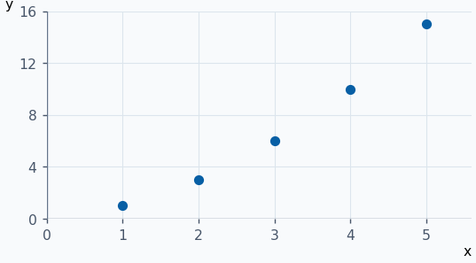
:::

::: ejemplo Ejemplo 2 · Suma de impares por inducción
Para \(n = 1\) se cumple \(1 = 1²\). Si \(1 + 3 + ⋯ + (2n − 1) = n²\), el siguiente impar es \(2n + 1\) y \(n² + 2n + 1 = (n + 1)²\). Los puntos ilustran el crecimiento de las sumas parciales.

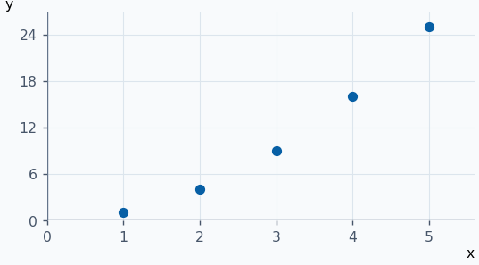
:::

::: ejemplo Ejemplo 3 · Clasificar tres números reales
\(−2\) es entero y por ello racional. \(3/2\) es racional pero no entero. \(√2\) es irracional. En la recta, \(1 < √2 < 3/2\) porque \(1 < 2 < 9/4\) al cuadrar los tres números positivos.

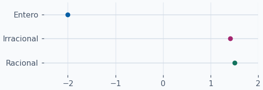
:::

::: ejemplo Ejemplo 4 · Suma geométrica de potencias de dos
Para \(n = 1\), \(2⁰ = 2¹ − 1\). Si \(1 + 2 + ⋯ + 2^{n−1} = 2ⁿ − 1\), al añadir \(2ⁿ\) queda \(2^{n+1} − 1\). Los puntos crecen de \(1\) a \(31\) en cinco pasos.

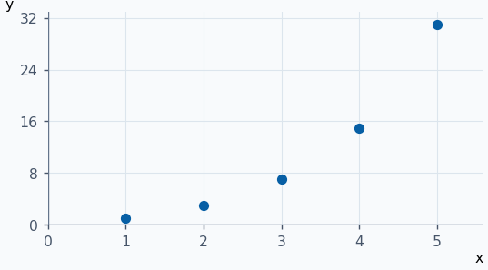
:::

**Ejercicios para resolver**

**1.** Clasifica \(−5\), \(0\), \(7/3\) y \(π\) en el menor conjunto de la tabla que los contiene.

::: solucion
\(−5\) y \(0\) pertenecen a \(ℤ\). \(7/3 ∈ ℚ ∖ ℤ\). \(π ∈ ℝ ∖ ℚ\).
:::

**2.** Demuestra por inducción que \(2 + 4 + ⋯ + 2n = n(n + 1)\).

::: solucion
La base da \(2 = 1·2\). Si vale para \(n\), sumar \(2(n + 1)\) da \(n(n + 1) + 2(n + 1) = (n + 1)(n + 2)\).
:::

**3.** Expresa \(0,272727…\) como fracción irreducible.

::: solucion
Si \(t = 0,272727…\), entonces \(100t − t = 27\). Así \(t = 27/99 = 3/11\).
:::

**4.** Aplica el argumento de paridad del PDF para demostrar que \(√6\) es irracional.

::: solucion
Si \(p² = 6q²\) con \(p/q\) irreducible, \(p = 2k\). Entonces \(2k² = 3q²\). El miembro izquierdo es par, de donde \(q\) también es par. Contradicción.
:::

## Producto cartesiano, intersección y unión {#operaciones-conjuntos}

| Operación | Definición | Lectura |
| --- | --- | --- |
| Producto cartesiano | \(A × B = {(a,b) : a ∈ A, b ∈ B}\) | Pares ordenados. Se elige primero en \(A\) y luego en \(B\). |
| Intersección | \(A ∩ B = {x : x ∈ A y x ∈ B}\) | Deben cumplirse ambas condiciones. |
| Unión | \(A ∪ B = {x : x ∈ A o x ∈ B}\) | Basta con una condición. La pertenencia a los dos conjuntos también vale. |

Si \(A ⊂ B\), entonces \(A ∩ B = A\) y \(A ∪ B = B\). El conjunto vacío se denota \(∅\). El orden importa en el producto: con \(A = {0,1}\) y \(B = {1,2}\), \((0,1) ∈ A × B\) mientras que \((0,1) ∉ B × A\). Los múltiplos de \(3\) que también son múltiplos de \(4\) son exactamente los múltiplos de \(12\).

**Ejemplos resueltos**

::: original Ejemplo del PDF · El cuadrado unidad
Si \(A = B = [0,1]\), el producto \(A × B\) está formado por los pares \((x,y)\) con \(0 ≤ x ≤ 1\) y \(0 ≤ y ≤ 1\). Los cuatro lados pertenecen al producto porque las dos desigualdades admiten igualdad.

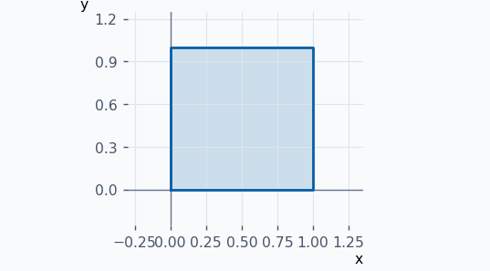
:::

::: ejemplo Ejemplo 2 · Producto cartesiano discreto
Con \(A = {−1,1}\) y \(B = {0,2}\) se obtienen \((−1,0)\), \((−1,2)\), \((1,0)\) y \((1,2)\). Los cuatro puntos agotan las dos elecciones para cada coordenada.

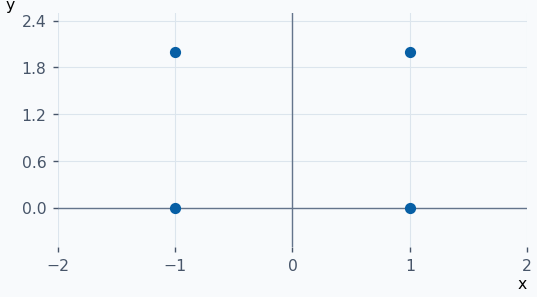
:::

::: ejemplo Ejemplo 3 · Intersección y unión de intervalos
Si \(A = [−1,2]\) y \(B = (0,3)\), la franja común es \((0,2]\). La unión es \([−1,3)\) porque los intervalos se solapan. El punto \(0\) está en la unión por pertenecer a \(A\).

![Rectas de A, B, su intersección (0,2\] y su unión \[−1,3).](graficas/operaciones-conjuntos-3.png)
:::

::: ejemplo Ejemplo 4 · Semirrectas contenidas una en otra
Para \(A = {x ∈ ℝ : x > −2}\) y \(B = {x ∈ ℝ : x > 1}\), se cumple \(B ⊂ A\). Por tanto, \(A ∩ B = B\) y \(A ∪ B = A\). Los círculos abiertos excluyen los extremos.

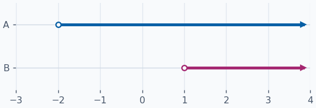
:::

**Ejercicios para resolver**

**1.** Escribe \(A × B\) y \(B × A\) si \(A = {0,2}\) y \(B = {−1}\).

::: solucion
\(A × B = {(0,−1),(2,−1)}\) y \(B × A = {(−1,0),(−1,2)}\).
:::

**2.** Calcula \(A ∩ B\) y \(A ∪ B\) para \(A = {x ∈ ℝ : x > 1}\) y \(B = {x ∈ ℝ : x < 3}\).

::: solucion
La intersección exige \(1 < x < 3\). La unión es \(ℝ\), pues todo real satisface al menos una de las dos desigualdades.
:::

**3.** Sean \(A\) los múltiplos enteros de \(6\) y \(B\) los de \(9\). Describe \(A ∩ B\).

::: solucion
Los múltiplos comunes son los del mínimo común múltiplo \(18\). Así, \(A ∩ B = {18k : k ∈ ℤ}\).
:::

**4.** Calcula la intersección y la unión de \([−2,0]\) y \((0,4]\).

::: solucion
La intersección es \(∅\) porque \(0\) solo pertenece al primer intervalo. La unión es \([−2,4]\), pues \(0\) queda incluido.
:::

## Orden y valor absoluto {#orden-distancias}

Dados \(a,b,c ∈ ℝ\), exactamente una de \(a < b\), \(a = b\) y \(b < a\) es cierta. El orden es transitivo: \(a ≤ b\) y \(b ≤ c ⇒ a ≤ c\).

| Si \(a ≤ b\)… | Resultado |
| --- | --- |
| Se suma \(c\) | \(a + c ≤ b + c\) |
| Se multiplica por \(c > 0\) | \(ac ≤ bc\) |
| Se multiplica por \(c < 0\) | \(ac ≥ bc\). En particular, \(−a ≥ −b\). |
| Se toma la recíproca de números no nulos del mismo signo | \(1/a ≥ 1/b\) |

El **valor absoluto** es \(∣x∣ = x\) si \(x ≥ 0\), y \(∣x∣ = −x\) si \(x < 0\). También \(∣x∣ = max{x, −x} = √(x²)\). Geométricamente, \(∣x − c∣\) es la distancia entre \(x\) y \(c\).

| Propiedad | Expresión |
| --- | --- |
| Positividad y simetría | \(∣x∣ ≥ 0\), \(∣x∣ = 0 ⇔ x = 0\), \(∣−x∣ = ∣x∣\) |
| Producto y cociente | \(∣xy∣ = ∣x∣·∣y∣\), \(∣x/y∣ = ∣x∣/∣y∣\) si \(y ≠ 0\) |
| Cotas | \(−∣x∣ ≤ x ≤ ∣x∣\) |
| Distancia a un centro | Para \(δ ≥ 0\), \(∣x∣ ≤ δ ⇔ −δ ≤ x ≤ δ\) y \(∣x − c∣ ≤ δ ⇔ c − δ ≤ x ≤ c + δ\) |
| Desigualdad triangular | \(∣x + y∣ ≤ ∣x∣ + ∣y∣\) y \(∣x − y∣ ≤ ∣x∣ + ∣y∣\) |
| Triangular inversa | \(∣∣x∣ − ∣y∣∣ ≤ ∣x − y∣\) |

Para obtener la triangular inversa, aplica la triangular a \(x = (x − y) + y\) y luego intercambia \(x\) e \(y\). Para escribir un valor absoluto por tramos, localiza dónde cambia de signo el argumento. Por ejemplo, \(∣x − 1∣\) vale \(x − 1\) si \(x ≥ 1\) y \(1 − x\) si \(x < 1\). La expresión \(∣x² − 1∣\) vale \(x² − 1\) fuera de \([−1,1]\) y \(1 − x²\) dentro.

**Ejemplos resueltos**

::: original Ejemplo del PDF · Una distancia mínima
\(∣x − 2∣ ≥ 1\) equivale a \(x − 2 ≥ 1\) o \(x − 2 ≤ −1\). La solución es \((−∞,1] ∪ [3,+∞)\). En la gráfica se selecciona la región donde la V queda por encima de la recta discontinua, incluidos los cruces.

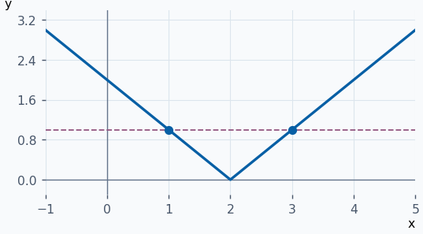
:::

::: ejemplo Ejemplo 2 · Distancia estrictamente menor
\(∣2x + 1∣ < 3 ⇔ −3 < 2x + 1 < 3 ⇔ −2 < x < 1\). Los círculos abiertos indican que en los cruces se obtiene igualdad, excluida por el signo estricto.

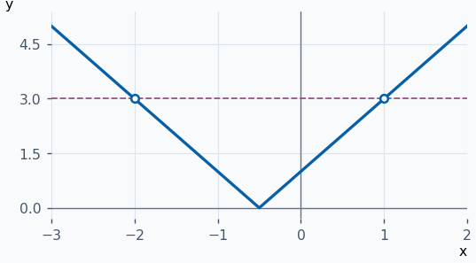
:::

::: ejemplo Ejemplo 3 · Una desigualdad cuadrática
\(∣x² − 4∣ ≤ 3 ⇔ −3 ≤ x² − 4 ≤ 3 ⇔ 1 ≤ x² ≤ 7\). Por tanto, \(x ∈ [−√7,−1] ∪ [1,√7]\). Las dos zonas se leen bajo el nivel \(3\).

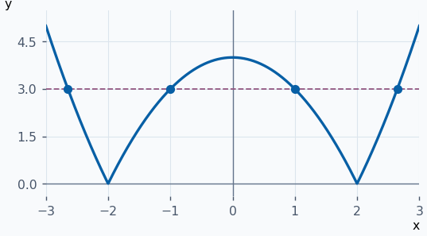
:::

::: ejemplo Ejemplo 4 · Cociente con denominador variable
Para \(x ≠ 2\), \(∣x/(x − 2)∣ ≤ 1 ⇔ ∣x∣ ≤ ∣x − 2∣ ⇔ x² ≤ (x − 2)² ⇔ x ≤ 1\). Se puede cuadrar porque los dos miembros son no negativos. En la gráfica de las distancias, la curva de \(∣x∣\) queda por debajo hasta \(x = 1\).

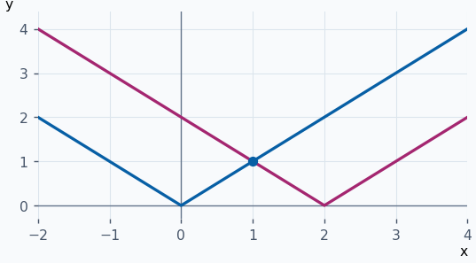
:::

**Ejercicios para resolver**

**1.** Resuelve \(∣x² − 1∣ ≥ 1\).

::: solucion
\(x² − 1 ≥ 1\) o \(x² − 1 ≤ −1\). Equivale a \(x ≥ √2\), \(x ≤ −√2\) o \(x = 0\).
:::

**2.** Resuelve \(∣x/(x + 1)∣ ≤ 1\).

::: solucion
En \(x ≠ −1\), equivale a \(x² ≤ (x + 1)²\), es decir, \(2x + 1 ≥ 0\). El resultado \([−1/2,+∞)\) respeta el dominio.
:::

**3.** Resuelve \(∣x/(x² + 1)∣ ≤ 1\).

::: solucion
\(x² + 1 > 0\) y \(x² − ∣x∣ + 1 = (∣x∣ − 1/2)² + 3/4 > 0\). Luego todo real es solución.
:::

**4.** Resuelve \(∣x + 3∣ + ∣x − 3∣ < 8\).

::: solucion
En \([−3,3]\) la suma vale \(6\). Para \(x > 3\) vale \(2x\), y para \(x < −3\) vale \(−2x\). Reuniendo los tres tramos queda \((−4,4)\).
:::

## Acotación, supremo e intervalos {#cotas}

Una **cota superior** de \(A ⊂ ℝ\) es un \(p ∈ ℝ\) tal que \(x ≤ p\) para todo \(x ∈ A\). Una **cota inferior** es un \(q ∈ ℝ\) con \(q ≤ x\) para todo \(x ∈ A\). El conjunto está acotado si tiene ambas, o equivalentemente si existe \(K > 0\) con \(∣x∣ ≤ K\) para todo \(x ∈ A\).

**Axioma del supremo.** Todo subconjunto no vacío de \(ℝ\) acotado superiormente tiene una menor cota superior, \(sup A\). Si está acotado inferiormente, tiene una mayor cota inferior, \(inf A\). Se puede obtener la segunda afirmación aplicando la primera a \(−A = {−x : x ∈ A}\) y tomando \(inf A = −sup(−A)\). Si \(sup A ∈ A\), se llama \(max A\). Si \(inf A ∈ A\), se llama \(min A\).

| Intervalo | Condición sobre \(x\) |
| --- | --- |
| \((a,b)\), \([a,b]\) | \(a < x < b\), \(a ≤ x ≤ b\) |
| \((a,b]\), \([a,b)\) | \(a < x ≤ b\), \(a ≤ x < b\) |
| \((a,+∞)\), \([a,+∞)\) | \(a < x\), \(a ≤ x\) |
| \((−∞,b)\), \((−∞,b]\) | \(x < b\), \(x ≤ b\) |
| \((−∞,+∞)\) | \(x ∈ ℝ\) |

Un círculo abierto indica que el extremo queda fuera. El símbolo \(∞\) señala una dirección ilimitada y siempre lleva paréntesis.

**Ejemplos resueltos**

::: original Ejemplo del PDF · El conjunto de recíprocos naturales
En \(A = {1,1/2,1/3,…}\), \(sup A = max A = 1\). Cero es cota inferior y todo \(q > 0\) falla como cota inferior al tomar \(n > 1/q\). Por tanto \(inf A = 0\) y no hay mínimo. La gráfica muestra una muestra finita de puntos y marca el límite con un círculo abierto.

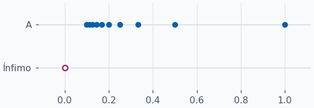
:::

::: ejemplo Ejemplo 2 · Intervalo con un solo extremo incluido
Para \(A = (−2,3]\), \(inf A = −2\) y \(sup A = 3\). Solo \(3\) pertenece a \(A\), de modo que es su máximo. Cualquier número mayor que \(−2\) deja de ser cota inferior porque el intervalo contiene valores arbitrariamente próximos a \(−2\).

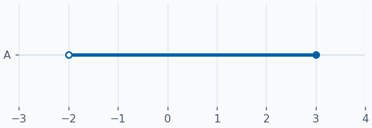
:::

::: ejemplo Ejemplo 3 · Acotación por un solo lado
Si \(A = [4,+∞)\), todos los elementos son mayores o iguales a \(4\) y \(4 ∈ A\). Entonces \(inf A = min A = 4\). Dado cualquier \(p ∈ ℝ\), \(max{4,p+1}\) pertenece a \(A\) y supera \(p\), por lo que no hay cota superior real.

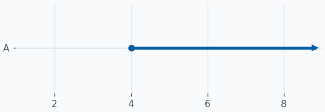
:::

::: ejemplo Ejemplo 4 · Cotas al resolver una inecuación
Sea \(A = {x ∈ ℝ : x² + x − 6 ≤ 0}\). Factorizar da \((x + 3)(x − 2) ≤ 0\), luego \(A = [−3,2]\). Sus dos extremos se alcanzan. La gráfica muestra que la parábola queda bajo el eje entre las raíces.

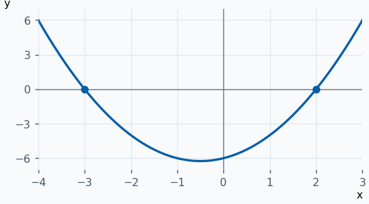
:::

**Ejercicios para resolver**

**1.** Halla supremo, ínfimo, máximo y mínimo de \((0,4)\).

::: solucion
\(sup A = 4\) e \(inf A = 0\). Ninguno pertenece a \(A\), así que no hay máximo ni mínimo.
:::

**2.** Determina las cotas extremas de \(ℕ\) según la convención del PDF.

::: solucion
\(inf ℕ = min ℕ = 1\). Como para cualquier cota propuesta existe un natural mayor, no hay supremo real ni máximo.
:::

**3.** Estudia \(A = {x ∈ ℝ : x² + 5x − 6 ≤ 0}\).

::: solucion
\((x − 1)(x + 6) ≤ 0\) equivale a \(−6 ≤ x ≤ 1\). Así, \(inf A = min A = −6\) y \(sup A = max A = 1\).
:::

**4.** Escribe como intervalos \(B = {x ∈ ℝ : 1 < ∣x∣ ≤ 4}\) y halla sus extremos globales.

::: solucion
\(B = [−4,−1) ∪ (1,4]\). El mínimo y el ínfimo son \(−4\). El máximo y el supremo son \(4\).
:::
