# 1.2 Funciones reales de una variable real

[Apuntes de Manuel José Fernández · pp. 7–17](apuntes-originales.pdf)

## Dominio, imagen y gráfica {#conceptos}

Una función real de variable real es una aplicación \(f : D ⊂ ℝ → ℝ\). A cada entrada \(x ∈ D\) corresponde exactamente una salida \(y=f(x)\). El dominio puede venir dado. Si se da solo una expresión, se toma el dominio natural, formado por las entradas para las que la expresión tiene valor real.

\(Dom f = D,   Im f = f(D) = {y ∈ ℝ : ∃ x ∈ D, f(x)=y}\)

La gráfica contiene los puntos \((x,f(x))\) con \(x ∈ D\). Cada vertical con abscisa en \(D\) la corta exactamente una vez. Las proyecciones de la gráfica sobre los ejes horizontal y vertical dan el dominio y la imagen.

| Expresión | Restricción |
| --- | --- |
| Raíz de índice par | Radicando mayor o igual que cero. |
| Cociente | Denominador distinto de cero. |
| Logaritmo | Argumento estrictamente positivo. |

**Ejemplos resueltos**

::: original Ejemplo del PDF · Dominio e imagen de la parábola
\(x²\) se define en \(ℝ\). Como \(x²≥0\) y cada \(y≥0\) se alcanza en \(x=√y\), la imagen es \([0,+∞)\).

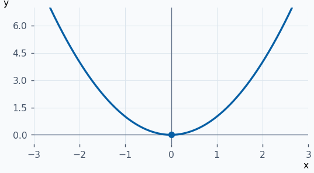
:::

::: ejemplo Ejemplo 2 · Raíz desplazada
Para \(√(x−2)\) se exige \(x≥2\). Para cada \(y≥0\) sirve \(x=y²+2\). Así \(Dom f=[2,+∞)\) e \(Im f=[0,+∞)\).

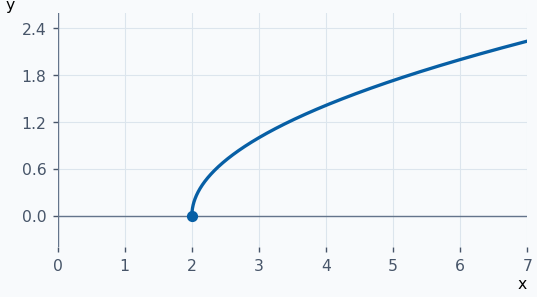
:::

::: ejemplo Ejemplo 3 · Recíproca trasladada
Para \(1/(x+2)\) se excluye \(x=−2\). La imagen excluye \(0\). Para cualquier \(y≠0\), \(x=1/y−2\) da una preimagen válida.

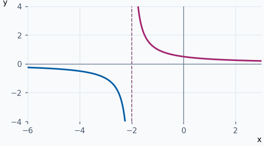
:::

::: ejemplo Ejemplo 4 · Función constante
Para \(f : ℝ → ℝ\) dada por \(f(x)=2\), cualquier real es una entrada. Todas las alturas son \(2\), por lo que \(Im f={2}\).

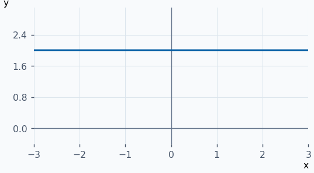
:::

**Ejercicios para resolver**

**1.** Halla dominio e imagen de \(√(x+4)\).

::: solucion
\(x+4≥0\) da \([−4,+∞)\). Toda altura \(y≥0\) se alcanza en \(x=y²−4\), así que la imagen es \([0,+∞)\).
:::

**2.** Halla dominio e imagen de \(1/(x−1)\).

::: solucion
Se excluye \(x=1\). La imagen es \(ℝ ∖ {0}\) porque \(x=1+1/y\) produce cualquier \(y≠0\).
:::

**3.** Halla dominio e imagen de \(2−x²\).

::: solucion
El dominio es \(ℝ\). Para \(y≤2\) sirve \(x=√(2−y)\) y ningún valor supera \(2\). La imagen es \((−∞,2]\).
:::

**4.** Determina el dominio de \(√(4−x²)/(x−1)\).

::: solucion
La raíz exige \(−2≤x≤2\) y el cociente excluye \(1\). Resultado \([−2,1) ∪ (1,2]\).
:::

## Monotonía, acotación, simetrías y periodicidad {#grafica-propiedades}

Sea \(S ⊂ Dom f\). En cada fila se supone \(x₁,x₂ ∈ S\) y \(x₁<x₂\).

| Monotonía en \(S\) | Comparación |
| --- | --- |
| Creciente | \(f(x₁)≤f(x₂)\) |
| Decreciente | \(f(x₁)≥f(x₂)\) |
| Estrictamente creciente | \(f(x₁)<f(x₂)\) |
| Estrictamente decreciente | \(f(x₁)>f(x₂)\) |

La función \(x³\) es estrictamente creciente en \(ℝ\). La función \(x²\) decrece estrictamente en \((−∞,0]\) y crece estrictamente en \([0,+∞)\). Tiene mínimo \(0\) y carece de cota superior en \(ℝ\). Sobre \([−5,9]\) su imagen es \([0,81]\), y sobre \((−5,9)\) es \([0,81)\).

Una cota superior de \(f\) en \(S\) es un \(p\) con \(f(x)≤p\) para todo \(x∈S\). Una cota inferior es un \(q\) con \(q≤f(x)\). La función está acotada si y solo si \(∃ K>0 : ∣f(x)∣≤K\) para todo \(x∈S\). Todas estas condiciones se refieren al conjunto imagen \(f(S)\).

| Propiedad | Condición | Gráfica |
| --- | --- | --- |
| Par | Dominio simétrico y \(f(−x)=f(x)\) | Simetría respecto al eje de ordenadas, como \(x⁴\). |
| Impar | Dominio simétrico y \(f(−x)=−f(x)\) | Simetría respecto al origen, como \(x⁷\). |
| Periódica | Algún \(h>0\) preserva el dominio al trasladarlo y cumple \(f(x+h)=f(x)\) | Se repite al desplazarla \(h\). |

El período fundamental es el menor \(h>0\) con esa propiedad, cuando existe. Para una función constante en \(ℝ\), todos los \(h>0\) son períodos y no hay uno menor.

**Ejemplos resueltos**

::: original Ejemplo del PDF · Parte fraccionaria
La parte entera \([x]\) es el mayor entero menor o igual que \(x\). Como \([x+1]=[x]+1\), \(x+1−[x+1]=x−[x]\). Todo período positivo lleva el cero \(0\) a otro cero, que debe ser entero. El menor es \(1\).

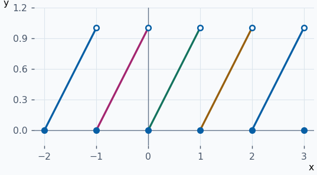
:::

::: ejemplo Ejemplo 2 · Función par y acotada
\(f(x)=1/(1+x²)\) cumple \(f(−x)=f(x)\) y \(0<f(x)≤1\). Al aumentar \(∣x∣\) crece el denominador. Tiene máximo \(1\) en \(0\) e ínfimo \(0\).

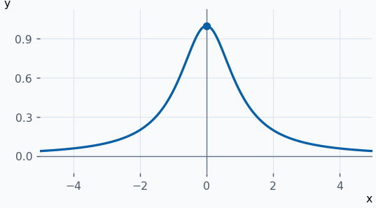
:::

::: ejemplo Ejemplo 3 · Recta impar y decreciente
Para \(f(x)=−2x\), \(f(−x)=−f(x)\). Si \(x₁<x₂\), multiplicar por \(−2\) da \(f(x₁)>f(x₂)\). Sus alturas no están acotadas por arriba ni por abajo.

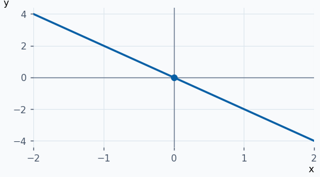
:::

::: ejemplo Ejemplo 4 · Cambiar la escala del período
\(f(x)=cos(2x)\) cumple \(f(x+π)=cos(2x+2π)=f(x)\). Un período positivo \(h\) exige \(cos(2h)=f(0)=1\), de modo que \(h\) es múltiplo de \(π\).

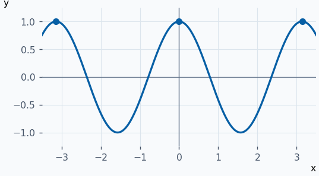
:::

**Ejercicios para resolver**

**1.** Clasifica \(x²\) en simetría y monotonía sobre \([−3,0]\) y \([0,3]\).

::: solucion
En \(ℝ\) es par. En \([−3,0]\) decrece estrictamente porque disminuye la distancia a cero. En \([0,3]\) crece estrictamente.
:::

**2.** Halla supremo e ínfimo de \(x²\) en \((−2,3)\). ¿Se alcanzan?

::: solucion
El ínfimo \(0\) se alcanza en \(0\). El supremo es \(9\) por aproximación a \(3\), pero \(3\) y \(−3\) quedan fuera.
:::

**3.** Comprueba si \(x²+x\) es par o impar.

::: solucion
\(f(−1)=0\) y \(f(1)=2\), por lo que ninguna de las dos igualdades vale para todo \(x\).
:::

**4.** Halla el período fundamental de \(sen(3x)\).

::: solucion
\(2π/3\) funciona. Si \(h>0\) es período, al evaluar en \(x=π/6\) queda \(sen(π/2+3h)=1\). Así, \(3h\) es múltiplo de \(2π\).
:::

## Operaciones con funciones {#operaciones-funciones}

Sea \(D = Dom f ∩ Dom g\). Las operaciones se aplican a los valores de las dos funciones en la misma entrada.

| Operación | Expresión | Dominio |
| --- | --- | --- |
| Suma y diferencia | \((f ± g)(x)=f(x) ± g(x)\) | \(D\) |
| Producto | \((fg)(x)=f(x)g(x)\) | \(D\) |
| Cociente | \((f/g)(x)=f(x)/g(x)\) | \(D\) salvo los ceros de \(g\). |

La función nula \(0_{f}(x)=0\) es neutra para la suma y la función unidad \(1_{f}(x)=1\) lo es para el producto. La opuesta \(−f\) toma valores \(−f(x)\), de manera que \(f+(−f)=0_{f}\) en \(Dom f\). La recíproca \(1/f\) toma valores \(1/f(x)\) donde \(f(x)≠0\). En ese dominio \(f(1/f)=1_{f}\).

Para combinar funciones a trozos, divide la recta por todos sus puntos de cambio. Para simplificar cocientes, conserva las restricciones de la expresión inicial.

**Ejemplos resueltos**

::: original Ejemplo del PDF · Suma y producto racionales
Para \(f(x)=x²\) y \(g(x)=x/(x−1)\), la suma es \((x³−x²+x)/(x−1)\) y el producto es \(x³/(x−1)\). Ambos tienen dominio \(ℝ ∖ {1}\).

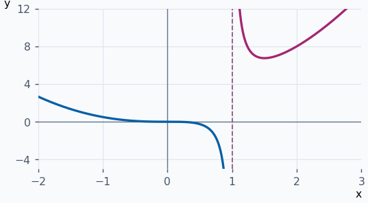
:::

::: ejemplo Ejemplo 2 · Suma con dos raíces
\(√x+√(4−x)\) exige \(x≥0\) y \(x≤4\). Su dominio es \([0,4]\) y toma altura \(2\) en ambos extremos.

![Suma de las dos raíces sobre \[0,4\], con extremos a altura 2.](graficas/operaciones-funciones-2.png)
:::

::: ejemplo Ejemplo 3 · Cociente simplificado con hueco
\((x²−4)/(x−2)=x+2\) para \(x≠2\). El denominador inicial excluye el punto \((2,4)\) de la recta.

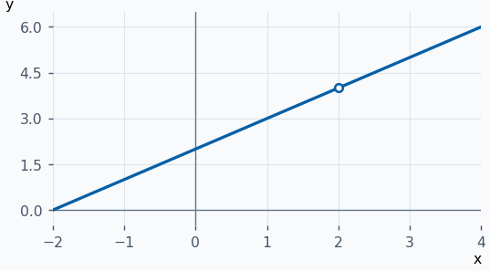
:::

::: ejemplo Ejemplo 4 · Suma con cambios en dos puntos
Sea \(f(x)=x\) si \(x≤0\) y \(f(x)=1\) si \(x>0\). Sea \(g(x)=0\) si \(x<2\) y \(g(x)=x\) si \(x≥2\). La suma vale \(x\) en \(x≤0\), \(1\) en \((0,2)\) y \(1+x\) en \([2,+∞)\).

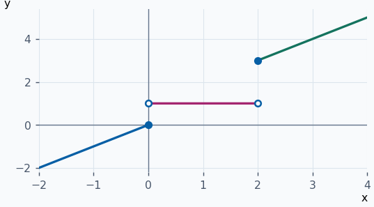
:::

**Ejercicios para resolver**

**1.** Para \(f(x)=√x\) y \(g(x)=x−1\), halla \(Dom(f/g)\).

::: solucion
El dominio común es \([0,+∞)\) y se excluye \(1\). Resultado \([0,1) ∪ (1,+∞)\).
:::

**2.** Sean \(f(x)=x\) si \(x≤0\) y \(−1\) si \(x>0\), y \(g(x)=−x\) si \(x<1\) y \(x²\) si \(x≥1\). Calcula \(f+g\) y \(fg\).

::: solucion
\(f+g\) vale \(0\), \(−1−x\) y \(−1+x²\) en \(x≤0\), \(0<x<1\) y \(x≥1\). El producto vale \(−x²\), \(x\) y \(−x²\) en los mismos tramos.
:::

**3.** Halla la recíproca de \(x²−9\) y su dominio.

::: solucion
Es \(1/(x²−9)\) y se excluyen \(−3\) y \(3\).
:::

**4.** Simplifica el cociente de \(x²−1\) entre \(x+1\).

::: solucion
Al factorizar queda \(x−1\) en \(ℝ ∖ {−1}\).
:::

## Composición e inversa {#composicion-inversa}

\((f ∘ g)(x)=f(g(x)),   Dom(f ∘ g)={x ∈ Dom g : g(x) ∈ Dom f}\)

La composición evalúa primero la función de la derecha. Es asociativa, \((f∘g)∘h=f∘(g∘h)\), y la identidad \(I(x)=x\) es su elemento neutro. En general \(f∘g≠g∘f\).

Una función es **inyectiva** si \(f(x₁)=f(x₂) ⇒ x₁=x₂\). Cuando lo es, a cada \(y ∈ Im f\) corresponde un único \(x ∈ Dom f\) tal que \(f(x)=y\). La **inversa** devuelve ese \(x\).

| Identidad | Dónde se cumple |
| --- | --- |
| \(f(f^{−1}(y))=y\) | \(y ∈ Im f = Dom(f^{−1})\) |
| \(f^{−1}(f(x))=x\) | \(x ∈ Dom f = Im(f^{−1})\) |

Para hallarla, despeja la entrada de \(y=f(x)\) respetando el dominio de partida. Las dos gráficas se reflejan respecto a \(y=x\). La identidad y \(1/x\) son sus propias inversas. La función \(x²\) no es inyectiva en \(ℝ\), pero sus restricciones a \([0,+∞)\) y \((−∞,0]\) tienen inversas \(√y\) y \(−√y\).

**Ejemplos resueltos**

::: original Ejemplo del PDF · Cambiar el orden de composición
Si \(f(x)=x²+x\) y \(g(x)=3x\), \(f∘g=9x²+3x\) y \(g∘f=3x²+3x\). Ambas tienen dominio \(ℝ\). En \(x=1\) dan \(12\) y \(6\).

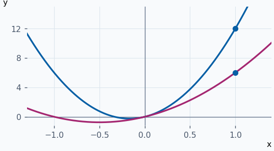
:::

::: ejemplo Ejemplo 2 · El orden cambia el dominio
Para \(f(x)=√x\) y \(g(x)=x−2\), \(f∘g=√(x−2)\) exige \(x≥2\) y \(g∘f=√x−2\) exige \(x≥0\).

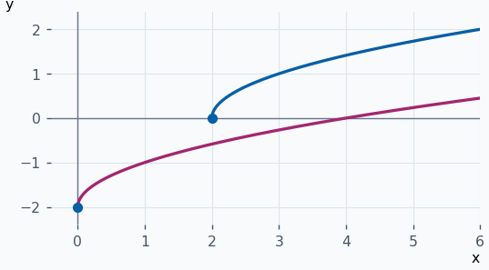
:::

::: ejemplo Ejemplo 3 · Inversa de una recta
\(y=2x+1\) implica \(x=(y−1)/2\). Así, \(f^{−1}(x)=(x−1)/2\) en \(ℝ\). El punto \((0,1)\) de \(f\) se corresponde con \((1,0)\) en la inversa.

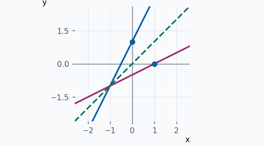
:::

::: ejemplo Ejemplo 4 · Restringir una parábola
En \(x≥1\), \(f(x)=(x−1)²\) es inyectiva. Al despejar se toma \(x−1=√y\), por lo que \(f^{−1}(x)=1+√x\) para \(x≥0\).

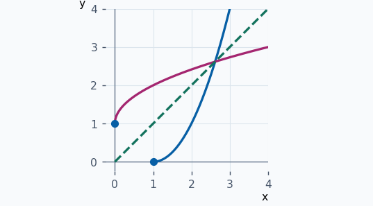
:::

**Ejercicios para resolver**

**1.** Halla ambas composiciones de \(f(x)=x²+1\) y \(g(x)=√x\).

::: solucion
\(f∘g=x+1\) para \(x≥0\). \(g∘f=√(x²+1)\) para todo real.
:::

**2.** Halla ambas composiciones de \(f(x)=√(x−3)\) y \(g(x)=x²+1\).

::: solucion
\(f∘g=√(x²−2)\) exige \(∣x∣≥√2\). \(g∘f=x−2\) tiene dominio \([3,+∞)\).
:::

**3.** Invierte \(f(x)=x²−x\) para \(x≥1/2\).

::: solucion
\(y=(x−1/2)²−1/4\). La restricción obliga a tomar \(f^{−1}(y)=1/2+√(y+1/4)\) para \(y≥−1/4\).
:::

**4.** Invierte \(f(x)=1−(x−2)^{1/3}\).

::: solucion
\(y=1−(x−2)^{1/3}\) da \((1−y)³=x−2\). La inversa es \((1−y)³+2\) en \(ℝ\).
:::

## Potencias, polinomios y funciones racionales {#algebraicas}

| Familia | Expresión y dominio | Propiedades |
| --- | --- | --- |
| Potencia entera no negativa | \(xⁿ\), \(n ∈ ℕ ∪ {0}\), dominio \(ℝ\) | Para \(n\) impar es estrictamente creciente con imagen \(ℝ\). Para \(n>0\) par, imagen \([0,+∞)\). Para \(n=0\) se toma la constante \(1\). |
| Polinomio | \(P(x)=a₀+a₁x+⋯+aₙxⁿ\), \(aₙ≠0\), dominio \(ℝ\) | \(n\) es el grado. Grado \(1\) da una recta y grado \(2\) una parábola. |
| Racional | \(P(x)/Q(x)\), con \(Q\) polinomio no nulo | El dominio excluye todos los ceros de \(Q\), incluso cuando se cancelan factores. |

**Ejemplos resueltos**

::: ejemplo Ejemplo 1 · Potencia par e impar
\(x⁴\) toma valores no negativos y \((−x)⁴=x⁴\). Para \(x³\) se cumple \((−x)³=−x³\) y cada \(y∈ℝ\) se alcanza en \(x=∛y\).

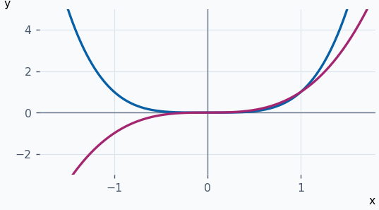
:::

::: ejemplo Ejemplo 2 · Polinomio de segundo grado
\(x²−4x+3=(x−1)(x−3)\) tiene ceros \(1\) y \(3\). Completar el cuadrado da \((x−2)²−1\), con vértice \((2,−1)\) e imagen \([−1,+∞)\).

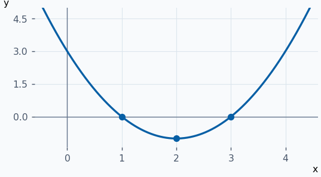
:::

::: ejemplo Ejemplo 3 · Racional con dos exclusiones
\((x+1)/(x²−1)\) excluye \(−1\) y \(1\). La forma \(1/(x−1)\) muestra un hueco en \(−1\) y ramas separadas en \(1\).

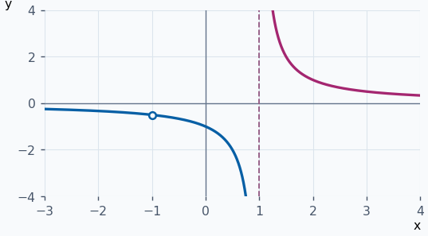
:::

**Ejercicios para resolver**

**1.** Halla dominio e imagen de \(x⁶\) y \(x⁵\).

::: solucion
Ambas tienen dominio \(ℝ\). La sexta potencia tiene imagen \([0,+∞)\) y la quinta tiene imagen \(ℝ\).
:::

**2.** Halla grado, raíces y dominio de \(2x²−8\).

::: solucion
Grado \(2\) y dominio \(ℝ\). \(2(x−2)(x+2)=0\) da \(−2\) y \(2\).
:::

**3.** Halla el dominio de \((x³−2x²+5x−1)/((x−1)(x+1)(x²+1))\).

::: solucion
\(x²+1>0\) en \(ℝ\). Las únicas exclusiones son \(−1\) y \(1\).
:::

**4.** ¿Qué punto falta en la gráfica de \((x²−4)/(x+2)\)?

::: solucion
La expresión vale \(x−2\) para \(x≠−2\). Falta \((−2,−4)\).
:::

## Funciones circulares y sus inversas {#trigonometricas}

Los ángulos se miden en radianes. Seno y coseno tienen dominio \(ℝ\), imagen \([−1,1]\) y período \(2π\). El seno es impar y el coseno es par. La tangente \(tg(x)=sen(x)/cos(x)\) excluye \(π/2+kπ\), \(k ∈ ℤ\). Tiene imagen \(ℝ\), es impar, no acotada y tiene período \(π\).

| Inversa | Rama de la función directa e imagen de la inversa | Dominio de la inversa | Comportamiento |
| --- | --- | --- | --- |
| \(arcsen\) | \([−π/2,π/2]\) | \([−1,1]\) | Creciente, impar, acotada. |
| \(arccos\) | \([0,π]\) | \([−1,1]\) | Decreciente, acotada. |
| \(arctg\) | \((−π/2,π/2)\) | \(ℝ\) | Creciente, impar, acotada. |

La inversa devuelve el único ángulo de la rama indicada que produce el valor pedido. La composición inversa recupera el ángulo original cuando pertenece a esa rama.

| Recíprocas | Identidades |
| --- | --- |
| \(cotg(x)=cos(x)/sen(x)\) para \(x≠kπ\) | \(cosec²(x)=1+cotg²(x)\). \(cotg(x)=1/tg(x)\) donde ambas expresiones están definidas. |
| \(sec(x)=1/cos(x)\) para \(x≠π/2+kπ\) | \(sec²(x)=1+tg²(x)\) |
| \(cosec(x)=1/sen(x)\) para \(x≠kπ\) | La identidad \(sen²(x)+cos²(x)=1\) vale en todo \(ℝ\). |

\(sen(2x)=2sen(x)cos(x),   cos(2x)=cos²(x)−sen²(x)\)

Combinando la segunda con \(sen²(x)+cos²(x)=1\) quedan \(sen²(x)=(1−cos(2x))/2\) y \(cos²(x)=(1+cos(2x))/2\). También \(cos(x)=sen(π/2−x)=sen(π/2+x)\).

**Ejemplos resueltos**

::: ejemplo Ejemplo 1 · Elegir el ángulo de la rama del seno
\(sen(5π/6)=1/2\). En \([−π/2,π/2]\) el ángulo que da \(1/2\) es \(π/6\). Por tanto \(arcsen(sen(5π/6))=π/6\).

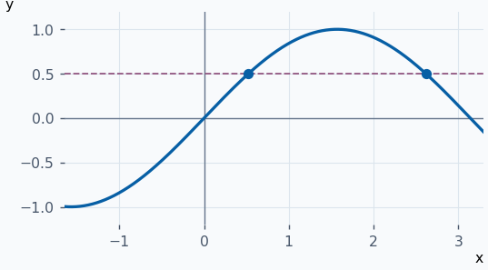
:::

::: ejemplo Ejemplo 2 · Ángulo negativo y rama del coseno
\(cos(−π/3)=1/2\). En \([0,π]\) el único ángulo con ese coseno es \(π/3\), así que \(arccos(cos(−π/3))=π/3\).

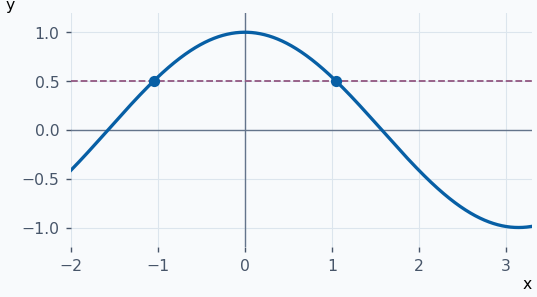
:::

::: ejemplo Ejemplo 3 · Leer la inversa de la tangente
En \((−π/2,π/2)\), \(tg(±π/4)=±1\), así que \(arctg(±1)=±π/4\). La inversa es creciente y queda entre \(−π/2\) y \(π/2\).

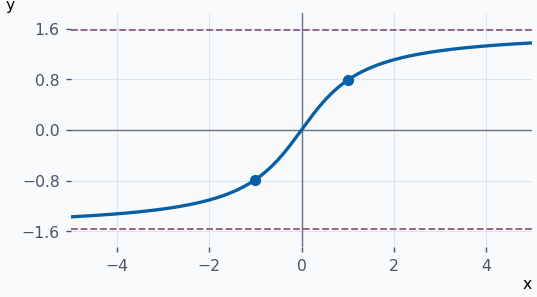
:::

**Ejercicios para resolver**

**1.** Calcula \(arcsen(−1)\) y \(arccos(−1)\).

::: solucion
En sus respectivas ramas se obtienen \(−π/2\) y \(π\).
:::

**2.** Halla \(arctg(tg(3π/4))\).

::: solucion
\(tg(3π/4)=−1\). En la rama elegida, \(tg(−π/4)=−1\), así que el resultado es \(−π/4\).
:::

**3.** Justifica \(sec²(x)=1+tg²(x)\).

::: solucion
Divide \(sen²(x)+cos²(x)=1\) por \(cos²(x)\) donde \(cos(x)≠0\).
:::

**4.** Decide si \(cotg(π/2)\) y \(1/tg(π/2)\) existen.

::: solucion
\(cotg(π/2)=0/1=0\). La tangente no está definida ahí y su recíproca tampoco.
:::

## Exponenciales y logaritmos {#exponenciales-logaritmos}

Para \(a>0\), \(aˣ\) se define en \(ℝ\). Si \(a>1\) crece estrictamente y si \(0<a<1\) decrece estrictamente. En ambos casos su imagen es \((0,+∞)\). Para \(a=1\) es constante de valor \(1\). Se cumple \(a⁰=1\), \(aˣaʸ=a^{x+y}\) y \(a^{−x}=1/aˣ\).

Si \(a>0\) y \(a≠1\), la inversa es \(logₐ(x)\). Tiene dominio \((0,+∞)\) e imagen \(ℝ\) y el mismo sentido de monotonía. En base \(e\) se llama neperiano o natural y se escribe \(log\) o \(ln\). En base \(10\) se llama decimal.

| Regla | Fórmula para \(x,y>0\) |
| --- | --- |
| Cambio de base | \(logₐ(x)=log(x)/log(a)\) |
| Exponencial en base \(e\) | \(aˣ=e^{x·log(a)}\) |
| Producto y cociente | \(logₐ(xy)=logₐ(x)+logₐ(y)\) y \(logₐ(x/y)=logₐ(x)−logₐ(y)\) |
| Potencia y unidad | \(logₐ(xⁿ)=n·logₐ(x)\) y \(logₐ(1)=0\) |

**Ejemplos resueltos**

::: ejemplo Ejemplo 1 · Base mayor que uno
\(2^{−1}=1/2\), \(2⁰=1\) y \(2¹=2\). Para \(h>0\), \(2^{x+h}=2ˣ·2ʰ>2ˣ\). La gráfica queda por encima del eje horizontal.

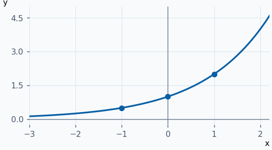
:::

::: ejemplo Ejemplo 2 · Base entre cero y uno
\((1/2)ˣ=2^{−x}\). Al crecer \(x\), decrece \(−x\) y por tanto decrece la función. Es el reflejo de \(2ˣ\) respecto al eje vertical.

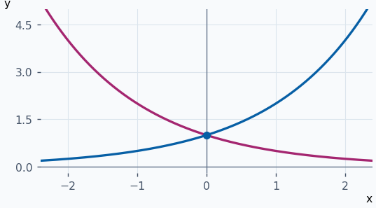
:::

::: ejemplo Ejemplo 3 · Reflejo de una exponencial y su inversa
\(2³=8\) implica \(log₂(8)=3\). El punto \((3,8)\) de la exponencial corresponde a \((8,3)\) del logaritmo.

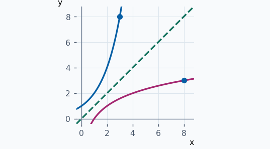
:::

**Ejercicios para resolver**

**1.** Calcula \(log₂(32)\) y \(log₂(1/8)\).

::: solucion
Como \(2⁵=32\) y \(2^{−3}=1/8\), son \(5\) y \(−3\).
:::

**2.** Resuelve \(3^{2x−1}=27\).

::: solucion
\(27=3³\). Por inyectividad, \(2x−1=3\), de donde \(x=2\).
:::

**3.** Halla el dominio de \(log(4−x²)\).

::: solucion
\(4−x²>0\) da \((−2,2)\).
:::

**4.** Resuelve \(log(x)+log(x−3)=log(4)\).

::: solucion
El dominio exige \(x>3\). La regla del producto da \(x(x−3)=4\) y \((x−4)(x+1)=0\). Solo \(x=4\) cumple el dominio.
:::
