# 1.3 Límites de funciones

[Apuntes de Manuel José Fernández · pp. 18–26](apuntes-originales.pdf)

## Límite finito en un punto y límites laterales {#limites-finitos}

Un **punto de acumulación** \(c\) del dominio \(D\) tiene puntos de \(D\) distintos de \(c\) arbitrariamente cerca. Se escribe \(lim_{x→c} f(x)=l\) si, para cualquier tolerancia en la salida, se puede elegir una distancia en la entrada que garantice esa tolerancia.

\(∀ ε>0  ∃ δ>0 :  x ∈ D,  0<∣x−c∣<δ  ⇒  ∣f(x)−l∣<ε\)

La condición \(x≠c\) excluye el valor puntual \(f(c)\). El radio \(δ\) puede depender de \(ε\) y de \(c\). Las dos desigualdades describen una ventana horizontal perforada y una banda vertical en torno a \(l\).

| Límite | Condición sobre \(x∈D\) en la definición |
| --- | --- |
| \(lim_{x→c⁻} f(x)=l\) | \(c−δ<x<c\) |
| \(lim_{x→c⁺} f(x)=l\) | \(c<x<c+δ\) |

Cuando el dominio se acumula a ambos lados, el límite existe y vale \(l\) exactamente cuando los dos laterales valen \(l\). Para reunir las dos condiciones se toma el menor de sus dos radios. Si solo hay puntos del dominio arbitrariamente próximos por un lado, ese lateral describe todo el límite relativo al dominio.

**Ejemplos resueltos**

::: original Ejemplo del PDF · Demostración para la raíz cuadrada
Si \(c>0\) y \(x≥0\), al racionalizar queda \(∣√x−√c∣=∣x−c∣/(√x+√c)≤∣x−c∣/√c\). Elige \(δ=ε√c\). En \(c=0\) se elige \(δ=ε²\) para que \(√x<ε\). La gráfica ilustra la ventana alrededor de \(c=1\).

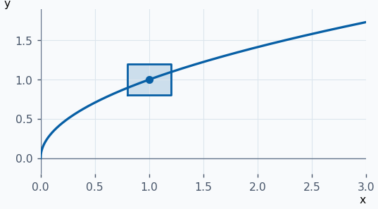
:::

::: ejemplo Ejemplo 2 · Una elección explícita de radio
Para \(f(x)=3x−1\) en \(c=2\), \(∣f(x)−5∣=3∣x−2∣\). Dado \(ε>0\) basta \(δ=ε/3\). La pendiente relaciona el ancho de la ventana con la altura de la banda.

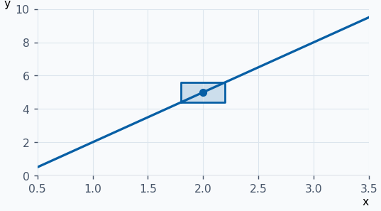
:::

::: ejemplo Ejemplo 3 · El límite ignora el valor puntual
Sea \(f(x)=(x²−4)/(x−2)\) para \(x≠2\) y \(f(2)=0\). Para \(x≠2\), \(f(x)=x+2\). Por ambos lados el límite es \(4\), aunque \(f(2)=0\).

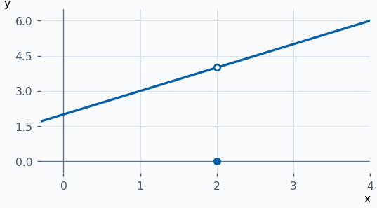
:::

::: ejemplo Ejemplo 4 · Un límite lateral en cada rama
Sea \(f(x)=x+1\) para \(x<0\) y \(f(x)=2−x\) para \(x>0\). Los límites izquierdo y derecho son \(1\) y \(2\). Al ser distintos, no hay límite bilateral.

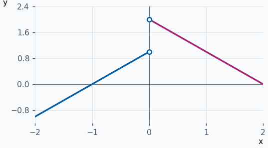
:::

**Ejercicios para resolver**

**1.** Prueba por definición \(lim_{x→−1}(2x+3)=1\).

::: solucion
\(∣2x+3−1∣=2∣x+1∣\). Toma \(δ=ε/2\).
:::

**2.** Halla el límite en \(1\) de \((x²−2x+1)/(x−1)\) y de su extensión con valor \(1\) en ese punto.

::: solucion
En ambos casos, para \(x≠1\) la expresión vale \(x−1\), así que el límite es \(0\). La extensión solo cambia el valor puntual.
:::

**3.** Calcula los laterales en \(0\) de la función que vale \(1\) para \(x<0\) y \(−1\) para \(x>0\).

::: solucion
El izquierdo vale \(1\) y el derecho \(−1\). El bilateral no existe.
:::

**4.** Sea \(g(x)=(x²−2x+1)/(x−1)\) si \(x<1\) y \(g(x)=log(x)\) si \(x>1\). Calcula \(lim_{x→1}g(x)\).

::: solucion
La rama izquierda se reduce a \(x−1\) y tiende a \(0\). El logaritmo tiende a \(log(1)=0\) por la derecha. El límite es \(0\).
:::

## Límites infinitos y límites en el infinito {#tipos-limite}

Cuando \(x→c\), decir \(f(x)→+∞\) significa \(∀ M>0  ∃ δ>0 : x∈D, 0<∣x−c∣<δ ⇒ f(x)>M\). Para \(−∞\) se exige \(f(x)<−M\). Para un límite lateral se sustituye la condición de distancia por \(c−δ<x<c\) o \(c<x<c+δ\).

En \(+∞\) el dominio debe ser no acotado superiormente, y en \(−∞\) no acotado inferiormente. En cada caso se cuantifica sobre los \(x∈D\) que cumplan la condición de la tabla.

| Destino de \(x\) | Condición para \(x\) | Si \(f(x)→l∈ℝ\) | Si \(f(x)→±∞\) |
| --- | --- | --- | --- |
| \(+∞\) | \(x>A\) | Para todo \(ε>0\) existe \(A\) con \(∣f(x)−l∣<ε\). | Para todo \(M>0\) existe \(A\) con \(f(x)>M\) o \(f(x)<−M\), según el signo. |
| \(−∞\) | \(x<A\) | Para todo \(ε>0\) existe \(A\) con \(∣f(x)−l∣<ε\). | Para todo \(M>0\) existe \(A\) con \(f(x)>M\) o \(f(x)<−M\), según el signo. |

Si existe, el límite es único, sea finito o infinito. Dos límites finitos distintos se separarían tomando bandas disjuntas y un mismo \(x\) suficientemente próximo a \(c\). Una banda finita y una condición de magnitud suficientemente grande también son incompatibles.

**Ejemplos resueltos**

::: original Ejemplo del PDF · Crecimiento a ambos lados de cero
\(1/x²→+∞\) cuando \(x→0\). Para \(M>0\) basta \(0<∣x∣<1/√M\). La versión con signo contrario tiende a \(−∞\).

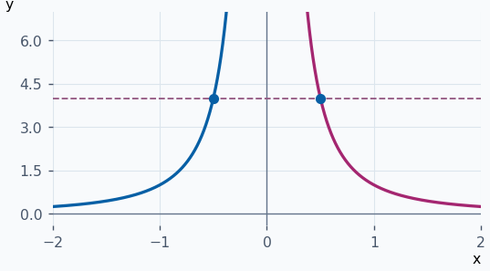
:::

::: ejemplo Ejemplo 2 · Signos laterales de un polo
Para \(1/(x−1)\), \(x−1\) es negativo a la izquierda y positivo a la derecha. Si \(0<∣x−1∣<1/M\), el valor absoluto del cociente supera \(M\). Así los límites son \(−∞\) y \(+∞\), respectivamente.

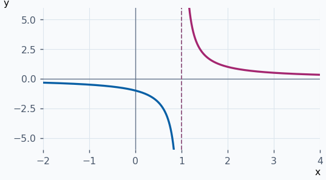
:::

::: ejemplo Ejemplo 3 · Límite finito en ambos infinitos
Para \(f(x)=2+1/x\), \(∣f(x)−2∣=1/∣x∣\). Basta tomar \(∣x∣>1/ε\), por lo que ambos límites en el infinito valen \(2\). La aproximación es desde abajo a la izquierda y desde arriba a la derecha.

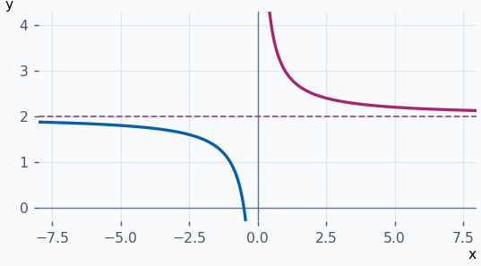
:::

::: ejemplo Ejemplo 4 · Límites infinitos de signo opuesto
Para \(x³\), si \(x>∛M\) se tiene \(x³>M\). Si \(x<−∛M\), se tiene \(x³<−M\). Así \(x³→+∞\) a la derecha y \(x³→−∞\) a la izquierda.

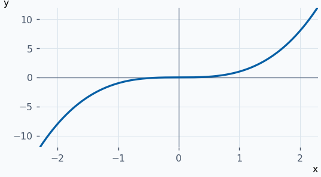
:::

**Ejercicios para resolver**

**1.** Da los laterales de \(−1/x\) en \(0\).

::: solucion
El cociente es positivo para \(x<0\) y negativo para \(x>0\). Los límites son \(+∞\) por la izquierda y \(−∞\) por la derecha.
:::

**2.** ¿Se pueden plantear límites de \(√(1−x²)\) en \(±∞\)?

::: solucion
Su dominio es \([−1,1]\), acotado por ambos lados. No hay entradas del dominio arbitrariamente grandes en ninguna de las dos direcciones.
:::

**3.** Calcula \(lim_{x→−∞} eˣ\), \(lim_{x→+∞} e^{−x}\) y \(lim_{x→+∞} log(x)\).

::: solucion
Los dos primeros valen \(0\). El último es \(+∞\): si \(x>eᴹ\), \(log(x)>M\).
:::

**4.** Justifica que \(log(x)→−∞\) al acercarse a \(0\) desde el dominio.

::: solucion
Dado \(M>0\), toma \(δ=e^{−M}\). Si \(0<x<δ\), entonces \(log(x)<−M\).
:::

## Operaciones, función intermedia e indeterminaciones {#algebra-limites}

Para un mismo destino \(c\), con \(lim f=l∈ℝ\) y \(lim g=m∈ℝ\):

| Operación | Límite |
| --- | --- |
| Suma y diferencia | \(lim(f±g)=l±m\) |
| Múltiplo constante | \(lim(af)=al\) para \(a∈ℝ\) |
| Producto | \(lim(fg)=lm\) |
| Recíproca y cociente | \(lim(1/g)=1/m\) y \(lim(f/g)=l/m\) si \(m≠0\) |

También \(f→l ⇔ f−l→0 ⇔ ∣f−l∣→0\). Las reglas se aplican a límites laterales y a límites en el infinito.

**Teorema de la función intermedia.** Si \(g(x)≤f(x)≤h(x)\) en un entorno reducido de \(c\) y \(g,h→l\), entonces \(f→l\). Una vez que \(g\) y \(h\) están en la banda \(l±ε\), \(f\) queda dentro. En particular, si \(u→0\) y \(v\) está acotada, \(uv→0\) porque \(∣uv∣≤K∣u∣\) para alguna cota \(K\).

| Combinación con infinito | Regla cuando queda determinada |
| --- | --- |
| Suma de un finito y un infinito, o de dos infinitos del mismo signo | Se conserva el signo del infinito. |
| Producto de infinitos, o de un infinito por un límite finito no nulo | Infinito con el signo del producto. |
| Cociente de un infinito por un límite finito no nulo | Infinito con el signo del cociente. |
| Cociente de un límite finito por un infinito | Tiende a \(0\). Para numerador de límite no nulo, el signo eventual viene dado por el cociente. |

Las formas **indeterminadas** son \(0/0\), \(∞/∞\), \(∞−∞\), \(0·∞\), \(0⁰\), \(1^∞\) y \(∞⁰\). Los límites de los componentes por sí solos no fijan el resultado. Se puede factorizar, racionalizar, comparar órdenes o transformar la expresión.

**Ejemplos resueltos**

::: original Ejemplo del PDF · Oscilación por un factor que tiende a cero
Para \(x≠0\), \(−∣x∣≤x·sen(1/x)≤∣x∣\). Las dos envolventes tienden a \(0\) y la oscilación queda atrapada entre ellas.

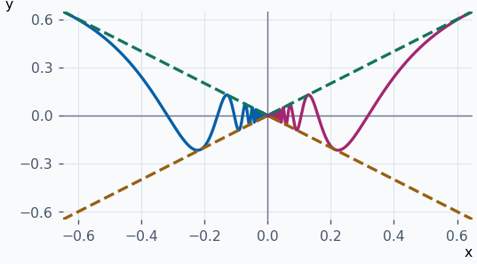
:::

::: ejemplo Ejemplo 2 · Factorización de un 0/0
Al acercarse \(x\) a \(3\), \((x²−9)/(x−3)\) presenta \(0/0\). Se cancela \(x−3\) en el entorno reducido y queda \(x+3\), de límite \(6\).

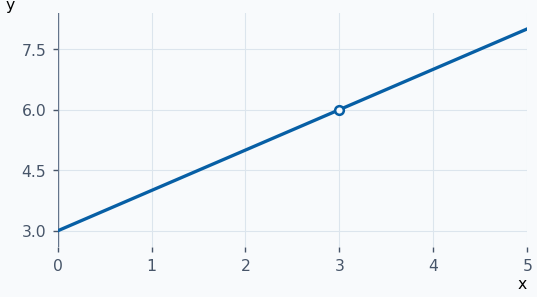
:::

::: ejemplo Ejemplo 3 · Racionalizar una diferencia de infinitos
Para \(x>0\), \(√(x²+4)−x=4/(√(x²+4)+x)\). El denominador tiende a \(+∞\) cuando \(x→+∞\), de modo que la diferencia tiende a \(0\) desde arriba.

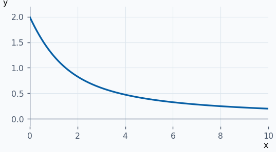
:::

::: ejemplo Ejemplo 4 · Dividir por la potencia dominante
\((2x²−1)/(x²+1)\) es de tipo \(∞/∞\) en \(+∞\). Al dividir por \(x²\) se obtiene \((2−1/x²)/(1+1/x²)→2\). La curva se aproxima a \(2\) por debajo.

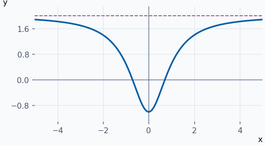
:::

**Ejercicios para resolver**

**1.** Halla \(lim_{x→0}(√(1+x)−1)/x\).

::: solucion
Racionaliza y cancela \(x\). Queda \(1/(√(1+x)+1)→1/2\).
:::

**2.** Halla \(lim_{x→0} x²·cos(1/x)\).

::: solucion
El coseno está entre \(−1\) y \(1\). Por comparación entre \(−x²\) y \(x²\), el límite es \(0\).
:::

**3.** Calcula \(lim_{x→+∞}(x³−x²)\).

::: solucion
La diferencia es \(x²(x−1)\) y ambos factores tienden a \(+∞\). El resultado es \(+∞\).
:::

**4.** Calcula \(lim_{x→−∞}(3x−1)/(x²+4)\).

::: solucion
Divide por \(x²\). El numerador reducido tiende a \(0\) y el denominador a \(1\). El cociente tiende a \(0\) desde valores negativos.
:::

## Asíntotas verticales, horizontales y oblicuas {#calculo-limites}

| Tipo | Criterio |
| --- | --- |
| Vertical \(x=a\) | Algún lateral en \(a\) vale \(+∞\) o \(−∞\). Puede existir incluso si \(f(a)\) está definido. |
| Horizontal \(y=b\) | \(lim_{x→+∞} f(x)=b\) o \(lim_{x→−∞} f(x)=b\), con \(b∈ℝ\). |
| Oblicua \(y=ax+b\) | \(a≠0\) y \(lim_{x→±∞}[f(x)−(ax+b)]=0\) en el extremo considerado. |

Para la oblicua se calcula primero \(a=lim_{x→±∞} f(x)/x\) y luego \(b=lim_{x→±∞}[f(x)−ax]\). Esto se deduce al dividir \(f(x)=ax+b+[f(x)−(ax+b)]\) por \(x\). Si \(a≠0\) y ambos límites son finitos, el segundo demuestra el acercamiento. En una misma dirección solo cabe una recta asintótica, pues la diferencia entre dos rectas distintas no tiende a cero en el infinito.

**Ejemplos resueltos**

::: original Ejemplo del PDF · Una vertical y dos extremos con la misma horizontal
Para \(f(x)=\frac{1}{1−e^{x/(1−x)}}\), se excluyen \(0\) y \(1\). Cuando \(x→0\), el exponente tiende a \(0\) con el signo de \(x\), y el denominador se aproxima a \(0\) con el signo contrario: los laterales son \(+∞\) y \(−∞\). En \(1\), los exponentes laterales son \(+∞\) y \(−∞\), dando límites \(0\) y \(1\). En \(±∞\) el exponente tiende a \(−1\), así que la horizontal es \(y=e/(e−1)\) en ambos extremos.

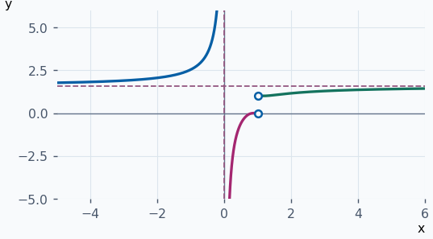
:::

::: ejemplo Ejemplo 2 · Vertical con valor puntual definido
Sea \(f(x)=1/(x−2)²\) si \(x≠2\) y \(f(2)=0\). Los dos límites laterales son \(+∞\). La recta \(x=2\) es asíntota y el punto \((2,0)\) también pertenece a la gráfica.

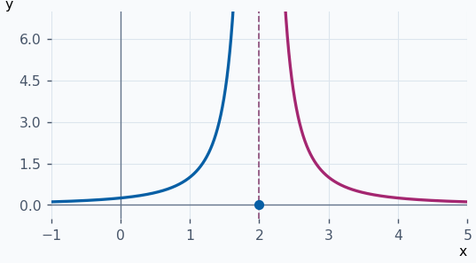
:::

::: ejemplo Ejemplo 3 · Horizontales a distinta altura
En \(f(x)=1/(eˣ+2)\), al ir hacia \(−∞\) se tiene \(eˣ→0\) y \(f→1/2\). Al ir hacia \(+∞\) se tiene \(eˣ→+∞\) y \(f→0\).

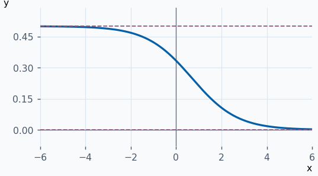
:::

::: ejemplo Ejemplo 4 · Oblicua por división de polinomios
\((x²+1)/(x−1)=x+1+2/(x−1)\). La diferencia con \(y=x+1\) tiende a \(0\) en ambos extremos. El término que sobra también revela una vertical en \(x=1\).

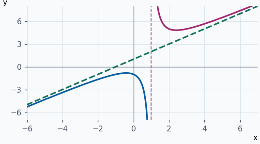
:::

**Ejercicios para resolver**

**1.** Halla las asíntotas de \(f(x)=1/(x+3)\).

::: solucion
Los laterales divergen en \(−3\), así que \(x=−3\) es vertical. En \(±∞\) el límite es \(0\), así que \(y=0\) es horizontal por ambos lados.
:::

**2.** Estudia \(f(x)=x/(eˣ+1)\) en los dos infinitos.

::: solucion
En \(+∞\), la exponencial domina a \(x\) y \(f→0\). En \(−∞\), \(f(x)−x=−xeˣ/(eˣ+1)→0\) porque \(xeˣ→0\). Las rectas son \(y=0\) a la derecha e \(y=x\) a la izquierda.
:::

**3.** Halla la oblicua de \(f(x)=(2x²−3)/(x+1)\).

::: solucion
La división da \(2x−2−1/(x+1)\). El último término tiende a cero en los dos infinitos, así que \(y=2x−2\).
:::

**4.** ¿Es \(x=1\) asíntota vertical de \((x²−1)/(x−1)\)?

::: solucion
Para \(x≠1\), el cociente vale \(x+1\). Los laterales valen \(2\), de modo que hay un hueco en \((1,2)\).
:::

## Infinitésimos, infinitos y equivalencias {#equivalentes}

Un infinitésimo en \(c\) tiende a \(0\) y un infinito positivo tiende a \(+∞\). Se pueden considerar también en límites laterales o en \(±∞\). Para comparar \(f\) con \(g\), con \(g\) no nula en el entorno reducido, se toma el límite de \(f/g\). Para comparar el crecimiento de infinitos de signo variable se usa \(∣f/g∣\). Por ejemplo, \(1/x²\) es de orden superior a \(1/x\) cuando \(x→0\), pues \(∣(1/x²)/(1/x)∣=1/∣x∣→+∞\).

| Resultado | Si ambas tienden a \(0\) | Si ambas tienden a \(+∞\) |
| --- | --- | --- |
| \(0\) | \(f\) es de orden superior a \(g\), se hace pequeña más rápido. | \(f\) es de orden inferior a \(g\), crece más despacio. |
| \(+∞\) | \(f\) es de orden inferior a \(g\). Para signos variables se puede comparar la magnitud \(∣f/g∣\). | \(f\) es de orden superior a \(g\). |
| \(l∈ℝ ∖ {0}\) | Son del mismo orden. Si \(l=1\) son equivalentes. | Para \(l>0\) son del mismo orden. Si \(l=1\) son equivalentes. |

En \(x→0\) se usan \(sen(x)≈x≈arcsen(x)\), \(tg(x)≈x≈arctg(x)\), \(1−cos(x)≈x²/2\), \(log(1+x)≈x\) y \(aˣ−1≈x·log(a)\) para \(a>0\), \(a≠1\). En particular \(eˣ−1≈x\). Con \(u=x−1\), también \(log(x)≈x−1\) cuando \(x→1\). De \(1−cos(x)=2sen²(x/2)\) y \(sen(x/2)≈x/2\) se obtiene el equivalente cuadrático.

Puedes reemplazar un infinitésimo por uno equivalente cuando es **factor o divisor** de toda la expresión: el reemplazo introduce un factor de límite \(1\). Para una diferencia, factoriza antes de reemplazar, pues los términos principales pueden cancelarse. La jerarquía en \(+∞\) es \(log(x)≪xᵖ≪eˣ\) para \(p>0\), donde cada cociente entre un término y el siguiente tiende a \(0\).

**Ejemplos resueltos**

::: original Ejemplo del PDF · Un producto con resultados laterales distintos
Para \(x→0⁻\), \(x·e^{1/x}→0\) porque ambos factores tienden a cero. Para \(x→0⁺\), con \(t=1/x→+∞\), queda \(eᵗ/t→+∞\) por jerarquía. Los laterales no coinciden.

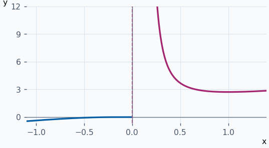
:::

::: ejemplo Ejemplo 2 · Infinitésimos equivalentes
Para \(x≠0\), \((x·cos(2x))/x=cos(2x)→1\). En la gráfica, \(x·cos(2x)\) y \(x\) muestran el mismo comportamiento lineal cerca de cero.

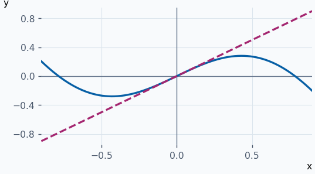
:::

::: ejemplo Ejemplo 3 · Factorizar antes de sustituir
\(tg(2x)−sen(2x)=sen(2x)(1−cos(2x))/cos(2x)\). Al acercarse \(x\) a cero, \(sen(2x)≈2x\), \(1−cos(2x)≈2x²\) y \(cos(2x)→1\). La diferencia equivale a \(4x³\), de modo que al dividir por \(x³\) el límite es \(4\).

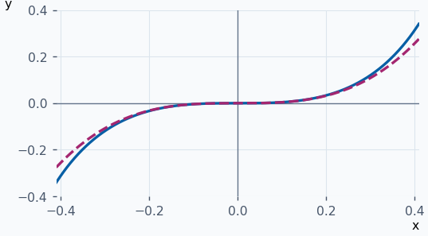
:::

::: ejemplo Ejemplo 4 · Comparación de infinitos
Para \(x→+∞\), \(x/x²=1/x→0\). Por tanto \(x²\) es un infinito de orden superior a \(x\). Las dos gráficas pasan por \((1,1)\) y sus alturas se separan hacia la derecha.

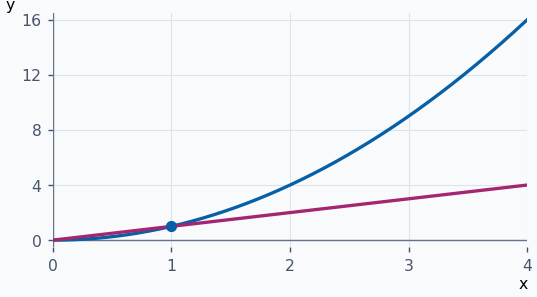
:::

**Ejercicios para resolver**

**1.** Clasifica \(x²\) frente a \(x\) en \(0\), y \(2x·cos(x)\) frente a \(x\) en \(0\).

::: solucion
El primer cociente vale \(x→0\): orden superior. El segundo vale \(2cos(x)→2\): mismo orden, sin equivalencia.
:::

**2.** Calcula \(lim_{x→0} \frac{x·sen²(x)}{log(1+x)}\).

::: solucion
Como \(sen(x)≈x\) y \(log(1+x)≈x\), el cociente equivale a \(x·x²/x=x²\). El límite es \(0\).
:::

**3.** Calcula \(lim_{x→0}(1−cos(3x))/x²\).

::: solucion
\(1−cos(3x)≈(3x)²/2\). El límite es \(9/2\).
:::

**4.** Calcula \(lim_{x→+∞}(log(x)+x²)/eˣ\).

::: solucion
Por jerarquía, \(x²/eˣ→0\). También \(log(x)/eˣ=(log(x)/x²)(x²/eˣ)→0\). Sumando, el límite es \(0\).
:::
