# 1.4 Continuidad de funciones

[Apuntes de Manuel José Fernández · pp. 27–31](apuntes-originales.pdf)

## Continuidad en un punto y tipos de discontinuidad {#diagnostico}

Sea \(f : D ⊂ ℝ → ℝ\) y \(c\) punto de acumulación de \(D\). Para que \(f\) sea continua en \(c\) deben cumplirse las tres condiciones:

1. \(c ∈ D\), de modo que existe \(f(c)\).
2. Existe un límite finito \(l=lim_{x→c} f(x)\).
3. \(l=f(c)\).

| Discontinuidad | Qué ocurre al acercarse a \(c\) |
| --- | --- |
| Evitable | Existe un límite real \(l\), pero \(f(c)\) falta o es distinto de \(l\). Asignar \(f(c)=l\) hace continua la extensión. |
| Esencial de primera especie, salto finito | Ambos laterales son finitos y distintos. |
| Esencial de primera especie, salto infinito | Al menos un lateral es \(+∞\) o \(−∞\) y el otro existe como límite finito o infinito. |
| Esencial de segunda especie | Al menos un lateral carece de límite, incluso infinito, por ejemplo por oscilación. |

En una función a trozos, calcula cada lateral usando su rama y evalúa \(f(c)\) con la rama que incluye el punto. En los ejemplos del PDF, \(sen(x)−1\) a la izquierda y \(x−1\) a la derecha dan límite común \(−1\). Hay discontinuidad evitable si \(f(0)\) no está definido o si se fija en \(2\). Con \(2−x²\) a la izquierda y \(sen(x)/x\) a la derecha, los límites \(2\) y \(1\) dan salto finito. Si se sustituye la rama izquierda por \(1/x\), los límites \(−∞\) y \(1\) dan salto infinito.

**Ejemplos resueltos**

::: original Ejemplo del PDF · Salto en un cociente exponencial
Si \(f(x)=e^{1/x}/(1+e^{1/x})\), en \(0⁻\) se tiene \(e^{1/x}→0\) y el cociente tiende a \(0\). En \(0⁺\), divide por \(e^{1/x}\): \(f(x)=1/(e^{−1/x}+1)→1\). Es esencial de primera especie, de salto finito.

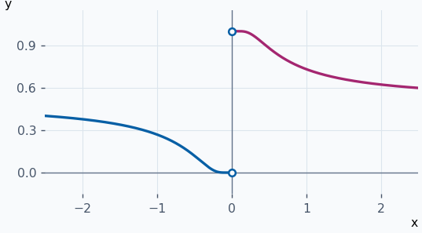
:::

::: ejemplo Ejemplo 2 · Hueco con valor en otra altura
Sea \(f(x)=(x²−1)/(x−1)\) si \(x≠1\) y \(f(1)=4\). Los dos laterales son \(2\) porque el cociente se reduce a \(x+1\). El círculo abierto está a altura \(2\) y el valor real está a altura \(4\). Se corrige poniendo \(f(1)=2\).

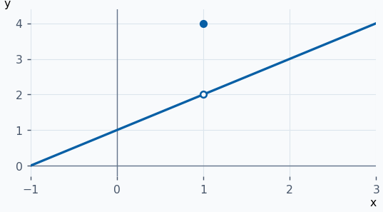
:::

::: ejemplo Ejemplo 3 · Salto infinito en un solo lado
Sea \(f(x)=1/(x−1)\) si \(x<1\) y \(f(x)=x−1\) si \(x≥1\). A la izquierda el límite es \(−∞\). A la derecha es \(0\) y coincide con \(f(1)\). La discontinuidad es de salto infinito.

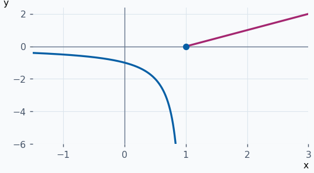
:::

::: ejemplo Ejemplo 4 · Un lateral oscilante
Sea \(f(x)=0\) para \(x≤0\) y \(f(x)=cos(1/x)\) para \(x>0\). A la derecha, en \(x=1/(2kπ)\) toma \(1\) y en \(x=1/((2k+1)π)\) toma \(−1\). Las dos sucesiones se acercan a \(0\), por lo que no existe ese lateral. Es de segunda especie.

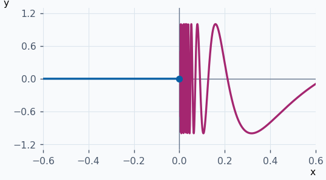
:::

**Ejercicios para resolver**

**1.** Clasifica la discontinuidad de \(f(x)=sen(x)−1\) si \(x<0\), \(f(x)=x−1\) si \(x>0\) y \(f(0)=2\).

::: solucion
Ambos laterales valen \(−1\). Como \(f(0)=2\), es evitable y se corrige con \(f(0)=−1\).
:::

**2.** Clasifica en \(0\) la función \(2−x²\) para \(x<0\) y \(sen(x)/x\) para \(x>0\).

::: solucion
Los laterales valen \(2\) y \(1\), respectivamente. Es un salto finito.
:::

**3.** Clasifica \(f(x)=1/x\) para \(x<0\) y \(sen(x)/x\) para \(x>0\).

::: solucion
Los laterales son \(−∞\) y \(1\). Es esencial de primera especie de salto infinito.
:::

**4.** Clasifica \(f(x)=x²\) para \(x<0\) y \(sen(1/x)\) para \(x>0\).

::: solucion
El izquierdo vale \(0\) y el derecho oscila entre \(−1\) y \(1\) sin acercarse a un límite. Es esencial de segunda especie.
:::

## Continuidad lateral y de las funciones elementales {#continuidad-lateral}

Si \(c∈Dom f\), hay continuidad por la derecha cuando \(lim_{x→c⁺}f(x)=f(c)\), y por la izquierda cuando \(lim_{x→c⁻}f(x)=f(c)\). Cuando hay puntos del dominio arbitrariamente cerca por ambos lados, la continuidad equivale a tener las dos continuidades laterales.

En \((a,b)\) se pide continuidad en cada punto interior. En \([a,b]\) se añade continuidad por la derecha en \(a\) y por la izquierda en \(b\). Para comprobar un extremo se usa la aproximación desde el intervalo.

| Operación | Condición suficiente para continuidad en \(c\) |
| --- | --- |
| \(f+g\), \(f−g\), \(fg\) | \(f\) y \(g\) continuas en \(c\). |
| \(f/g\) | Ambas continuas en \(c\) y \(g(c)≠0\). |
| \(f∘g\) | \(g\) continua en \(c\) y \(f\) continua en \(g(c)\). |

Las reglas de suma, producto y cociente se obtienen aplicando el álgebra de límites y evaluando en \(c\). En la composición, \(g(x)\) se aproxima a \(g(c)\) y la continuidad de \(f\) en esa entrada hace que \(f(g(x))\) se aproxime a \(f(g(c))\).

| Familia | Continuidad |
| --- | --- |
| Potencias enteras no negativas, polinomios, \(sen\), \(cos\) y exponenciales | En todo \(ℝ\). |
| Racionales | Donde el denominador no se anula. |
| \(tg\) | En su dominio, donde \(cos(x)≠0\). |
| Logaritmos | En \((0,+∞)\). |

**Ejemplos resueltos**

::: original Ejemplo del PDF · Continuidad en los extremos de un intervalo
Sea \(f(x)=1/[x(x−1)]\) en \((0,1)\) y \(f(0)=f(1)=0\). Dentro es continua por ser racional. En \(0⁺\) y \(1⁻\) el denominador tiende a cero por valores negativos, así que ambos límites son \(−∞\). Los valores \(0\) en la frontera no arreglan la discontinuidad.

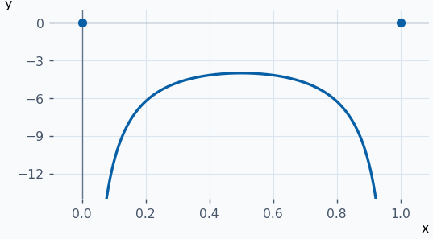
:::

::: ejemplo Ejemplo 2 · Ajustar el parámetro de una unión
Para \(f(x)=x²+1\) si \(x<1\) y \(f(x)=ax\) si \(x≥1\), el límite izquierdo es \(2\). El derecho y \(f(1)\) son \(a\). Se obtiene continuidad en \(1\) exactamente para \(a=2\).

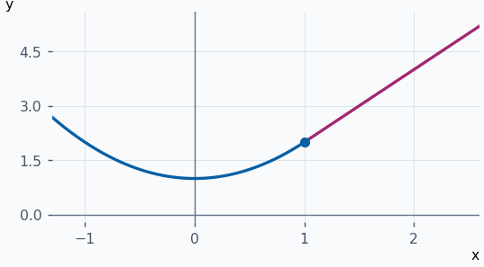
:::

::: ejemplo Ejemplo 3 · Continuidad en una frontera sin rama izquierda
\(f(x)=√(x−1)\) en \([1,5]\) es continua en \((1,5)\). En \(1\), el límite derecho es \(0=f(1)\). En \(5\), el izquierdo es \(2=f(5)\). Así es continua en todo el intervalo cerrado.

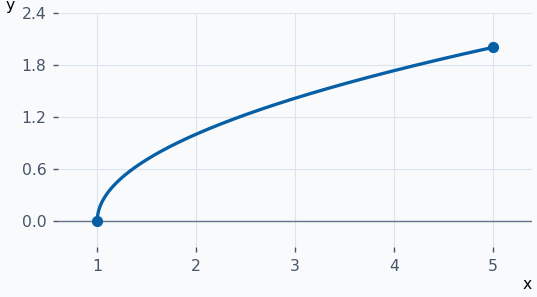
:::

::: ejemplo Ejemplo 4 · Composición con argumento positivo
\(f(x)=log(1+x²)\) está definida para todo real porque \(1+x²≥1\). El polinomio interior es continuo y su imagen queda en el dominio del logaritmo, así que la composición es continua. En cero vale \(0\).

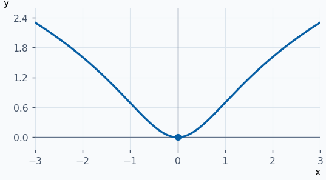
:::

**Ejercicios para resolver**

**1.** Estudia la continuidad de \(log(x²)\).

::: solucion
Su dominio es \(ℝ ∖ {0}\). Allí es continua por composición. En \(0\), \(x²→0⁺\) y \(log(x²)→−∞\).
:::

**2.** Para \(x≠0\) toma \(f(x)=x·e^{1/x}\) y define \(f(0)=0\). ¿Por qué lado es continua en \(0\)?

::: solucion
El límite izquierdo vale \(0\). Por la derecha, \(t=1/x\) da \(eᵗ/t→+∞\). Solo hay continuidad por la izquierda.
:::

**3.** Si \(f(x)=e^{1/x}/(1+e^{1/x})\) para \(x≠0\) y \(f(0)=0\), estudia la continuidad lateral.

::: solucion
Los laterales son \(0\) y \(1\). Solo el izquierdo coincide con \(f(0)\).
:::

**4.** Halla el dominio y los puntos de continuidad de \(1/(x²−4)\).

::: solucion
Es racional. El dominio es \(ℝ ∖ {−2,2}\) y es continua en cada uno de sus puntos.
:::

## Bolzano y Darboux {#valores-intermedios}

**Teorema de Bolzano.** Si \(f\) es continua en \([a,b]\) y \(f(a)f(b)<0\), existe al menos un \(c∈(a,b)\) con \(f(c)=0\). Un cero de \(f\) es una raíz de la ecuación \(f(x)=0\). Para aplicar el teorema, comprueba la continuidad en todo el intervalo y los signos opuestos en sus extremos.

**Teorema de Darboux o del valor intermedio.** Si \(f\) es continua en \([a,b]\) y \(d\) queda estrictamente entre \(f(a)\) y \(f(b)\), existe algún \(c∈(a,b)\) con \(f(c)=d\). Se aplica Bolzano a \(g(x)=f(x)−d\). Si \(d\) es el valor de un extremo, ese extremo ya lo alcanza.

**Ejemplos resueltos**

::: original Ejemplo del PDF · Una raíz trigonométrica
Sea \(f(x)=x/2−sen(x)\). Es continua en \([π/2,π]\). En el extremo izquierdo, \(f(π/2)=π/4−1<0\). En el derecho, \(f(π)=π/2>0\). Bolzano garantiza al menos una raíz entre ambos.

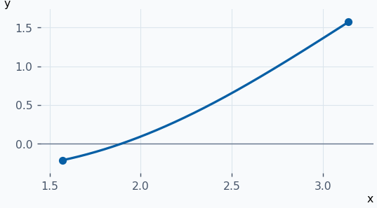
:::

::: ejemplo Ejemplo 2 · Encerrar una raíz cúbica
Para \(f(x)=x³+x−3\), \(f(1)=−1\) y \(f(2)=7\). Es un polinomio continuo en \([1,2]\). Como cambia de signo, existe una raíz en \((1,2)\).

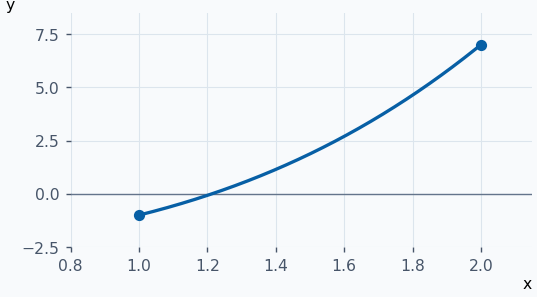
:::

::: ejemplo Ejemplo 3 · Alcanzar una altura distinta de cero
\(f(x)=x²+1\) es continua en \([0,2]\) y en los extremos vale \(1\) y \(5\). Darboux garantiza una entrada que da \(3\). Aquí \(x=√2\) y el nivel se marca en la gráfica.

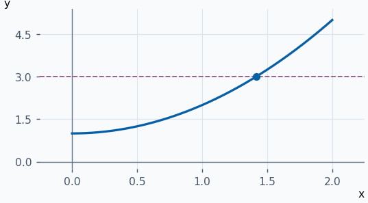
:::

::: ejemplo Ejemplo 4 · Signos opuestos separados por un salto
En \([−1,1]\), toma \(f(x)=−1\) para \(x<0\) y \(f(x)=1\) para \(x≥0\). Los extremos tienen signos contrarios, pero hay un salto en \(0\) y no se cumple la hipótesis de continuidad. La función nunca alcanza \(0\).

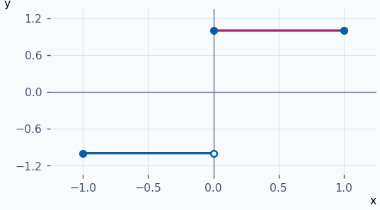
:::

**Ejercicios para resolver**

**1.** ¿Se puede aplicar Bolzano a \(f(x)=1/x\) en \((0,1]\) y \(f(0)=−1\) sobre \([0,1]\)?

::: solucion
Los valores extremos cambian de signo, pero \(f(x)→+∞\) por la derecha de \(0\). Falta continuidad y no hay raíz en \((0,1)\).
:::

**2.** Demuestra que \(x²−2=0\) tiene una raíz en \((1,2)\).

::: solucion
El polinomio es continuo en \([1,2]\) y en los extremos vale \(−1\) y \(2\). Aplica Bolzano.
:::

**3.** Prueba que \(cos(x)=1/3\) tiene solución en \((0,π)\).

::: solucion
El coseno es continuo en \([0,π]\), con extremos \(1\) y \(−1\). El valor \(1/3\) está estrictamente entre ambos, así que aplica Darboux.
:::

**4.** ¿Qué se puede afirmar de las raíces de \(x²\) en \([−1,1]\) usando el criterio de cambio de signo?

::: solucion
El criterio no se activa porque ambos extremos valen \(1\). El cero en \(0\) existe aunque Bolzano no lo garantice con esos extremos.
:::

## Acotación y teorema de Weierstrass {#teoremas-continuidad}

**Teorema de la acotación.** Si \(f\) es continua en \([a,b]\), existe \(K>0\) con \(∣f(x)∣≤K\) para todo \(x∈[a,b]\).

**Teorema de Weierstrass.** En las mismas condiciones existen \(x₁,x₂∈[a,b]\) tales que

\(f(x₁) ≤ f(x) ≤ f(x₂)   ∀ x∈[a,b]\)

Por tanto \(m=f(x₁)\) es el mínimo absoluto y \(M=f(x₂)\) el máximo absoluto. Son alturas. Los puntos \(x₁,x₂\) donde se alcanzan pueden estar en el interior o en la frontera, y puede haber varias entradas con la misma altura extrema. La existencia de \(m\) y \(M\) da una cota \(K=max{1,∣m∣,∣M∣}\).

En la gráfica de los apuntes el máximo absoluto se alcanza en \(b\) con valor \(2\), y el mínimo absoluto se alcanza en \(0\) y en \(2\) con valor \(0\). El máximo local de altura \(1\) en \(x=1\) y el máximo local en la frontera izquierda se obtienen comparando solo valores cercanos del dominio.

**Ejemplos resueltos**

::: ejemplo Ejemplo 1 · Un extremo en la frontera y otro en el interior
\(f(x)=(x−1)²\) es continua en \([−1,2]\). El mínimo es \(0\) en \(x=1\). La mayor distancia a \(1\) dentro del intervalo se obtiene en \(x=−1\), por lo que el máximo es \(4\).

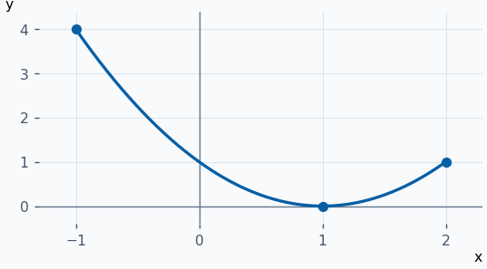
:::

::: ejemplo Ejemplo 2 · El mismo mínimo en dos puntos
En \([−1,1]\), \(f(x)=1−x²\) es continua y toma valores entre \(0\) y \(1\). El mínimo \(0\) se alcanza en \(−1\) y \(1\). El máximo \(1\) se alcanza en \(0\).

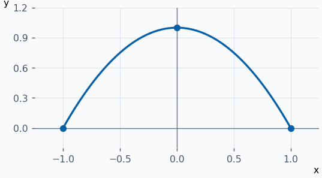
:::

::: ejemplo Ejemplo 3 · Un intervalo abierto sin extremos alcanzados
\(f(x)=x\) es continua en \((0,1)\) y está acotada. El ínfimo es \(0\) y el supremo es \(1\). Ninguno se alcanza porque ambos extremos se excluyen.

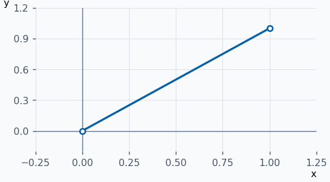
:::

**Ejercicios para resolver**

**1.** Halla mínimo y máximo de \(x²\) en \([−2,1]\).

::: solucion
Es continua. El mínimo es \(0\) en \(x=0\). La mayor distancia a cero se da en \(−2\), así que el máximo es \(4\).
:::

**2.** ¿Está acotada \(1/x\) en \((0,1]\)?

::: solucion
Tiene cota inferior \(1\). No tiene cota superior porque \(1/x→+∞\) cuando \(x→0⁺\).
:::

**3.** Da una cota para \(∣2x−1∣\) en \([0,3]\).

::: solucion
Como \(−1≤2x−1≤5\), sirve \(K=5\), y se alcanza en \(x=3\).
:::

**4.** Sea \(f(x)=x\) en \([0,1)\) y \(f(1)=0\). ¿Se alcanzan ambos extremos en \([0,1]\)?

::: solucion
El mínimo \(0\) se alcanza en \(0\) y \(1\). El supremo \(1\) no se alcanza. La discontinuidad en \(1\) impide aplicar Weierstrass.
:::
