# 1.5 Derivabilidad y propiedades de las funciones derivables

[Apuntes de Manuel José Fernández · pp. 32–41](apuntes-originales.pdf)

## Derivada, tangente y derivadas laterales {#cociente-incremental}

Sea \(c\) interior al dominio de \(f\). Para \(h≠0\), el cociente \([f(c+h)−f(c)]/h\) es la pendiente de la secante que une \((c,f(c))\) y \((c+h,f(c+h))\). Si su límite existe y es finito, \(f\) es derivable en \(c\).

\(f′(c) = lim_{h→0} \frac{f(c+h)−f(c)}{h}\)

La tangente en \((c,f(c))\) tiene ecuación \(y−f(c)=f′(c)(x−c)\). Es horizontal cuando \(f′(c)=0\). Si el cociente tiene límite infinito, los apuntes hablan de derivada infinita y la tangente es vertical cuando ambos lados tienen dirección vertical y la curva es continua en el punto. La derivabilidad exige pendiente finita.

| Límite del cociente | Notación |
| --- | --- |
| \(h→0⁻\) | Derivada izquierda \(f′(c⁻)\) |
| \(h→0⁺\) | Derivada derecha \(f′(c⁺)\) |

En un punto interior hay derivada si y solo si ambos límites laterales son finitos e iguales. Si son finitos y distintos y la función es continua, el punto es **anguloso**. También puede ocurrir que un lateral sea infinito y el otro finito.

**Derivabilidad implica continuidad.** Para \(h≠0\), \(f(c+h)−f(c)=h·[f(c+h)−f(c)]/h\), es decir, \(h\) multiplicado por el cociente incremental. Si el cociente tiende a un número finito, la diferencia tiende a cero. El mismo razonamiento funciona por un lado. La continuidad sola no garantiza derivabilidad.

La **función derivada** \(f′ : D^{*} ⊂ ℝ → ℝ\) asigna a cada entrada su derivada finita. Su dominio \(D^{*} ⊂ D\) puede ser menor. Una función es derivable en un abierto si lo es en todos sus puntos.

**Ejemplos resueltos**

::: original Ejemplo del PDF · Parábola y tangente horizontal
Para \(f(x)=x²\) en \(0\), el cociente es \(h²/h=h→0\). En cualquier \(x\), desarrollar \((x+h)²\) da el cociente \(2x+h\), así que \(f′(x)=2x\). En \((0,0)\) la tangente es \(y=0\).

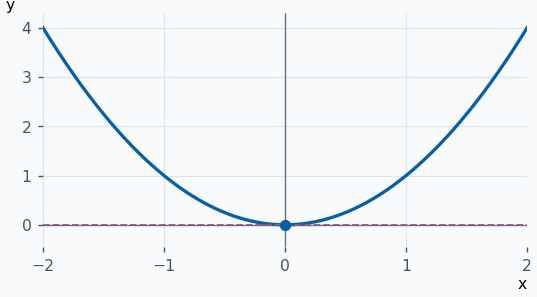
:::

::: ejemplo Ejemplo 2 · Secante y tangente en un punto no nulo
Para \(f(x)=x²\) en \(c=1\), el cociente es \(2+h\). Si \(h=1\), la secante tiene pendiente \(3\) y ecuación \(y=3x−2\). En el límite la tangente es \(y=2x−1\). Ambas pasan por \((1,1)\).

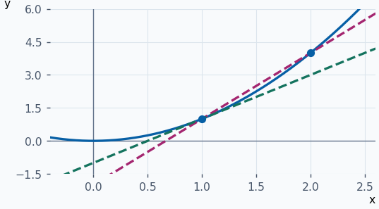
:::

::: ejemplo Ejemplo 3 · Un punto anguloso trasladado
Para \(f(x)=∣x−2∣\), en \(2\) el cociente es \(∣h∣/h\). Es \(−1\) si \(h<0\) y \(1\) si \(h>0\). El punto \((2,0)\) es continuo pero anguloso, sin derivada bilateral.

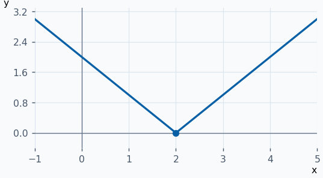
:::

::: ejemplo Ejemplo 4 · Tangente vertical desplazada
Para \(f(x)=∛(x+1)\) en \(c=−1\), el cociente vale \(∛h/h=1/(∛h)²→+∞\) desde ambos lados. La tangente es \(x=−1\) y no existe derivada finita en esa entrada.

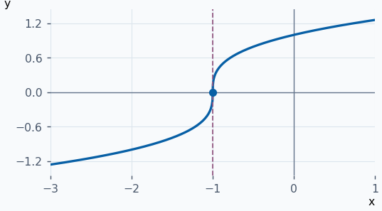
:::

**Ejercicios para resolver**

**1.** Calcula mediante el cociente las derivadas de \(f(x)=k\) y \(g(x)=x\).

::: solucion
Para la constante, el numerador es \(k−k=0\). Para la identidad, es \(x+h−x=h\). Así, \(f′=0\) y \(g′=1\) en \(ℝ\).
:::

**2.** Calcula \(f′(x)\) para \(f(x)=√x\) en \(x>0\).

::: solucion
Racionaliza el cociente. Queda \(1/(√(x+h)+√x)→1/(2√x)\).
:::

**3.** Halla las derivadas laterales de \(√(∣x∣)\) en \(0\).

::: solucion
El cociente es \(−1/√(−h)\) si \(h<0\) y \(1/√h\) si \(h>0\). Los límites son \(−∞\) y \(+∞\).
:::

**4.** Sea \(f(x)=eˣ−1\) si \(x≥0\) y \(f(x)=x³\) si \(x<0\). Decide si es derivable en cero.

::: solucion
Ambos tramos tienden a \(0=f(0)\). El cociente izquierdo es \(h²→0\). El derecho \((eʰ−1)/h→1\). Los laterales difieren.
:::

## Reglas de derivación y funciones elementales {#tabla-derivadas}

Si \(f\) y \(g\) son derivables en \(c\), las siguientes reglas se evalúan en \(c\). Los cocientes requieren \(g(c)≠0\).

| Operación | Derivada |
| --- | --- |
| Suma y múltiplo | \((f+g)′=f′+g′\), \((αf)′=αf′\) para \(α∈ℝ\). |
| Producto | \((fg)′=f′g+fg′\). |
| Recíproca | \((1/g)′=−g′/g²\). |
| Cociente | \((f/g)′=(f′g−fg′)/g²\). |

**Producto.** Suma y resta \(f(c)g(c+h)\) en el incremento de \(fg\). El cociente se divide en \([f(c+h)−f(c)]g(c+h)/h\) y \(f(c)[g(c+h)−g(c)]/h\). Al tomar límites se usa \(g(c+h)→g(c)\) por continuidad. La recíproca se obtiene escribiendo su incremento como \(−[g(c+h)−g(c)]/[g(c+h)g(c)]\). El cociente combina producto y recíproca.

| Función | Derivada y condición |
| --- | --- |
| Constante \(k\), identidad \(x\) | \(0\) y \(1\) en \(ℝ\). |
| \(xⁿ\), \(n∈ℤ\) | \(nx^{n−1}\) si \(n≠0\). Para \(n<0\) se exige \(x≠0\). |
| \(sen(x)\), \(cos(x)\) | \(cos(x)\) y \(−sen(x)\) en \(ℝ\). |
| \(tg(x)\) | \(1/cos²(x)=sec²(x)=1+tg²(x)\), donde \(cos(x)≠0\). |
| \(logₐ(x)\) | \(logₐ(e)/x=1/[x·log(a)]\) para \(x>0\), \(a>0\), \(a≠1\). |
| \(log(x)\) | \(1/x\) en \((0,+∞)\). |

Por inducción, si \((xⁿ)′=nx^{n−1}\), la regla del producto aplicada a \(xⁿ·x\) da \((n+1)xⁿ\). Para potencias negativas se deriva \(1/x^{−n}\). Así, si \(P(x)=a₀+a₁x+⋯+aₙxⁿ\), \(P′(x)=a₁+2a₂x+⋯+naₙx^{n−1}\). Las funciones racionales se derivan en todos los puntos de su dominio.

**Seno y tangente.** La fórmula de adición separa el cociente del seno en \(sen(x)[cos(h)−1]/h+cos(x)sen(h)/h\). Los factores de \(h\) tienden a \(0\) y \(1\), respectivamente. La derivada de la tangente se obtiene por cociente: el numerador es \(cos²(x)+sen²(x)=1\).

**Logaritmo.** Para \(x>0\) y \(h\) suficientemente pequeño, \(log(x+h)−log(x)=log(1+h/x)\). Si \(u=h/x\), el cociente incremental es \((1/x)·log(1+u)/u\). Como \(log(1+u)≈u\) en cero, el límite es \(1/x\). El cambio de base añade el factor constante \(1/log(a)\) para \(logₐ\).

**Ejemplos resueltos**

::: ejemplo Ejemplo 1 · Derivar un polinomio término a término
Para \(f(x)=x³−3x+1\), se obtiene \(f′(x)=3x²−3\). En \(1\), la pendiente vale cero y \(f(1)=−1\), así que la tangente es \(y=−1\).

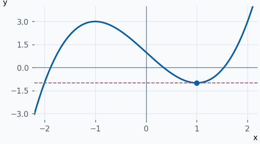
:::

::: ejemplo Ejemplo 2 · Producto que se anula en el origen
Para \(f(x)=x·sen(x)\), \(f′(x)=sen(x)+x·cos(x)\). En \(0\), ambos sumandos valen cero. Cerca del origen, \(x·sen(x)≈x²\), coherente con la tangente horizontal.

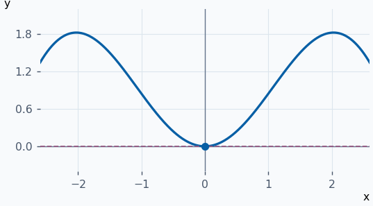
:::

::: ejemplo Ejemplo 3 · Cociente con numerador lineal
Para \(f(x)=x/(1+x²)\), \(f′(x)=(1+x²−2x²)/(1+x²)²=(1−x²)/(1+x²)²\). En \(0\) la pendiente es \(1\) y la tangente es \(y=x\).

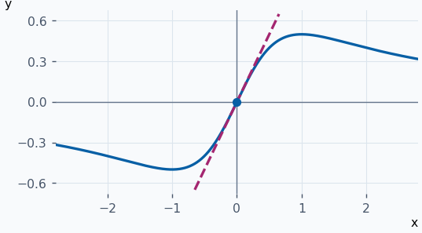
:::

**Ejercicios para resolver**

**1.** Deriva \(4x⁵−x²+7\).

::: solucion
Derivando término a término queda \(20x⁴−2x\).
:::

**2.** Deriva \(x²·cos(x)\).

::: solucion
La regla del producto da \(2x·cos(x)−x²·sen(x)\).
:::

**3.** Deriva \((x+1)/(x−1)\) e indica dónde vale la expresión obtenida.

::: solucion
La regla del cociente da \([(x−1)−(x+1)]/(x−1)²=−2/(x−1)²\) para \(x≠1\).
:::

**4.** Deriva \(x^{−3}+log₂(x)\) e indica el dominio.

::: solucion
El logaritmo exige \(x>0\). La derivada es \(−3x^{−4}+1/[x·log(2)]\).
:::

## Cadena, inversa y derivación logarítmica {#cadena-inversa}

Si \(g\) es derivable en \(c\) y \(f\) lo es en \(g(c)\), entonces

\((f∘g)′(c)=f′(g(c))·g′(c)\)

Deriva la función exterior en la salida de la interior, y multiplica por la derivada de la interior. Como \(cos(x)=sen(π/2−x)\), la cadena da \(cos(π/2−x)·(−1)=−sen(x)\). Para \(y=aˣ\), \(log(y)=x·log(a)\), por lo que \(y′/y=log(a)\) y \(y′=aˣlog(a)\). En base \(e\) se obtiene \((eˣ)′=eˣ\).

Si \(f\) es inyectiva, derivable en \(u=f^{−1}(c)\) con \(f′(u)≠0\) y su inversa es continua en \(c\), entonces

\((f^{−1})′(c)=\frac{1}{f′(f^{−1}(c))}\)

Se obtiene del cociente incremental inverso. Si \(y=f(x)\) y \(c=f(u)\), se cumple \([f^{−1}(y)−f^{−1}(c)]/(y−c)=(x−u)/[f(x)−f(u)]\). Como \(y→c\) implica \(x→u\), el límite es la recíproca de \(f′(u)\).

| Inversa | Derivada |
| --- | --- |
| \(arcsen(x)\) | \(1/√(1−x²)\) si \(−1<x<1\). En su rama \(cos(arcsen(x))=√(1−x²)\). |
| \(arccos(x)\) | \(−1/√(1−x²)\) si \(−1<x<1\). En su rama \(sen(arccos(x))=√(1−x²)\). |
| \(arctg(x)\) | \(1/(1+x²)\) en \(ℝ\), a partir de \(tg′=1+tg²\). |
| \(g(x)=x^{1/n}\), \(n≥2\) | \(1/[n·g(x)^{n−1}]\). Para \(n\) impar, \(x≠0\). Para \(n\) par, \(x>0\). |

Para \(y=u(x)^{v(x)}\) con \(u>0\), toma logaritmos: \(log(y)=v·log(u)\). Al derivar,

\(y′=y·[v′·log(u)+v·u′/u]\)

**Ejemplos resueltos**

::: original Ejemplo del PDF · Exponente y base dependientes de x
Para \(y=(1+x)^{log(1+x)}\), \(x>−1\), se tiene \(log(y)=[log(1+x)]²\). De la cadena resulta \(y′=y·2log(1+x)/(1+x)\). En \(0\), \(y=1\) y \(y′=0\).

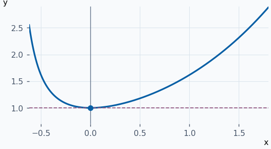
:::

::: ejemplo Ejemplo 2 · Cuadrado dentro del seno
Para \(f(x)=sen(x²)\), la exterior es el seno y la interior tiene derivada \(2x\). Así \(f′(x)=2x·cos(x²)\). En \(0\), la pendiente se anula aunque \(cos(0)=1\).

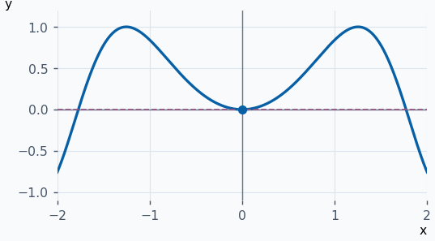
:::

::: ejemplo Ejemplo 3 · Derivar una inversa en una entrada concreta
\(f(x)=x³+x\) es estrictamente creciente, con inversa continua. Como \(f(1)=2\) y \(f′(1)=4\), \((f^{−1})′(2)=1/4\). La gráfica usa los pares \((x³+x,x)\) y marca la tangente en \((2,1)\).

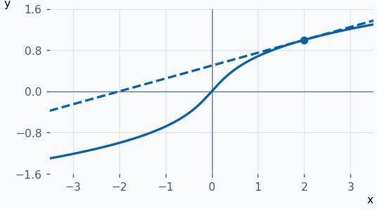
:::

::: ejemplo Ejemplo 4 · Pendiente de la inversa trigonométrica
Si \(y=arctg(x)\), \(tg(y)=x\) y \((1+tg²(y))y′=1\). Entonces \(y′=1/(1+x²)\). En \(x=1\), \(y=π/4\) y la pendiente es \(1/2\).

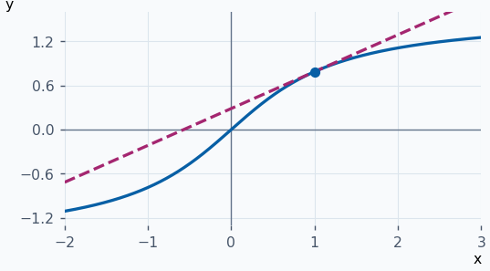
:::

**Ejercicios para resolver**

**1.** Deriva \(tg((1+x)³)\) donde está definida.

::: solucion
La exterior aporta \(1/cos²((1+x)³)\) y la interior \(3(1+x)²\). Multiplica los dos factores.
:::

**2.** Deriva \(e^{−x}\) y \(log(1+x²)\).

::: solucion
La cadena da \(−e^{−x}\) y \(2x/(1+x²)\), ambas en todo \(ℝ\).
:::

**3.** Deriva \(x²·sen(1/x)\) para \(x≠0\) y su extensión con valor \(0\) en \(x=0\).

::: solucion
Fuera de \(0\), producto y cadena dan \(2x·sen(1/x)−cos(1/x)\). En \(0\) el cociente \(h·sen(1/h)→0\), así que \(f′(0)=0\).
:::

**4.** Deriva \(arcsen(2x)\) e indica dónde existe la derivada finita.

::: solucion
La regla de la cadena da \(2/√(1−4x²)\) para \(−1/2<x<1/2\). En los extremos de su dominio no hay derivada bilateral finita.
:::

## Teorema de Rolle y número de raíces {#rolle}

Si \(f\) es continua en \([a,b]\), derivable en \((a,b)\) y \(f(a)=f(b)\), existe al menos un \(c∈(a,b)\) tal que \(f′(c)=0\). La tangente en ese punto es horizontal. Si \(f\) es constante, cualquier punto interior sirve. Si no lo es, Weierstrass garantiza un máximo o un mínimo distinto de la altura de los extremos y alcanzado en el interior. En ese punto los cocientes de incremento cambian de signo entre lados, de modo que su límite común debe ser cero.

Entre dos ceros distintos de \(f\) hay un cero de \(f′\) siempre que se cumplan las hipótesis en el intervalo que los une. En particular, cuando \(f′\) nunca se anula en un intervalo, \(f\) tiene como máximo una raíz. Si además Bolzano garantiza una raíz por cambio de signo, esa raíz es única. Con \(k\) raíces distintas, los \(k−1\) intervalos consecutivos obligan a tener al menos \(k−1\) ceros distintos de \(f′\).

**Ejemplos resueltos**

::: original Ejemplo del PDF · Dos raíces para una función logarítmica
Sea \(f(x)=log(x)−x²/2+2\), \(x>0\). Su derivada \(1/x−x\) solo se anula en \(1\), de modo que Rolle permite como máximo dos ceros. En \(1\), \(f(1)=3/2\). En \(0⁺\), \(f→−∞\), y \(f(e)=3−e²/2<0\). Bolzano asegura un cero a cada lado de \(1\), el derecho dentro de \((1,e)\).

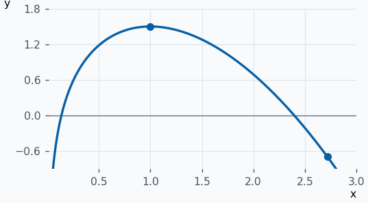
:::

::: ejemplo Ejemplo 2 · Tangente horizontal entre dos ceros
\(f(x)=(x−1)(x−3)\) es continua en \([1,3]\), derivable en \((1,3)\) y vale cero en ambos extremos. Como \(f′(x)=2x−4\), el punto de Rolle es \(c=2\).

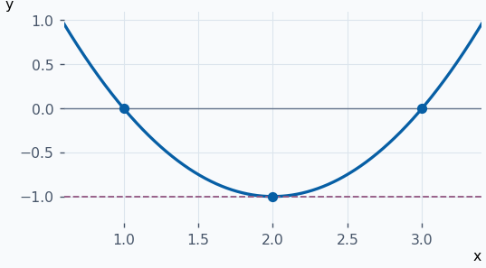
:::

::: ejemplo Ejemplo 3 · Existencia y unicidad en un intervalo
\(f(x)=x³+x−1\) es continua y cambia de signo entre \(0\) y \(1\). Como \(f′(x)=3x²+1>0\) en \(ℝ\), dos raíces contradirían Rolle. Por tanto hay exactamente una raíz real y está en \((0,1)\).

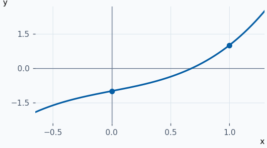
:::

::: ejemplo Ejemplo 4 · Igual altura en las fronteras con un pico interior
\(f(x)=∣x∣+1\) en \([−1,1]\) cumple \(f(−1)=f(1)=2\). En el origen carece de derivada y fuera de él su pendiente vale \(−1\) o \(1\). No hay tangente horizontal.

![V sobre \[−1,1\] con extremos a altura 2 y vértice anguloso a altura 1.](graficas/rolle-4.png)
:::

**Ejercicios para resolver**

**1.** Da una función en \([−1,1]\) con derivada nula en un punto interior aunque los valores de los extremos sean distintos.

::: solucion
\(x³\) es derivable, \(f′(0)=0\), pero \(f(−1)=−1≠1=f(1)\).
:::

**2.** Demuestra la unicidad de la raíz de \(x/2−sen(x)\) en \((π/2,π)\).

::: solucion
Por Bolzano hay una. En \((π/2,π)\) la derivada \(1/2−cos(x)\) es positiva, así que no puede haber dos por Rolle.
:::

**3.** Encuentra un intervalo de longitud menor que dos que contenga la única raíz de \(sen(x)+3x−1\).

::: solucion
\(f′(x)=cos(x)+3≥2\) en \(ℝ\). Por Rolle hay como máximo una raíz. \(f(0)=−1\) y \(f(1)=sen(1)+2>0\). Bolzano da una raíz en \((0,1)\).
:::

**4.** ¿Cuántas raíces distintas como máximo puede tener una función derivable en \(ℝ\) cuya derivada tiene exactamente dos ceros?

::: solucion
Como máximo tres. Cuatro raíces obligarían a tener un cero de la derivada en cada uno de los tres intervalos disjuntos entre raíces consecutivas.
:::

## Regla de L’Hôpital {#lhopital}

Para un cociente de tipo \(0/0\) o \(∞/∞\), considera \(f\) y \(g\) derivables en el entorno reducido, lateral o en el infinito según corresponda. Supón que \(g′(x)≠0\) allí y que \(lim f′(x)/g′(x)\) existe, como límite finito o infinito. Entonces

\(lim \frac{f(x)}{g(x)} = lim \frac{f′(x)}{g′(x)}\)

Se derivan por separado el numerador y el denominador. Si el nuevo cociente vuelve a presentar una forma admitida y cumple las hipótesis, se puede repetir. Para los demás tipos, transforma primero la expresión.

| Forma | Transformación habitual |
| --- | --- |
| \(0·∞\) | \(uv=u/(1/v)\) o \(uv=v/(1/u)\), según el caso. |
| \(∞−∞\) | Un denominador común o un conjugado permite obtener un cociente. |
| \(0⁰\), \(1^∞\), \(∞⁰\) | Para base \(u>0\), escribe \(u^v=exp(v·log(u))\) y estudia el exponente. |

**Ejemplos resueltos**

::: original Ejemplo del PDF · Cociente entre diferencias trigonométricas
En \(x→0\), \((tg(x)−x)/(x−sen(x))\) es \(0/0\). Las derivadas dan \(tg²(x)/(1−cos(x))\). Como \(tg²(x)≈x²\) y \(1−cos(x)≈x²/2\), el límite es \(2\).

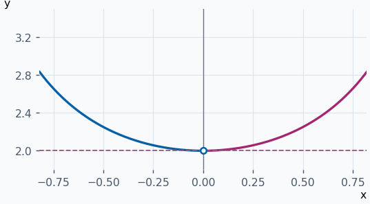
:::

::: ejemplo Ejemplo 2 · Dos aplicaciones seguidas
Para \(x→0\), \((eˣ−1−x)/x²\) es \(0/0\). La primera aplicación da \((eˣ−1)/(2x)\), otra vez \(0/0\). La segunda da \(eˣ/2→1/2\).

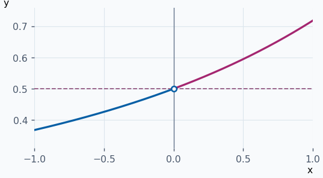
:::

::: ejemplo Ejemplo 3 · Convertir un producto en cociente
Si \(x→0⁺\), \(x·log(x)\) es \(0·(−∞)\). Escribe \(log(x)/(1/x)\). Las derivadas dan \((1/x)/(−1/x²)=−x→0\). La curva se acerca al origen por debajo.

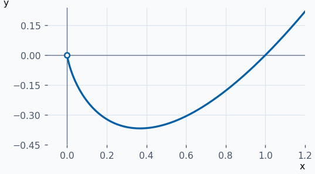
:::

::: ejemplo Ejemplo 4 · Potencia de tipo uno elevado a infinito
Con \(x→0\) y \(x≠0\), \((1+2x)^{1/x}=exp(log(1+2x)/x)\). La derivación del cociente da \(2/(1+2x)→2\). El límite de la potencia es \(e²\).

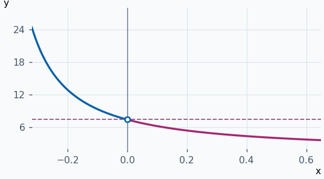
:::

**Ejercicios para resolver**

**1.** Calcula \(lim_{x→1}[x/(x−1)−1/log(x)]\).

::: solucion
Unifica en \([x·log(x)−(x−1)]/[(x−1)log(x)]\). La primera derivación da \(log(x)/[log(x)+(x−1)/x]\), otra vez \(0/0\). La segunda da \((1/x)/(1/x+1/x²)→1/2\).
:::

**2.** Calcula \(lim_{x→0⁺}xˣ\).

::: solucion
Se escribe \(exp(x·log(x))\). Por L’Hôpital, \(log(x)/(1/x)\) tiene límite \(0\). La potencia tiende a \(e⁰=1\).
:::

**3.** Calcula \(lim_{x→+∞}log(x)/√x\).

::: solucion
Es \(∞/∞\). Las derivadas dan \((1/x)/(1/(2√x))=2/√x→0\).
:::

**4.** ¿Se puede aplicar L’Hôpital a \((x+1)/x\) en \(x→0⁺\)?

::: solucion
El numerador tiende a \(1\) y el denominador a \(0⁺\). No se presenta \(0/0\) ni \(∞/∞\). Por el signo y el tamaño del denominador, el límite es \(+∞\).
:::
