# 1.6 Polinomio de Taylor

[Apuntes de Manuel José Fernández · pp. 42–46](apuntes-originales.pdf)

## Derivadas sucesivas y clases de regularidad {#derivadas-sucesivas}

La función derivada \(f′ : D₁ ⊂ ℝ → ℝ\) tiene dominio \(D₁ ⊂ D\). Si \(f′\) es derivable en un punto interior \(c\) de \(D₁\), su derivada allí es la **derivada segunda** de \(f\).

\(f″(c)=lim_{h→0}\frac{f′(c+h)−f′(c)}{h}\)

Al volver a derivar se obtienen \(f‴\), \(f^{(4)}\) y, en general, \(f^{(n)}=(f^{(n−1)})′\). Los dominios están encajados: \(Dₙ ⊂ D_{n−1} ⊂ ⋯ ⊂ D₁ ⊂ D\).

| Orden | Notación con \(y=f(x)\) |
| --- | --- |
| Primero | \(y′=f′(x)=dy/dx\) |
| Segundo | \(y″=f″(x)=d²y/dx²\) |
| \(n\)-ésimo | \(y^{(n)}=f^{(n)}(x)=dⁿy/dxⁿ\) |

\(f ∈ Cⁿ(a,b)\) si existen todas las derivadas hasta orden \(n\) en \((a,b)\) y \(f^{(n)}\) es continua allí. Se escribe \(f ∈ C^{∞}(a,b)\) si se puede derivar a cualquier orden. Polinomios, exponenciales, seno y coseno son \(C^{∞}\) en \(ℝ\).

**Ejemplos resueltos**

::: original Ejemplo del PDF · Derivable con derivada discontinua
Sea \(f(x)=x²·sen(1/x)\) si \(x≠0\) y \(f(0)=0\). En el origen, \([f(h)−f(0)]/h=h·sen(1/h)→0\). Fuera de cero, \(f′(x)=2x·sen(1/x)−cos(1/x)\). El primer término tiende a cero y el segundo oscila. Por tanto, \(f′\) no es continua en \(0\) y \(f″(0)\) no existe. Para \(x≠0\), \(f″(x)=2sen(1/x)−2cos(1/x)/x−sen(1/x)/x²\). La gráfica muestra la derivada que oscila.

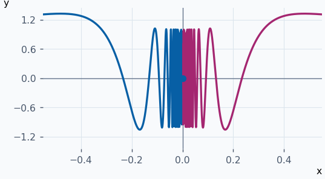
:::

::: ejemplo Ejemplo 2 · Derivadas de un polinomio
Para \(f(x)=x³−2x\), \(f′(x)=3x²−2\), \(f″(x)=6x\), \(f‴(x)=6\) y las siguientes valen cero. Todas son continuas. En la gráfica, la recta de \(f″\) cambia de signo en \(0\).

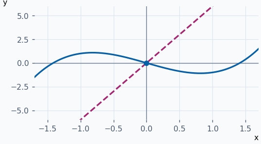
:::

::: ejemplo Ejemplo 3 · Ciclo de cuatro derivadas del seno
\(sen(x) → cos(x) → −sen(x) → −cos(x) → sen(x)\). Cada bloque de cuatro derivaciones recupera la función inicial. En particular, \(f^{(6)}=−sen(x)\).

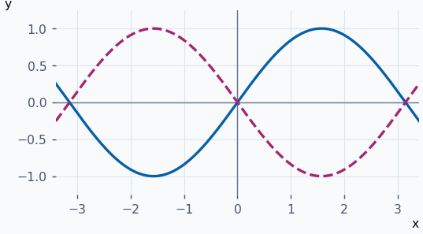
:::

::: ejemplo Ejemplo 4 · Una función de clase uno pero no de clase dos
Para \(f(x)=x∣x∣\), \(f′(x)=2∣x∣\) para \(x≠0\). En \(0\), el cociente vale \(∣h∣→0\) y la misma fórmula da \(f′(0)=0\). La derivada es continua pero angulosa en cero: los cocientes de \(f′\) son \(−2\) y \(2\), así que \(f″(0)\) no existe.

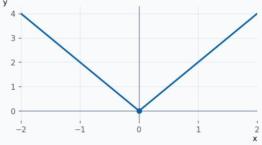
:::

**Ejercicios para resolver**

**1.** Halla las derivadas hasta orden cuatro de \(x⁴−3x²\).

::: solucion
\(4x³−6x\), \(12x²−6\), \(24x\) y \(24\).
:::

**2.** Halla \(f^{(n)}(x)\) para \(f(x)=e^{2x}\).

::: solucion
Cada derivación introduce un factor \(2\). Por inducción \(f^{(n)}(x)=2ⁿe^{2x}\).
:::

**3.** Calcula la séptima derivada de \(cos(x)\).

::: solucion
El ciclo es \(cos,−sen,−cos,sen\) y se repite. Como \(7=4+3\), queda \(sen(x)\).
:::

**4.** Estudia si \(f(x)=∣x∣³\) es \(C²\) en \((−1,1)\).

::: solucion
Para \(x≠0\) resulta \(f′(x)=3x∣x∣\) y \(f″(x)=6∣x∣\). En \(0\) el cociente de \(f\) tiende a \(0\) y el de \(f′\) es \(3∣h∣→0\). La fórmula \(f″(x)=6∣x∣\) vale también en cero y es continua.
:::

## Polinomio de Taylor y fórmula de Maclaurin {#construccion-taylor}

El polinomio de Taylor de orden \(n\) de \(f\) centrado en \(x₀\) es

\(Tₙ(f,x₀)(x)=f(x₀)+\frac{f′(x₀)}{1!}(x−x₀)+\frac{f″(x₀)}{2!}(x−x₀)²+⋯+\frac{f^{(n)}(x₀)}{n!}(x−x₀)ⁿ\)

Se toma \(0!=1\). Al derivar \(k\) veces y evaluar en el centro, las potencias menores que \(k\) ya desaparecieron y las mayores se anulan en \(x₀\). Solo queda \(k!\) multiplicando el coeficiente de \((x−x₀)ᵏ\). Esto prueba \(Tₙ^{(k)}(x₀)=f^{(k)}(x₀)\) para \(0≤k≤n\) y determina el único polinomio de grado a lo sumo \(n\) con esas coincidencias.

Para calcularlo, fija el centro y el orden, deriva hasta ese orden y evalúa las derivadas en el centro. Divide cada valor por su factorial y multiplícalo por la potencia correspondiente. Cuando \(x₀=0\), la fórmula es la de **Maclaurin** y las potencias son \(1,x,x²,…,xⁿ\).

**Ejemplos resueltos**

::: original Ejemplo del PDF · Maclaurin de la raíz hasta orden cuatro
Para \(f(x)=√(1+x)\), los valores \(f(0)\) a \(f^{(4)}(0)\) son \(1\), \(1/2\), \(−1/4\), \(3/8\) y \(−15/16\). Al dividir por los factoriales queda \(T₄(x)=1+x/2−x²/8+x³/16−5x⁴/128\). El polinomio de orden dos da \(√1,02≈T₂(0,02)=1,00995\).

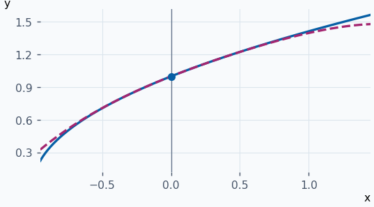
:::

::: ejemplo Ejemplo 2 · Maclaurin de la exponencial
Todas las derivadas de \(eˣ\) valen \(1\) en cero. Por tanto \(T₃(x)=1+x+x²/2+x³/6\). La curva y el polinomio comparten altura, pendiente y las derivadas segunda y tercera en \((0,1)\).

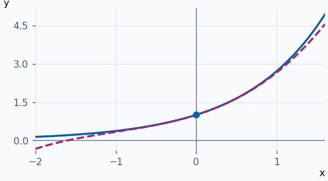
:::

::: ejemplo Ejemplo 3 · Taylor con centro desplazado
Para \(f(x)=1/x\) en \(x₀=1\), los valores \(f(1)=1\), \(f′(1)=−1\) y \(f″(1)=2\) dan \(T₂(x)=1−(x−1)+(x−1)²\). Ambas gráficas se acercan en torno a \(x=1\).

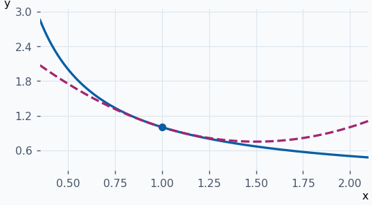
:::

::: ejemplo Ejemplo 4 · Coeficientes nulos por simetría
En \(f(x)=sen(x)\), \(f(0)=f″(0)=f^{(4)}(0)=0\), \(f′(0)=1\) y \(f‴(0)=−1\). Así \(T₄(x)=x−x³/6\), de grado tres. El seno y el polinomio son impares.

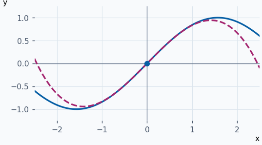
:::

**Ejercicios para resolver**

**1.** Halla el Maclaurin de orden cuatro de \(cos(x)\).

::: solucion
Los valores sucesivos son \(1,0,−1,0,1\). Queda \(1−x²/2+x⁴/24\).
:::

**2.** Halla el Taylor de orden dos de \(x³\) en \(x₀=1\).

::: solucion
\(f(1)=1\), \(f′(1)=3\), \(f″(1)=6\). Queda \(1+3(x−1)+3(x−1)²\).
:::

**3.** Halla el Taylor de orden tres de \(log(x)\) en \(x₀=1\).

::: solucion
Los valores de \(f,f′,f″,f‴\) en \(1\) son \(0,1,−1,2\). Queda \((x−1)−(x−1)²/2+(x−1)³/3\).
:::

**4.** Comprueba que \(T₂(x)=1+x+x²/2\) reproduce las tres condiciones de Taylor para \(eˣ\) en cero.

::: solucion
\(T₂(0)=1\), \(T₂′(0)=1\) y \(T₂″(0)=1\), iguales a los valores de la exponencial y sus dos primeras derivadas.
:::

## Resto de Lagrange y estimación del error {#resto-lagrange}

Si \(f ∈ C^{n+1}(a,b)\) y \(x₀,x ∈ (a,b)\) con \(x≠x₀\), existe algún \(c\) estrictamente entre \(x₀\) y \(x\) tal que

\(f(x)=Tₙ(f,x₀)(x)+Rₙ(f,x₀)(x)\)

\(Rₙ(f,x₀)(x)=\frac{f^{(n+1)}(c)}{(n+1)!}(x−x₀)^{n+1}\)

El resto es la diferencia exacta \(f(x)−Tₙ(f,x₀)(x)\). En \(x=x₀\) vale cero. En Maclaurin, \(x₀=0\) y \(c\) se encuentra entre \(0\) y \(x\), en el orden que corresponda al signo de \(x\).

| Para obtener… | Qué se necesita |
| --- | --- |
| Una cota de error | Si \(∣f^{(n+1)}(t)∣≤M\) entre el centro y la entrada, \(∣Rₙ∣≤M∣x−x₀∣^{n+1}/(n+1)!\). |
| Una cota superior para \(f(x)\) | Si el signo de \(Rₙ\) es negativo, \(f(x)<Tₙ(x)\). |
| Una cota inferior para \(f(x)\) | Si el signo de \(Rₙ\) es positivo, \(f(x)>Tₙ(x)\). |

**Ejemplos resueltos**

::: original Ejemplo del PDF · Desarrollo de log(1+x) y cota para log(2)
Para \(k≥1\), \(f^{(k)}(x)=(−1)^{k−1}(k−1)!/(1+x)ᵏ\). Por eso \(Tₙ(x)=x−x²/2+x³/3−⋯+(−1)^{n−1}xⁿ/n\) y \(Rₙ(x)=(−1)ⁿx^{n+1}/[(n+1)(1+c)^{n+1}]\). Al tomar \(x=1\), \(n=3\) y \(0<c<1\), se obtiene \(log(2)=5/6−1/[4(1+c)⁴]<5/6\).

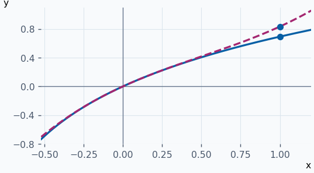
:::

::: ejemplo Ejemplo 2 · Aproximar un coseno con error acotado
Para \(cos(x)\), \(T₂(x)=1−x²/2\). Como \(∣f‴(t)∣=∣sen(t)∣≤1\), en \(x=0,2\) el error queda por debajo de \(0,2³/6≈0,00134\). El valor del polinomio es \(0,98\).

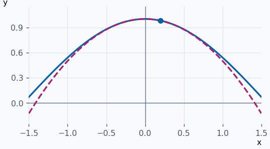
:::

::: ejemplo Ejemplo 3 · El signo del resto para la exponencial
Para \(eˣ\) y \(x>0\), la aproximación de orden uno es \(1+x\). El resto es \(eᶜx²/2>0\), luego \(eˣ>1+x\). Para \(x=1/2\), también \(R₁≤e^{1/2}/8\).

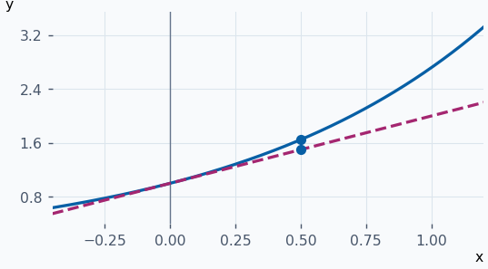
:::

::: ejemplo Ejemplo 4 · Cota del error de una raíz
Para \(f(x)=√(1+x)\), \(T₁=1+x/2\) y \(f″(t)=−1/[4(1+t)^{3/2}]\). En \(0≤t≤0,1\) su módulo no supera \(1/4\). Así \(0<1,05−√1,1≤0,1²/8=0,00125\). La tangente queda por encima.

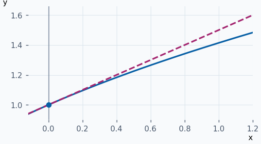
:::

**Ejercicios para resolver**

**1.** Acota el error de \(T₁(x)=x\) para \(sen(0,1)\).

::: solucion
\(∣f″(t)∣≤1\). Por Lagrange, \(∣sen(0,1)−0,1∣≤0,1²/2=0,005\).
:::

**2.** Prueba que \(log(1+x)<x\) para \(x>0\) usando el resto de orden uno.

::: solucion
\(T₁(x)=x\) y \(R₁(x)=−x²/[2(1+c)²]<0\).
:::

**3.** Acota el error de \(T₂(0,1)\) para \(e^{0,1}\).

::: solucion
Para \(0≤t≤0,1\) la tercera derivada es \(eᵗ≤e^{0,1}\). El error es positivo y vale como máximo \(e^{0,1}·0,1³/6\).
:::

**4.** Demuestra que \(T₂\) reproduce \(f(x)=x²−3x\) exactamente en cualquier centro.

::: solucion
La tercera derivada es cero en todo punto. El resto de orden dos se anula para cada \(x\).
:::
