# 1.7 Optimización

[Apuntes de Manuel José Fernández · pp. 47–52](apuntes-originales.pdf)

## Valor medio de Lagrange y monotonía {#valor-medio}

Si \(f\) es continua en \([a,b]\) y derivable en \((a,b)\), existe al menos un \(c∈(a,b)\) tal que

\(f′(c)=\frac{f(b)−f(a)}{b−a}\)

La tangente en \((c,f(c))\) es paralela a la secante entre \((a,f(a))\) y \((b,f(b))\). Para demostrarlo, resta a \(f\) la recta secante \(r(x)=f(a)+[f(b)−f(a)](x−a)/(b−a)\). La diferencia \(f−r\) vale cero en ambos extremos. Rolle da \((f−r)′(c)=0\), de donde \(f′(c)=r′(c)\).

Si \(x₁<x₂\) están en un intervalo \(I\) donde \(f\) es derivable, el valor medio da \(f(x₂)−f(x₁)=f′(c)(x₂−x₁)\) para algún \(c\) intermedio.

| Signo de \(f′\) en todo \(I\) | Comportamiento |
| --- | --- |
| \(f′>0\) | Estrictamente creciente. |
| \(f′<0\) | Estrictamente decreciente. |
| \(f′=0\) | Constante. |
| \(f′≥0\) o \(f′≤0\) | Creciente o decreciente en sentido no estricto, respectivamente. |

El recíproco estricto puede fallar: \(x³\) crece estrictamente, aunque su derivada se anula en \(0\). Si \(f′=g′\) en un intervalo, \((f−g)′=0\) allí y las funciones difieren en una constante.

**Ejemplos resueltos**

::: ejemplo Ejemplo 1 · Secante y tangente paralelas
Para \(f(x)=x²\) en \([0,2]\), la secante \(y=2x\) tiene pendiente \(2\). Resolver \(2c=2\) da \(c=1\). Su tangente es \(y=2x−1\), paralela a la secante.

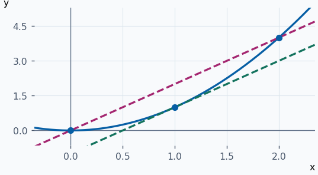
:::

::: ejemplo Ejemplo 2 · Valor medio para una función decreciente
Para \(f(x)=1/x\) en \([1,4]\), la pendiente media es \((1/4−1)/3=−1/4\). Como \(f′(x)=−1/x²\), la igualdad se cumple en \(c=2\). Allí la tangente es \(y=1−x/4\).

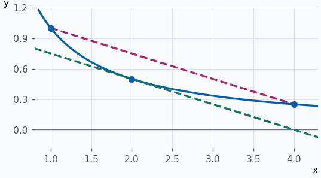
:::

::: ejemplo Ejemplo 3 · Separar intervalos por el signo de la derivada
Para \(f(x)=x³−3x\), \(f′(x)=3(x−1)(x+1)\). Es positiva fuera de \([−1,1]\) y negativa dentro. Por tanto la gráfica sube hasta \(−1\), baja hasta \(1\) y vuelve a subir.

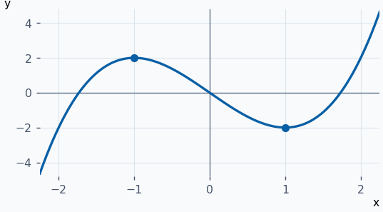
:::

**Ejercicios para resolver**

**1.** Halla un punto de valor medio para \(x³\) en \([0,2]\).

::: solucion
La pendiente media es \(4\). Resolver \(3c²=4\) dentro de \((0,2)\) da \(c=2/√3\).
:::

**2.** Estudia dónde crece o decrece \(f(x)=4−x²\).

::: solucion
\(f′(x)=−2x\) es positiva para \(x<0\) y negativa para \(x>0\). Crece en \((−∞,0)\) y decrece en \((0,+∞)\).
:::

**3.** Si \(f′=g′\) en \((0,3)\) y \(f(1)−g(1)=5\), halla \(f(2)−g(2)\).

::: solucion
La derivada de la diferencia vale cero en el intervalo, así que la diferencia es constante. Su valor es \(5\).
:::

**4.** ¿Puede aplicarse el teorema a \(∣x∣\) en \([−1,1]\)?

::: solucion
Es continua pero no es derivable en \(0\). La pendiente media es cero y ninguna derivada existente en el interior vale cero.
:::

## Extremos y criterio de la derivada primera {#criterios-optimizacion}

Sea \(c∈D=Dom f\). Hay un **máximo local** en \(c\) si existe \(δ>0\) tal que \(f(x)≤f(c)\) para todo \(x∈D∩(c−δ,c+δ)\). Para un **mínimo local** se invierte la desigualdad. Un **máximo absoluto** satisface \(f(x)≤f(c)\) para todo \(x∈D\). Para un **mínimo absoluto**, \(f(x)≥f(c)\) en todo el dominio. Un extremo absoluto también es local.

**Condición necesaria de extremo.** Si \(c\) es interior al dominio y hay un extremo local, entonces \(f′(c)=0\) o no existe. En efecto, si hay un máximo, \(f(c+h)−f(c)≤0\) a ambos lados. Al dividir por \(h\), los cocientes son no positivos a la derecha y no negativos a la izquierda. Si coinciden sus límites, valen cero. Para un mínimo se invierten los signos. Se llaman **puntos críticos interiores** las entradas con derivada nula o inexistente.

| Signo de \(f′\) a la izquierda | Signo a la derecha | Si \(f\) es continua en \(c\) |
| --- | --- | --- |
| \(+\) | \(−\) | Máximo local. |
| \(−\) | \(+\) | Mínimo local. |
| \(+\) | \(+\) | La función sigue creciendo, sin extremo. |
| \(−\) | \(−\) | La función sigue decreciendo, sin extremo. |

Se presupone que el signo indicado vale en un intervalo lateral suficientemente pequeño. La continuidad en \(c\) permite extender la comparación desde cada lado hasta el valor \(f(c)\).

**Ejemplos resueltos**

::: original Ejemplo del PDF · Dos mínimos y un máximo local
\(f(x)=∣x²−1∣\) vale \(x²−1\) fuera de \([−1,1]\) y \(1−x²\) dentro. Sus críticos son \(−1\), \(0\) y \(1\). De izquierda a derecha, el signo de \(f′\) es \(−,+,−,+\). En \(±1\) hay mínimos absolutos de valor \(0\); en \(0\) hay máximo local de valor \(1\). La función tiende a \(+∞\) en ambos extremos y no tiene máximo absoluto.

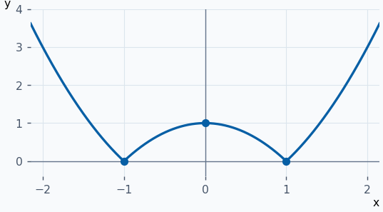
:::

::: ejemplo Ejemplo 2 · Mínimo en un punto sin derivada
\(f(x)=∣x+1∣+2\) tiene pendientes \(−1\) y \(1\) a los lados de \(−1\). Es continua allí, por lo que tiene un mínimo local y absoluto de altura \(2\).

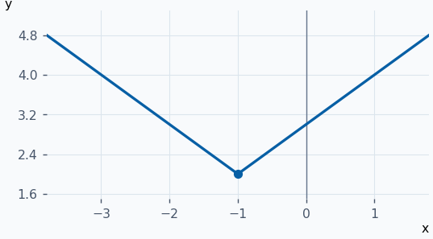
:::

::: ejemplo Ejemplo 3 · Un crítico donde se conserva el signo
Para \(f(x)=(x−1)³\), \(f′(x)=3(x−1)²\). Es positiva a ambos lados de \(1\), aunque vale cero en \(1\). La función sigue creciendo a través de la tangente horizontal y no hay extremo.

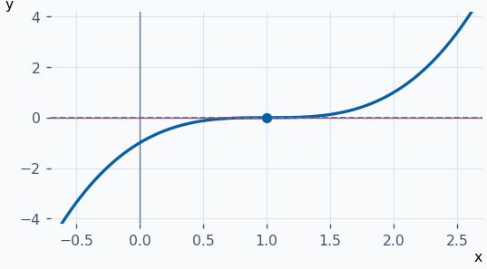
:::

::: ejemplo Ejemplo 4 · Máximo de una exponencial compuesta
Para \(f(x)=e^{−x²}\), \(f′(x)=−2x·e^{−x²}\). Es positiva para \(x<0\) y negativa para \(x>0\). En \(0\) se alcanza el máximo absoluto \(1\). La imagen es \((0,1]\), así que el ínfimo \(0\) no es un mínimo.

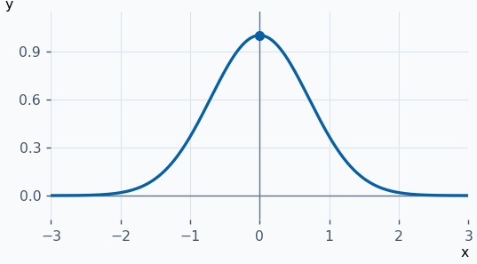
:::

**Ejercicios para resolver**

**1.** Halla los extremos de \(x³−3x\).

::: solucion
\(f′(x)=3(x−1)(x+1)\). Los signos son \(+,−,+\). Máximo local \(2\) en \(−1\) y mínimo local \(−2\) en \(1\). No hay extremos absolutos en \(ℝ\).
:::

**2.** Clasifica el punto \(x=2\) de \(−∣x−2∣\).

::: solucion
La derivada cambia de \(1\) a \(−1\). La función es continua en \(2\), donde alcanza su máximo absoluto \(0\).
:::

**3.** Encuentra los críticos y la monotonía de \(x⁴−2x²\).

::: solucion
\(f′(x)=4x(x−1)(x+1)\). Los críticos son \(−1,0,1\) y los signos de izquierda a derecha son \(−,+,−,+\). Hay mínimos en \(±1\) y máximo local en \(0\).
:::

**4.** ¿Puede \(c=0\) ser mínimo local de \(f(x)=x\) en \([0,1]\) aunque la pendiente sea \(1\)?

::: solucion
Sí, \(f(0)≤f(x)\) en todo el dominio. La condición necesaria con derivada nula se refiere a puntos interiores.
:::

## Criterios de la segunda derivada y de orden superior {#derivadas-superiores}

Sea \(f\) de clase \(Cⁿ\) en un intervalo abierto que contiene \(c\), con \(n≥2\). Supón que \(f′(c)=f″(c)=⋯=f^{(n−1)}(c)=0\) y \(f^{(n)}(c)≠0\). Cerca de \(c\), el signo de \(f(x)−f(c)\) viene dado por el primer término no nulo de Taylor, de signo igual al de \(f^{(n)}(c)(x−c)ⁿ\). Se aplica Taylor de orden \(n−1\) con resto y se usa que \(f^{(n)}\) es continua, por lo que mantiene su signo cerca de \(c\).

| Primera derivada no nula después de \(f(c)\) | Conclusión |
| --- | --- |
| Orden par, valor positivo | Mínimo local. |
| Orden par, valor negativo | Máximo local. |
| Orden impar | Cambia el signo de \(f(x)−f(c)\), sin extremo. |

Para \(n=2\), se requiere \(f′(c)=0\). Entonces \(f″(c)>0\) da mínimo y \(f″(c)<0\) da máximo. Si \(f″(c)=0\), la prueba no decide. Se puede examinar el siguiente orden o usar los signos de \(f′\).

**Ejemplos resueltos**

::: original Ejemplo del PDF · Dos críticos, dos órdenes de derivación
Para \(f(x)=(x−3)⁴(x−1)\), \(f′(x)=(x−3)³(5x−7)\) se anula en \(3\) y \(7/5\). Se tiene \(f″(x)=(x−3)²(20x−36)\), por lo que \(f″(7/5)<0\) y hay máximo local de valor \(8192/3125≈2,62\). En \(3\), \(f″(3)=f‴(3)=0\) y \(f^{(4)}(3)=48>0\), de modo que hay un mínimo local de valor cero.

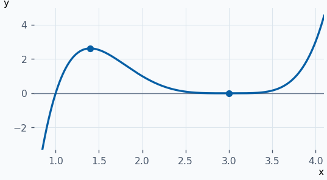
:::

::: ejemplo Ejemplo 2 · Mínimo con derivada segunda positiva
Para \(f(x)=x²+2x+3\), \(f′(x)=2x+2\) se anula en \(−1\). Como \(f″=2>0\), hay mínimo local. Completando el cuadrado, \(f=(x+1)²+2\), se ve que también es absoluto.

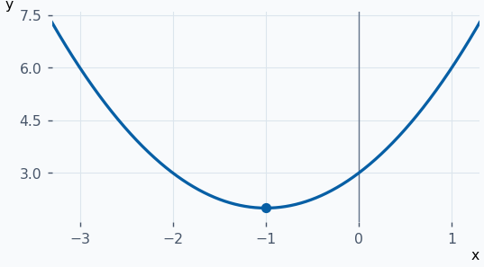
:::

::: ejemplo Ejemplo 3 · Máximo de cuarto orden
Para \(f(x)=2−(x−1)⁴\), en \(1\) se anulan las tres primeras derivadas. La cuarta vale \(−24\). Al ser un orden par con signo negativo, \((1,2)\) es un máximo local.

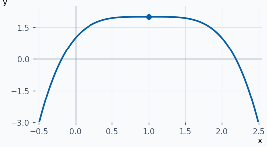
:::

::: ejemplo Ejemplo 4 · Un orden impar sin extremo
Para \(f(x)=1+(x+1)⁵\), la primera derivada no nula en \(−1\) es la quinta, que vale \(120\). El término de orden impar cambia de signo al atravesar \(−1\), así que la curva cruza la altura \(1\).

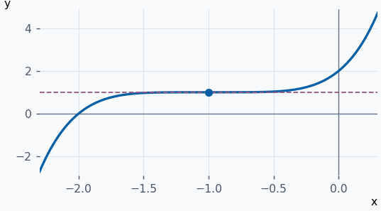
:::

**Ejercicios para resolver**

**1.** Clasifica \(x=0\) para \(f(x)=x⁴\).

::: solucion
Las derivadas de órdenes uno, dos y tres valen cero. La cuarta vale \(24>0\), así que hay mínimo.
:::

**2.** Clasifica los puntos críticos de \(f(x)=−x²+4x\).

::: solucion
\(f′(x)=−2x+4\) se anula en \(2\). Como \(f″=−2\), hay un máximo en \(2\) de valor \(4\).
:::

**3.** Estudia el crítico de \(f(x)=x³+1\) en cero con derivadas sucesivas.

::: solucion
\(f′(0)=f″(0)=0\) y \(f‴(0)=6\). El orden tres es impar, así que no hay extremo.
:::

**4.** Clasifica el punto \(x=2\) de \(1−(x−2)⁶\).

::: solucion
Las primeras cinco derivadas se anulan en \(2\) y la sexta vale \(−6!\). Hay máximo local de valor \(1\).
:::

## Extremos absolutos en intervalos cerrados {#extremos-intervalo}

Si \(f\) es continua en \([a,b]\), Weierstrass garantiza que alcanza máximo y mínimo absolutos. Para encontrarlos:

1. Resuelve \(f′(x)=0\) para \(x∈(a,b)\).
2. Incluye los puntos interiores donde \(f\) está definida y \(f′\) no existe.
3. Añade los extremos \(a,b\). En estos apuntes también se llaman críticos de frontera.
4. Evalúa \(f\) en los candidatos. La menor y la mayor altura son los extremos absolutos. Registra todos los puntos que los alcanzan.

Para extremos locales en la frontera, compara con los puntos cercanos **dentro** del dominio. Si el intervalo es abierto o la continuidad falla, la garantía de Weierstrass deja de ser aplicable.

**Ejemplos resueltos**

::: original Ejemplo del PDF · Comparar un crítico interior y dos fronteras
En \([0,5]\), \(f(x)=x³−3x²+7\) es continua y \(f′(x)=3x(x−2)\). El crítico interior es \(2\). Los valores de los candidatos son \(f(0)=7\), \(f(2)=3\) y \(f(5)=57\). El mínimo absoluto es \(3\) en \(2\) y el máximo absoluto \(57\) en \(5\). El punto \(0\) es máximo local de frontera porque la función empieza decreciendo.

![Cúbica sobre \[0,5\] con puntos marcados en (0,7), (2,3) y (5,57).](graficas/extremos-intervalo-1.png)
:::

::: ejemplo Ejemplo 2 · Un punto no derivable entre los candidatos
\(f(x)=∣x−1∣\) en \([−1,2]\) es continua. Se comparan \(f(−1)=2\), \(f(1)=0\) y \(f(2)=1\). El máximo absoluto está en \(−1\) y el mínimo en el vértice \(1\), donde no hay derivada.

![V restringida a \[−1,2\], con vértice y fronteras marcados.](graficas/extremos-intervalo-2.png)
:::

::: ejemplo Ejemplo 3 · Dos fronteras con la misma altura
Para \(f(x)=x²\) en \([−2,2]\), el candidato interior es \(0\). Como \(f(−2)=f(2)=4\) y \(f(0)=0\), el máximo se alcanza en ambas fronteras y el mínimo en \(0\).

![Parábola restringida a \[−2,2\] con dos extremos cerrados a altura 4.](graficas/extremos-intervalo-3.png)
:::

::: ejemplo Ejemplo 4 · Una parábola sin críticos interiores
Para \(f(x)=(x−3)²\) en \([0,2]\), \(f′(x)=2(x−3)<0\) en todo el interior. El candidato \(3\) queda fuera. Al comparar \(f(0)=9\) y \(f(2)=1\) se obtiene máximo en \(0\) y mínimo en \(2\).

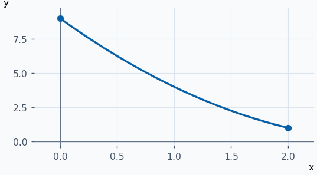
:::

**Ejercicios para resolver**

**1.** Halla los extremos absolutos de \(x²−2x\) en \([−1,3]\).

::: solucion
Se evalúa en \(−1,1,3\) y se obtiene \(3,−1,3\). Mínimo \(−1\) en \(1\) y máximo \(3\) en las dos fronteras.
:::

**2.** Halla los extremos de \(x³\) en \([−1,2]\).

::: solucion
El candidato interior es \(0\), con valor \(0\). Al comparar con \(−1\) y \(8\), se obtiene mínimo en \(−1\) y máximo en \(2\).
:::

**3.** Halla los extremos de \(∣x+2∣\) en \([−4,1]\).

::: solucion
Candidatos \(−4,−2,1\), con valores \(2,0,3\). Mínimo en \(−2\) y máximo en \(1\).
:::

**4.** Halla los extremos absolutos de \(2x−x²\) en \([0,3]\).

::: solucion
\(f′=2−2x\) se anula en \(1\). Los valores en \(0,1,3\) son \(0,1,−3\). Máximo \(1\) en \(1\) y mínimo \(−3\) en \(3\).
:::

## Concavidad y puntos de inflexión {#concavidad}

Para cualquier \(a<b\) de un intervalo \(I\), considera la cuerda entre \((a,f(a))\) y \((b,f(b))\). Si la cuerda queda por encima de la gráfica entre \(a\) y \(b\), \(f\) es **cóncava hacia arriba**. Si queda por debajo, es **cóncava hacia abajo**. En una entrada \(t=(1−λ)a+λb\), \(0≤λ≤1\), la altura de la cuerda es \((1−λ)f(a)+λf(b)\).

| Signo de \(f″\) en un intervalo abierto | Concavidad |
| --- | --- |
| \(f″>0\) | Hacia arriba. |
| \(f″<0\) | Hacia abajo. |

La segunda derivada positiva hace que \(f′\) sea creciente, por lo que las pendientes de las cuerdas consecutivas aumentan. La negativa hace que disminuyan. Hay **inflexión** en un punto interior \(c\) del dominio si la concavidad es de un sentido en \((c−δ,c)\) y del contrario en \((c,c+δ)\). Si hay una inflexión, \(f″(c)\) vale cero o no existe. Para localizarla, examina los signos de \(f″\) a ambos lados. Un cero sin cambio de signo puede ser un punto ordinario de la misma concavidad.

**Criterio de orden superior.** Si \(f ∈ Cⁿ\) cerca de \(c\), \(f″(c)=f‴(c)=⋯=f^{(n−1)}(c)=0\) y \(f^{(n)}(c)≠0\) con \(n≥3\) impar, hay inflexión. Se aplica Taylor a \(f″\). El término que determina su signo tiene exponente \(n−2\), impar, así que cambia de signo al cruzar \(c\).

**Ejemplos resueltos**

::: original Ejemplo del PDF · Extremo e inflexiones de un polinomio
Para \(f(x)=x³(x−1)\), \(f′(x)=x²(4x−3)\) y \(f″(x)=6x(2x−1)\). En \(0\) la derivada primera conserva signo negativo, y en \(3/4\) cambia de negativa a positiva, dando un mínimo de valor \(−27/256\). La segunda es positiva para \(x<0\) y \(x>1/2\) y negativa para \(0<x<1/2\). Hay inflexiones en \((0,0)\) y \((1/2,−1/16)\).

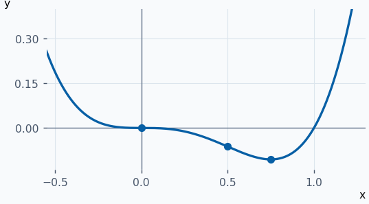
:::

::: ejemplo Ejemplo 2 · Cuerda sobre una parábola
Para \(f(x)=x²\), \(f″=2>0\). En \([−1,1]\), la cuerda que une ambos extremos tiene altura \(1\) y la gráfica queda por debajo entre ellos. Esto ilustra la concavidad hacia arriba.

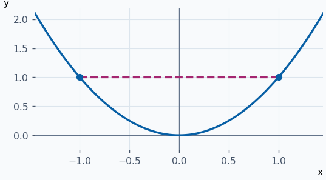
:::

::: ejemplo Ejemplo 3 · Cero de la segunda derivada sin inflexión
Para \(f(x)=x⁴\), \(f″(x)=12x²\). Se anula en \(0\), pero es positiva a ambos lados, así que no hay cambio de concavidad.

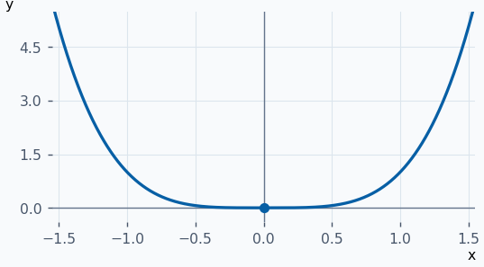
:::

::: ejemplo Ejemplo 4 · Inflexión de quinto orden
Para \(f(x)=(x−1)⁵\), en \(1\) se anulan las derivadas segunda, tercera y cuarta, y la quinta vale \(120\). La segunda es \(20(x−1)³\), negativa a la izquierda y positiva a la derecha. Hay inflexión en \((1,0)\).

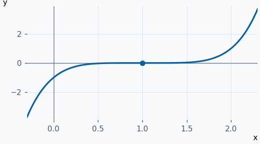
:::

**Ejercicios para resolver**

**1.** Estudia la concavidad de \(f(x)=x³\).

::: solucion
\(f″(x)=6x\). Es cóncava hacia abajo en \((−∞,0)\) y hacia arriba en \((0,+∞)\). Hay inflexión en \((0,0)\).
:::

**2.** Halla las inflexiones de \(f(x)=x⁴−2x²\).

::: solucion
\(f″(x)=12x²−4\) se anula en \(x=±1/√3\), con signo negativo entre ellos y positivo fuera. Hay dos inflexiones, ambas a altura \(−5/9\).
:::

**3.** Clasifica la concavidad de \(log(x)\) para \(x>0\).

::: solucion
\(f″(x)=−1/x²<0\). Es cóncava hacia abajo en \((0,+∞)\) y no tiene inflexiones.
:::

**4.** ¿Es \(x=0\) una inflexión de \(f(x)=∛x\)?

::: solucion
Para \(x≠0\), \(f″(x)=−2/[9(∛x)⁵]\). Es positiva para \(x<0\) y negativa para \(x>0\). La concavidad cambia y \((0,0)\) es un punto de inflexión.
:::
