# 1.8 Operaciones con límites de funciones

[Apuntes de Manuel José Fernández · p. 1](apuntes-originales.pdf)

Esta unidad amplía [1.3 Límites de funciones](?u=calculo%2Flimites). Primero calcula los límites de las piezas y luego comprueba si cumplen las hipótesis de la operación que las une.

## Operaciones con límites finitos {#operaciones-finitas}

Supón que \(lim_{x→c} f(x)=l\) y \(lim_{x→c} g(x)=m\), con \(l,m∈ℝ\). En el PDF, \(c\) puede ser un número real, \(+∞\) o \(−∞\). Las reglas también se aplican por separado a cada límite lateral, en el dominio común de las funciones.

| Operación | Límite | Condición adicional |
| --- | --- | --- |
| Suma | \(lim_{x→c}[f(x)+g(x)]=l+m\) | — |
| Resta | \(lim_{x→c}[f(x)−g(x)]=l−m\) | — |
| Multiplicación por constante | \(lim_{x→c}[a·f(x)]=a·l\) | \(a∈ℝ\) |
| Producto | \(lim_{x→c}[f(x)g(x)]=l·m\) | — |
| Recíproco | \(lim_{x→c}\frac{1}{g(x)}=\frac{1}{m}\) | \(m≠0\) |
| Cociente | \(lim_{x→c}\frac{f(x)}{g(x)}=\frac{l}{m}\) | \(m≠0\) |

**Por qué funcionan.** El error de una suma se acota con la suma de los errores. En el producto, \(f(x)\) permanece acotada cerca de \(c\) porque su límite es finito. Al descomponer el error, los dos términos se acercan a cero:

\(f(x)g(x)−lm=f(x)[g(x)−m]+m[f(x)−l]\)

Si \(m≠0\), cerca del punto de aproximación se cumple \(∣g(x)−m∣<∣m∣/2\) y por tanto \(∣g(x)∣>∣m∣/2\). El denominador no se anula allí y la diferencia entre recíprocos tiende a cero:

\(\frac{1}{g(x)}−\frac{1}{m}=\frac{m−g(x)}{m·g(x)}\)

El cociente se obtiene multiplicando \(f\) por el recíproco de \(g\). Que la función esté definida exactamente en \(c\) no es necesario para calcular el límite.

**Ejemplos resueltos**

::: ejemplo Ejemplo 1 · Restar y multiplicar por una constante
Para \(x→1\), toma \(f(x)=x^{2}\) y \(g(x)=x+1\). Sus límites son \(1\) y \(2\).

\(lim_{x→1}[3f(x)−g(x)]=3·1−2=1\)

La curva de \(3x^{2}−x−1\) se acerca al punto marcado \((1,1)\).

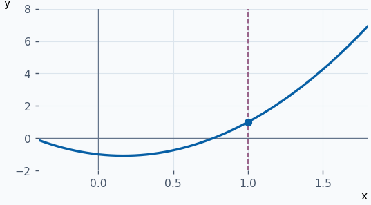
:::

::: ejemplo Ejemplo 2 · Producto con un factor negativo
Al acercarse \(x\) a \(0\), los factores \(x+2\) y \(x−3\) tienden a \(2\) y \(−3\).

\(lim_{x→0}[(x+2)(x−3)]=2·(−3)=−6\)

La gráfica del producto pasa por \((0,−6)\).

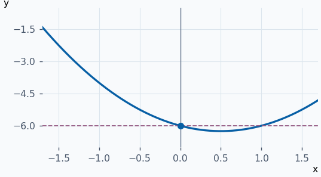
:::

::: ejemplo Ejemplo 3 · Dividir dos funciones con límites finitos en el infinito
Con \(x→+∞\), escribe el cociente como \(\frac{2+1/x}{3−1/x}\). El numerador tiende a \(2\) y el denominador a \(3≠0\).

\(lim_{x→+∞}\frac{2x+1}{3x−1}=\frac{2}{3}\)

La rama derecha se acerca a la horizontal \(y=2/3\).

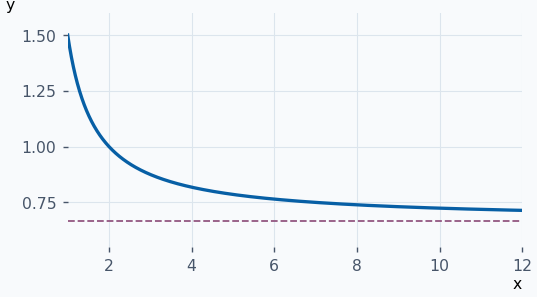
:::

**Ejercicios para resolver**

**1.** Calcula \(lim_{x→2}(4x−x^{2}+1)\).

::: solucion
Por las reglas de escala, resta y suma, \(4·2−2^{2}+1=5\).
:::

**2.** Calcula \(lim_{x→−1}[(x−2)(x^{2}+1)]\).

::: solucion
Los factores tienden a \(−3\) y \(2\). El producto tiende a \(−6\).
:::

**3.** Calcula \(lim_{x→0}\frac{1}{x^{2}+4}\).

::: solucion
El denominador tiende a \(4≠0\). Por la regla del recíproco, el límite es \(1/4\).
:::

**4.** Calcula \(lim_{x→−∞}\frac{5x^{2}−1}{2x^{2}+x}\).

::: solucion
Divide ambos polinomios por \(x^{2}\). Queda \(\frac{5−1/x^{2}}{2+1/x}\). Sus partes tienden a \(5\) y \(2≠0\), así que el límite vale \(5/2\).
:::

## Cocientes con denominador que tiende a cero {#denominador-cero}

El PDF usa \(0^{+}\) y \(0^{−}\) para indicar que **los valores del denominador** tienden a cero manteniendo signo positivo o negativo, respectivamente. Estos signos no son el lado de aproximación de \(x\). Por ejemplo, si \(x→0^{-}\), tanto \(x\) como \(x^{2}\) se acercan a cero, pero sus signos son opuestos.

Con \(l≠0\) y \(g(x)→0\), la magnitud del cociente se dispara: el numerador cumple \(∣f(x)∣>∣l∣/2\) cerca de \(c\), mientras que el denominador no nulo puede hacerse arbitrariamente pequeño. El signo se decide así:

| Límite del numerador | Denominador \(→0^{+}\) | Denominador \(→0^{−}\) |
| --- | --- | --- |
| \(l>0\) | \(+∞\) | \(−∞\) |
| \(l<0\) | \(−∞\) | \(+∞\) |

Si \(g\) cambia de signo, estudia los laterales o los caminos de aproximación del dominio por separado. Si los dos laterales son infinitos de signos opuestos, el límite bilateral no existe, aunque el valor absoluto tienda a \(+∞\). Si también \(l=0\), la forma \(0/0\) es indeterminada: hay que simplificar o aplicar otro método.

**Ejemplos resueltos**

::: ejemplo Ejemplo 1 · Dos laterales, dos signos
En \(\frac{2+x}{x}\), el numerador tiende a \(2>0\). Al ir por la izquierda, \(x→0^{-}\) y el cociente tiende a \(−∞\). Por la derecha tiende a \(+∞\).

La recta \(x=0\) es una asíntota vertical; las ramas suben o bajan en direcciones opuestas. No hay límite bilateral.

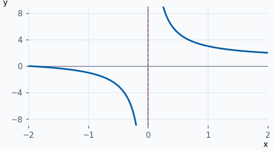
:::

::: ejemplo Ejemplo 2 · Cero positivo por los dos lados
En \(\frac{−1}{(x−1)^{2}}\), el cuadrado es positivo para \(x≠1\) y se acerca a cero a ambos lados. Dividir el numerador negativo por ese valor hace que ambos laterales tiendan a \(−∞\).

\(lim_{x→1}\frac{−1}{(x−1)^{2}}=−∞\)

Las dos ramas bajan al acercarse a \(x=1\).

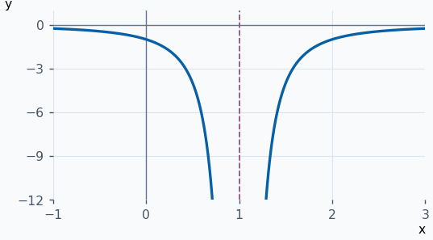
:::

::: ejemplo Ejemplo 3 · Aproximación por la izquierda con numerador negativo
Para \(x→2^{-}\), en \(\frac{1−x}{x−2}\) el numerador tiende a \(−1\) y el denominador a \(0^{-}\).

\(lim_{x→2^{-}}\frac{1−x}{x−2}=+∞\)

La rama representada queda a la izquierda de \(2\) y crece al acercarse a la asíntota. El signo positivo resulta de dividir dos cantidades negativas cerca de \(2\).

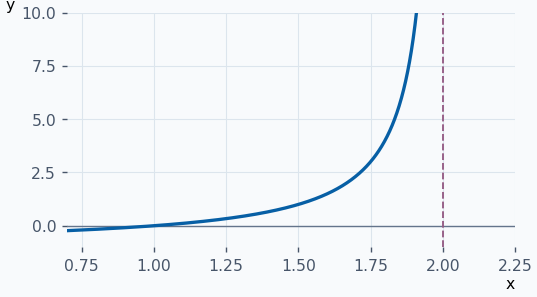
:::

**Ejercicios para resolver**

**1.** Calcula los dos límites laterales de \(4/(x+1)\) en \(−1\).

::: solucion
El numerador es positivo. A la izquierda \(x+1→0^{-}\), así que el límite es \(−∞\). A la derecha \(x+1→0^{+}\) y el límite es \(+∞\).
:::

**2.** Calcula \(lim_{x→3}\frac{2}{(x−3)^{4}}\).

::: solucion
El denominador se acerca a \(0^{+}\) desde ambos lados. Como el numerador es \(2>0\), el límite vale \(+∞\).
:::

**3.** Calcula \(lim_{x→0^{+}}\frac{x−1}{−x}\).

::: solucion
El numerador tiende a \(−1\) y el denominador a \(0^{-}\). El cociente es positivo cerca de cero y tiende a \(+∞\).
:::

**4.** Calcula \(lim_{x→1}\frac{x^{2}−1}{x−1}\) y explica por qué no se puede usar la tabla de signos.

::: solucion
Numerador y denominador tienden a cero. Para \(x≠1\), factoriza y cancela: \(\frac{(x−1)(x+1)}{x−1}=x+1\). El límite es \(2\).
:::

## Sumas, productos y cocientes con infinitos {#operaciones-infinitos}

En las tablas del PDF, expresiones como \((+∞)+l\) son **abreviaturas de reglas de límites**. Las entradas son los comportamientos de las funciones que se combinan. En esta sección, \(l\) denota un número finito.

| Suma | Resultado |
| --- | --- |
| \((+∞)+l\) o \((+∞)+(+∞)\) | \(+∞\) |
| \((−∞)+l\) o \((−∞)+(−∞)\) | \(−∞\) |

Un sumando que tiende a un número finito está acotado cerca de \(c\). Si el otro crece sin cota, esa contribución acotada no impide la divergencia. Para restar, cambia el signo del segundo término y usa las reglas de suma.

| Operación | Cuándo se aplica | Magnitud del resultado |
| --- | --- | --- |
| Producto | Un factor tiende a \(±∞\) y el otro a \(l≠0\) o a \(±∞\) | Tiende a \(+∞\) en valor absoluto |
| Cociente | Numerador \(→l≠0\) o \(→0^{±}\); denominador \(→±∞\) | Tiende a \(0\) |
| Cociente | Numerador \(→±∞\); denominador \(→l≠0\) o \(→0^{±}\) | Tiende a \(+∞\) en valor absoluto |

**Signos.** En cada producto o cociente de la tabla, signos iguales dan un resultado positivo y signos opuestos dan uno negativo. Si la magnitud tiende a cero, esto permite distinguir \(0^{+}\) de \(0^{−}\).

\((−∞)·l=+∞  si  l<0     \frac{0^{+}}{−∞}=0^{−}     \frac{−∞}{0^{−}}=+∞\)

En el producto, el factor con límite finito no nulo tiene una magnitud separada de cero; en el cociente con denominador infinito, su recíproco tiende a cero. Cuando la tabla no basta, reconoce la **indeterminación**: por ejemplo, \(∞−∞\), \(0·∞\) y \(∞/∞\) pueden dar resultados distintos según las funciones.

**Ejemplos resueltos**

::: ejemplo Ejemplo 1 · Una suma que conserva el infinito negativo
Cuando \(x→+∞\), \(−x→−∞\) y \(1/x→0\). El segundo término es acotado y no compensa al primero.

\(lim_{x→+∞}(−x+1/x)=−∞\)

La curva baja conforme avanza \(x\) hacia la derecha.

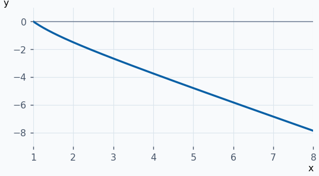
:::

::: ejemplo Ejemplo 2 · Producto de dos factores negativos
Cuando \(x→+∞\), \(−x^{2}→−∞\) y \(1/x−2→−2\). Los signos son iguales, de modo que el producto tiende a \(+∞\).

La expresión se puede comprobar multiplicando: \((−x^{2})(1/x−2)=2x^{2}−x\) para \(x>0\). Su curva sube en la rama derecha.

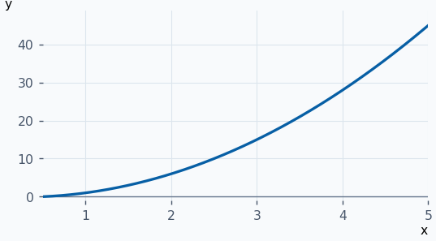
:::

::: ejemplo Ejemplo 3 · Cociente que se acerca a cero por debajo
Al crecer \(x\) hacia \(+∞\), \(−1/x→0^{-}\) y \(x+1→+∞\). El cociente es negativo y su magnitud disminuye.

\(\frac{−1/x}{x+1}=\frac{−1}{x(x+1)}→0^{-}\)

La curva se acerca al eje horizontal desde abajo.

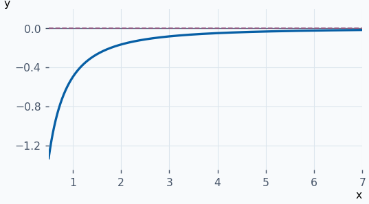
:::

**Ejercicios para resolver**

**1.** Calcula \(lim_{x→−∞}(x+\frac{2}{1+x^{2}})\).

::: solucion
El primer sumando tiende a \(−∞\) y el segundo a \(0\). Por la regla de suma con un término finito, el resultado es \(−∞\).
:::

**2.** Calcula \(lim_{x→0^{+}}[(−2+x)(1/x)]\).

::: solucion
El primer factor tiende a \(−2\); el segundo, a \(+∞\). Signos opuestos: el producto tiende a \(−∞\).
:::

**3.** Calcula \(lim_{x→−∞}\frac{−3}{x}\) e indica el signo de aproximación.

::: solucion
El numerador es negativo y \(x→−∞\). El cociente se acerca a \(0^{+}\).
:::

**4.** Calcula \(lim_{x→0^{-}}\frac{1/x}{x^{3}}\).

::: solucion
El numerador tiende a \(−∞\) y el denominador a \(0^{-}\). El cociente tiende a \(+∞\). Para \(x≠0\) equivale a \(1/x^{4}\).
:::

## Potencias con base positiva {#potencias-limites}

Escribe \(u(x)^{v(x)}\) con \(u(x)>0\) cerca del punto de aproximación. Los casos del PDF se leen a partir de \(u(x)^{v(x)}=e^{v(x)·log(u(x))}\), donde \(log\) es el logaritmo natural.

| Límite de la base \(u\) | Límite del exponente \(v\) | Límite de la potencia |
| --- | --- | --- |
| \(0<l<1\) | \(+∞\) | \(0^{+}\) |
| \(0<l<1\) | \(−∞\) | \(+∞\) |
| \(l>1\) | \(+∞\) | \(+∞\) |
| \(l>1\) | \(−∞\) | \(0^{+}\) |
| \(+∞\) | \(l>0\) o \(+∞\) | \(+∞\) |
| \(+∞\) | \(l<0\) o \(−∞\) | \(0^{+}\) |

Cuando \(u→l\) con \(0<l<1\), \(log(u)\) tiene un límite finito negativo; cuando \(l>1\), lo tiene positivo. Al multiplicarlo por un exponente infinito, la regla de signos fija si el exponente de \(e\) tiende a \(+∞\) o \(−∞\). Si \(u→+∞\), \(log(u)→+∞\) y basta que el exponente tienda a un valor positivo, negativo o infinito como en la tabla.

**Punto de interés.** Si \(u→1\) y \(v→±∞\), se obtiene un producto de tipo \(0·∞\) en el exponente; de ahí que \(1^{∞}\) sea una forma indeterminada. Con \(u→+∞\) y \(v→0\) ocurre algo análogo.

**Ejemplos resueltos**

::: ejemplo Ejemplo 1 · Una base menor que uno con exponente creciente
En \((1/2+1/x)^{x}\), para \(x>2\) la base es positiva y menor que \(1\). Tiende a \(1/2\) y el exponente a \(+∞\).

\(x·log(1/2+1/x)→−∞ ⇒ (1/2+1/x)^{x}→0^{+}\)

La curva se acerca al eje horizontal por arriba.

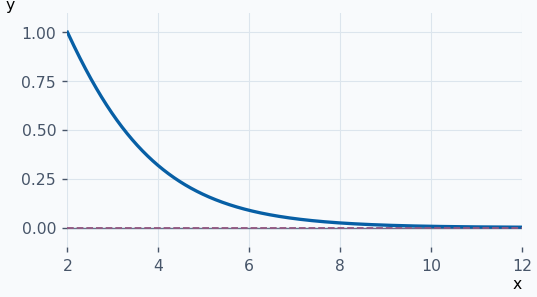
:::

::: ejemplo Ejemplo 2 · Base mayor que uno y exponente negativo infinito
Para \(x→+∞\), la base de \((2+1/x)^{−x}\) tiende a \(2\) y el exponente a \(−∞\). El logaritmo de la base tiende a \(log(2)>0\).

\((−x)·log(2+1/x)→−∞ ⇒ (2+1/x)^{−x}→0^{+}\)

La gráfica muestra el descenso hacia cero.

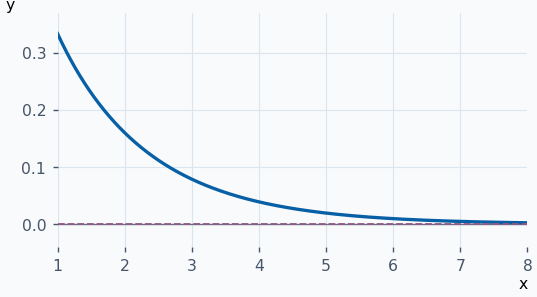
:::

::: ejemplo Ejemplo 3 · Base y exponente tienden a infinito positivo
En \(x^{√x}\), la base y el exponente se hacen arbitrariamente grandes cuando \(x→+∞\). Como \(√x·log(x)→+∞\), la potencia tiende a \(+∞\).

La curva crece cada vez más rápido en la ventana de la gráfica.

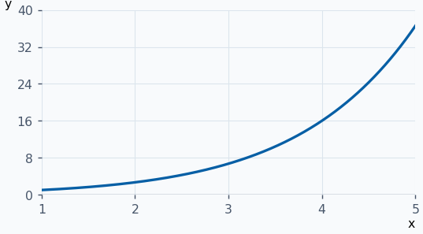
:::

**Ejercicios para resolver**

**1.** Calcula \(lim_{x→+∞}(1/3+1/x)^{−x}\).

::: solucion
La base tiende a \(1/3∈(0,1)\) y el exponente a \(−∞\). El producto \((−x)·log(1/3+1/x)\) tiende a \(+∞\). La potencia tiende a \(+∞\).
:::

**2.** Calcula \(lim_{x→+∞}(3−1/x)^{√x}\).

::: solucion
La base tiende a \(3>1\) y el exponente a \(+∞\). El producto de \(√x\) por el logaritmo de la base tiende a \(+∞\), así que la potencia también.
:::

**3.** Calcula \(lim_{x→+∞}x^{−2+1/x}\).

::: solucion
La base tiende a \(+∞\) y el exponente a \(−2<0\). El producto \((−2+1/x)·log(x)\) tiende a \(−∞\); por tanto, la potencia tiende a \(0^{+}\).
:::

**4.** Calcula \(lim_{x→+∞}x^{−x}\).

::: solucion
Los límites de base y exponente son \(+∞\) y \(−∞\). El exponente de \(e\), \(−x·log(x)\), tiende a \(−∞\). El límite es \(0^{+}\).
:::
