# 1.9 Infinitésimos equivalentes

[Apuntes de Manuel José Fernández · pp. 1–2](apuntes-originales.pdf)

Esta unidad amplía [1.3 Límites de funciones](?u=calculo%2Flimites) y usa las reglas de [1.8 Operaciones con límites](?u=calculo%2Foperaciones-con-limites). La idea es comparar dos funciones por su **cociente** cerca del punto de aproximación.

## Infinitésimos, infinitos y equivalencia {#definiciones-equivalencia}

Como en el PDF, las siguientes definiciones se refieren a \(x→c\); también se pueden usar en un límite lateral o en el infinito. Para los cocientes se trabaja donde el denominador está definido y no se anula.

| Concepto | Criterio |
| --- | --- |
| \(f\) es un infinitésimo en \(c\) | \(lim_{x→c} f(x)=0\) |
| \(f\) es un infinito en \(c\) | \(lim_{x→c} ∣f(x)∣=+∞\) |
| \(f\) y \(g\) son equivalentes | \(f∼g ⇔ lim_{x→c}\frac{f(x)}{g(x)}=1\) |

**Recíprocos.** Si \(f→0\), en los puntos donde \(f≠0\) el recíproco tiene magnitud arbitrariamente grande. Si \(∣f∣→+∞\), se tiene \(1/f→0\). La definición de infinito usa el valor absoluto porque \(f\) puede divergir con signos distintos a cada lado de \(c\).

\(∣1/f(x)∣=\frac{1}{∣f(x)∣}\)

**Equivalencia.** Tanto para infinitésimos como para infinitos, el cociente debe acercarse a \(1\). No basta que los dos límites sean cero o que ambas magnitudes crezcan sin cota. La condición mide el error **respecto al tamaño de \(g\)**:

\(\frac{f(x)−g(x)}{g(x)}=\frac{f(x)}{g(x)}−1→0\)

El PDF señala que \(f∼f\) y que \(f∼g\) implica \(g∼f\). En efecto, donde los cocientes se pueden tomar, \(f/f=1\) y, si \(f/g→1\), el recíproco \(g/f\) también tiende a \(1\).

**Ejemplos resueltos**

::: ejemplo Ejemplo 1 · Un infinitésimo y su recíproco
Si \(x→0\), \(x^{2}→0\) y \(x^{2}>0\) para \(x≠0\). Por tanto, \(1/x^{2}→+∞\).

La parábola discontinua se acerca al eje horizontal y las ramas continuas del recíproco suben al acercarse a cero.

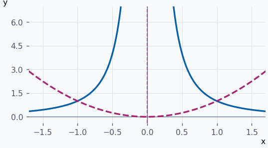
:::

::: ejemplo Ejemplo 2 · Dos infinitésimos con el mismo término dominante
Con \(f(x)=x^{2}+x^{3}\) y \(g(x)=x^{2}\), ambas funciones tienden a cero en \(0\). Para \(x≠0\), \(\frac{f(x)}{g(x)}=1+x→1\).

La curva continua de \(f\) y la discontinua de \(g\) se aproximan cerca del origen. Su diferencia es \(x^{3}\), que es pequeña respecto a \(x^{2}\).

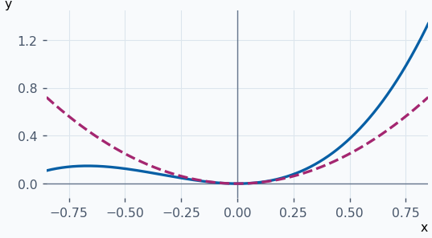
:::

::: ejemplo Ejemplo 3 · Dos infinitos con el mismo comportamiento principal
Al crecer \(x\) hacia \(+∞\), \(x^{2}+x\) y \(x^{2}\) son infinitos. Al dividir, \(\frac{x^{2}+x}{x^{2}}=1+1/x→1\).

La gráfica muestra el cociente acercándose a la línea \(y=1\). La diferencia entre las funciones es \(x\), que crece, pero el **error relativo** tiende a cero.

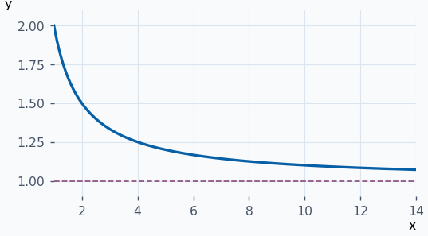
:::

**Ejercicios para resolver**

**1.** Decide si \(f(x)=x^{3}\) es un infinitésimo en \(0\) y si su recíproco tiene límite bilateral con signo.

::: solucion
Se cumple \(x^{3}→0\). Para \(x→0^{-}\), \(1/x^{3}→−∞\); para \(x→0^{+}\), \(1/x^{3}→+∞\). No hay límite bilateral con signo, pero \(∣1/x^{3}∣→+∞\).
:::

**2.** ¿Son equivalentes \(2x\) y \(x\) si \(x→0\)?

::: solucion
Para \(x≠0\), el cociente vale \(2\), cuyo límite no es \(1\). Los dos son infinitésimos, pero no equivalentes.
:::

**3.** Comprueba si \(x^{2}−3\) y \(x^{2}\) son infinitos equivalentes si \(x→−∞\).

::: solucion
Ambas funciones tienden a \(+∞\). Su cociente es \(1−3/x^{2}→1\); por tanto, son equivalentes.
:::

**4.** Decide si \(x^{2}\) y \(x^{3}\) son equivalentes en \(0\).

::: solucion
Ambas tienden a cero. Para probar la equivalencia se puede tomar \(x^{3}/x^{2}=x\), que tiende a \(0\). Como no tiende a \(1\), no son equivalentes.
:::

## Tabla de infinitésimos equivalentes {#tabla-equivalentes}

Para leer la tabla del PDF, escribe \(u=f(x)\) e identifica **a qué valor tiende el argumento**. En las cinco primeras filas debe tender a cero. En la última, debe tender a uno. Los ángulos se miden en radianes y \(log\) es el logaritmo natural, el de base \(e\).

| Forma básica | Composición con \(f(x)\) |
| --- | --- |
| \(sen(u)∼u\) si \(u→0\) | \(sen(f(x))∼f(x)\) si \(f(x)→0\) |
| \(tg(u)∼u\) si \(u→0\) | \(tg(f(x))∼f(x)\) si \(f(x)→0\) |
| \(1−cos(u)∼u^{2}/2\) si \(u→0\) | \(1−cos(f(x))∼f(x)^{2}/2\) si \(f(x)→0\) |
| \(e^{u}−1∼u\) si \(u→0\) | \(e^{f(x)}−1∼f(x)\) si \(f(x)→0\) |
| \(log(1+u)∼u\) si \(u→0\) | \(log(1+f(x))∼f(x)\) si \(f(x)→0\) |
| \(log(u)∼u−1\) si \(u→1\) | \(log(f(x))∼f(x)−1\) si \(f(x)→1\) |

**Cómo se obtienen.**

1. \(sen(u)/u→1\) se puede ver como el cociente incremental del seno en \(0\). Para la tangente, \(tg(u)=sen(u)/cos(u)\) y \(cos(u)→1\).
2. Para el coseno, usa \(1−cos(u)=2sen^{2}(u/2)\). Al dividir por \(u^{2}/2\), queda el cuadrado del cociente de \(sen(u/2)\) y \(u/2\), que tiende a \(1\).
3. \((e^{u}−1)/u\) y \(log(1+u)/u\) son cocientes incrementales. Sus límites son, respectivamente, la derivada de \(e^{u}\) en \(0\) y la de \(log(u)\) en \(1\); ambas valen \(1\). Para la última fila, escribe \(u=1+(u−1)\).

Se aplica el límite de la forma básica con el argumento compuesto en el dominio común. Si una expresión tiene logaritmos, comprueba que sus argumentos sean positivos cerca del punto.

**Ejemplos resueltos**

::: original Ejemplo del PDF · Seno con argumento que se anula en uno
Si \(x→1\), el argumento \(u=1−x→0\). El cociente \(sen(u)/u\) tiende a \(1\).

\(sen(1−x)∼1−x\)

La curva continua del seno y la recta discontinua se acercan al cruzar \(x=1\).

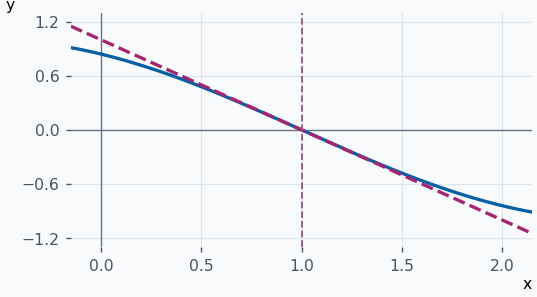
:::

::: original Ejemplo del PDF · Exponencial alrededor de un medio
Para \(x→1/2\), \(u=2x−1→0\). Usa la cuarta fila con ese argumento.

\(e^{2x−1}−1∼2x−1\)

La curva continua de la exponencial menos uno y la recta discontinua tienen la misma pendiente al pasar por \((1/2,0)\).

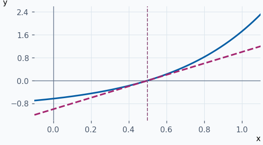
:::

::: original Ejemplo del PDF · Logaritmo de uno más un cuadrado
Como \(u=x^{2}→0\) cuando \(x→0\), el límite de \(log(1+u)/u\) vale \(1\).

\(log(1+x^{2})∼x^{2}\)

La curva continua del logaritmo y la parábola discontinua se acercan en el origen, aunque no son iguales fuera de él.

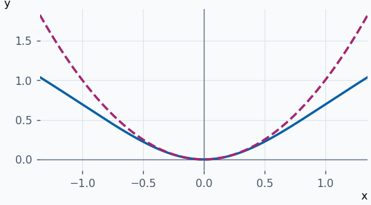
:::

::: original Ejemplo del PDF · Logaritmo de un cociente que tiende a uno
Para \(x→+∞\), el argumento \(f(x)=x^{2}/(1+x^{2})\) tiende a \(1\) y cumple \(f(x)−1=−1/(1+x^{2})\).

\(log(\frac{x^{2}}{1+x^{2}})∼\frac{−1}{1+x^{2}}\)

La curva continua del logaritmo y la discontinua del equivalente son negativas y se acercan al eje horizontal por debajo.

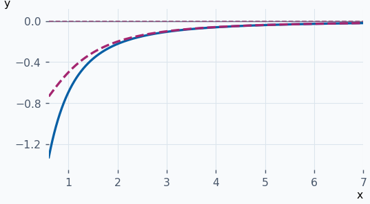
:::

::: ejemplo Ejemplo 1 · Tangente con un argumento escalado
Cuando \(x→0\), \(u=2x→0\). Así, \(tg(2x)∼2x\), de modo que \(\frac{tg(2x)}{x}→2\).

La recta discontinua representa \(2x\) y coincide en pendiente con la tangente continua cerca de cero.

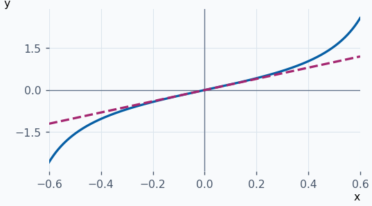
:::

::: ejemplo Ejemplo 2 · El coseno genera un término cuadrático
Para \(x→0\), \(u=3x→0\) y \(1−cos(3x)∼(3x)^{2}/2=9x^{2}/2\).

Ambas curvas se acercan al origen desde arriba: la continua es \(1−cos(3x)\) y la discontinua es su equivalente cuadrático.

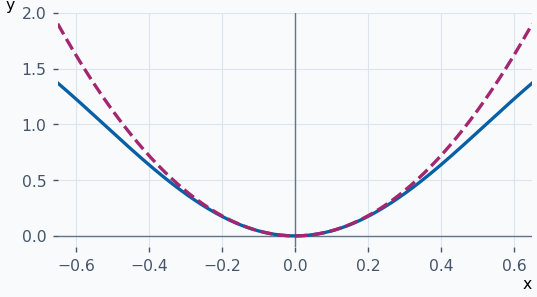
:::

::: ejemplo Ejemplo 3 · Logaritmo con argumento cerca de uno
Cuando \(x→0\), \(1/(1+x)→1\). Su diferencia con \(1\) es \(−x/(1+x)\).

\(log(\frac{1}{1+x})∼\frac{−x}{1+x}\)

Cerca de cero, la curva continua del logaritmo y la discontinua del equivalente casi coinciden. Las dos están definidas para \(x>−1\).

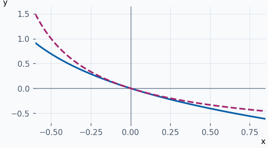
:::

**Ejercicios para resolver**

**1.** Encuentra un equivalente de \(sen(x^{3})\) si \(x→0\).

::: solucion
Como \(u=x^{3}→0\) y \(sen(u)∼u\), se tiene \(sen(x^{3})∼x^{3}\).
:::

**2.** Encuentra un equivalente de \(1−cos(2x−2)\) si \(x→1\).

::: solucion
El argumento \(2(x−1)\) tiende a cero. La tercera fila da \((2x−2)^{2}/2=2(x−1)^{2}\).
:::

**3.** Encuentra un equivalente de \(e^{−3x}−1\) si \(x→0\).

::: solucion
Toma \(u=−3x→0\). La cuarta fila da \(e^{−3x}−1∼−3x\).
:::

**4.** Encuentra un equivalente de \(log(2−x)\) si \(x→1\).

::: solucion
El argumento \(2−x\) es positivo cerca de \(1\) y tiende a \(1\). Aplica la última fila: \(log(2−x)∼(2−x)−1=1−x\).
:::

## Productos, cocientes y sustituciones en límites {#sustitucion-equivalentes}

Si \(f∼g\) y \(h∼j\) para \(x→c\), las dos propiedades del PDF se justifican comparando los cocientes correspondientes en su dominio:

| Operación | Equivalencia | Por qué |
| --- | --- | --- |
| Producto | \(fh∼gj\) | \(\frac{fh}{gj}=\frac{f}{g}·\frac{h}{j}→1\) |
| Cociente | \(f/h∼g/j\) | \(\frac{fj}{hg}=\frac{f}{g}·\frac{j}{h}→1\) |

Por tanto, para calcular un límite se puede sustituir un infinitésimo por otro equivalente **si actúa como factor o divisor de la expresión completa**. Al cambiarlo se introduce un factor que tiende a \(1\); esto conserva el límite, tanto si es finito como si es \(±∞\), siempre que exista.

1. Identifica si el infinitésimo está multiplicando o dividiendo a toda la expresión.
2. Si aparece dentro de una suma o resta, busca una factorización, un denominador común o un desarrollo que conserve los términos que sobreviven a la cancelación.
3. Sustituye los factores que cumplan la condición y simplifica. Si aún hay una indeterminación, aplica otra técnica con sus hipótesis.

**Por qué falla en una resta.** Si \(f=x+x^{2}\) y \(g=x\), entonces \(f∼g\) en \(0\). Pero \(f−x=x^{2}\) y \(g−x=0\). Sustituir antes de restar borra el término que determina el límite de \((f−x)/x^{2}\).

**Ejemplos resueltos**

::: original Ejemplo del PDF · Diferencia de dos cocientes y una sola aplicación de L’Hôpital
El PDF pide el límite de \(D(x)=\frac{x}{x−1}−\frac{1}{log(x)}\) cuando \(x→1\). Los dos cocientes divergen con el mismo signo entre sí en cada lado de \(1\). Sustituir directamente \(log(x)\) por \(x−1\) en la diferencia daría \(1\); la cancelación cambia el resultado.

**Paso 1.** Pon denominador común para obtener una forma \(0/0\):

\(D(x)=\frac{x·log(x)−x+1}{(x−1)log(x)}\)

**Paso 2.** Solo en el denominador, \(log(x)\) actúa como factor. Sustitúyelo por \(x−1\) y conserva el numerador entero:

\(lim_{x→1}D(x)=lim_{x→1}\frac{x·log(x)−x+1}{(x−1)^{2}}\)

**Paso 3.** Ambos términos tienden a cero y son derivables cerca de \(1\), con derivada del denominador \(2(x−1)≠0\) para \(x≠1\). Aplica [L’Hôpital](?u=calculo%2Fderivabilidad#lhopital) una vez:

\(lim_{x→1}\frac{x·log(x)−x+1}{(x−1)^{2}}=lim_{x→1}\frac{log(x)}{2(x−1)}\)

**Paso 4.** Ahora \(log(x)\) es todo el numerador y se puede reemplazar por \(x−1\). El cociente simplificado vale \(1/2\), así que ese es el límite. La gráfica muestra la diferencia original con un hueco en \((1,1/2)\).

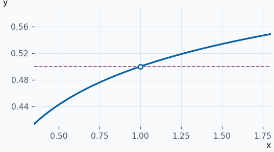
:::

::: ejemplo Ejemplo 1 · Producto de un seno y una exponencial
Para \(x→0\), \(e^{x}−1∼x\) y \(sen(x)∼x\). Los dos infinitésimos son factores del numerador, de modo que el producto es equivalente a \(x^{2}\).

\(lim_{x→0}\frac{(e^{x}−1)sen(x)}{x^{2}}=1\)

La gráfica del cociente se acerca a \(y=1\) con un hueco en \(x=0\).

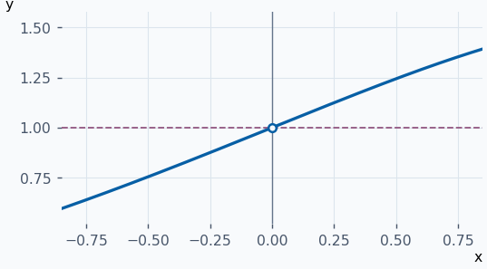
:::

::: ejemplo Ejemplo 2 · Cociente de dos infinitésimos cuadráticos
Al acercarnos a \(0\), \(1−cos(3x)∼9x^{2}/2\) y \(log(1+x^{2})∼x^{2}\). Sustituye el numerador y el denominador por sus equivalentes.

\(lim_{x→0}\frac{1−cos(3x)}{log(1+x^{2})}=9/2\)

La gráfica del cociente muestra ambos lados aproximándose a \(9/2\).

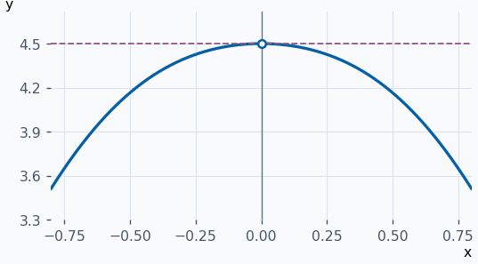
:::

::: ejemplo Ejemplo 3 · Una resta que cancela el término principal
En \((x+x^{2})−x\), el equivalente \(x\) del primer término se cancelaría con el segundo y se perdería \(x^{2}\). Simplifica la resta exacta antes de dividir.

\(\frac{(x+x^{2})−x}{x^{2}}=1\) para \(x≠0\)

La recta continua del cociente correcto se mantiene en \(1\). La línea discontinua en \(0\) muestra lo que daría la sustitución incorrecta.

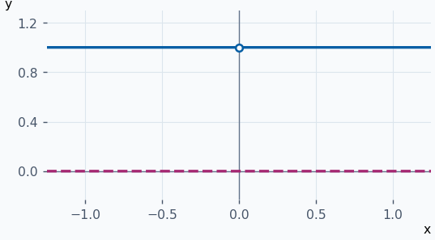
:::

**Ejercicios para resolver**

**1.** Calcula \(lim_{x→0}\frac{sen(4x)}{tg(2x)}\).

::: solucion
Las equivalencias son \(sen(4x)∼4x\) y \(tg(2x)∼2x\). El cociente de equivalentes se simplifica a \(2\).
:::

**2.** Calcula \(lim_{x→0}\frac{(e^{2x}−1)log(1+x)}{x^{2}}\).

::: solucion
Los factores se pueden reemplazar por \(2x\) y \(x\), respectivamente. El cociente se convierte en \(2x^{2}/x^{2}=2\).
:::

**3.** Calcula \(lim_{x→0}\frac{log(1+x^{2})}{1−cos(x)}\).

::: solucion
El numerador es equivalente a \(x^{2}\) y el denominador a \(x^{2}/2\). Tras sustituir ambos, el límite vale \(2\).
:::

**4.** Calcula \(lim_{x→0}\frac{(1+x)^{2}−1−2x}{1−cos(x)}\). ¿Qué término perderías si solo conservaras el orden lineal en el numerador?

::: solucion
Desarrolla la resta exacta: \((1+x)^{2}−1−2x=x^{2}\). Los términos de primer orden se cancelan y sobrevive el cuadrático. Sustituye únicamente el denominador completo por \(x^{2}/2\); el límite es \(2\).
:::
