# 3.1 Sucesiones numéricas

[Apuntes de Manuel José Fernández · curso 2026–27 · pp. 1–6](apuntes-originales.pdf)

## Término general, monotonía y acotación {#monotonia-y-acotacion}

Una **sucesión de números reales** es una aplicación \(f : ℕ → ℝ\). El término de índice \(n\) es \(aₙ=f(n)\). Escribimos \(\{aₙ\}\) para la sucesión completa y \(\{a₁,a₂,…\}\) para listar sus términos en orden. El índice importa aunque algunos valores coincidan. Si una fórmula empieza en \(n=2\), como sucede en un ejercicio de los apuntes, su primer término es \(a₂\).

La suma, el producto y el cociente se forman **término a término**. En el cociente se pide \(bₙ≠0\) para todos los índices utilizados.

\(\{aₙ\}+\{bₙ\}=\{aₙ+bₙ\},    \{aₙ\}\{bₙ\}=\{aₙbₙ\}\)

\(\{aₙ/bₙ\}=\{aₙ\}/\{bₙ\}\)

| Propiedad | Condición para todo índice |
| --- | --- |
| Creciente | \(aₙ≤a_{n+1}\) |
| Decreciente | \(aₙ≥a_{n+1}\) |
| Estrictamente creciente o decreciente | \(aₙ<a_{n+1}\) o \(aₙ>a_{n+1}\), respectivamente |
| Acotada superiormente | Existe \(M∈ℝ\) con \(aₙ≤M\). |
| Acotada inferiormente | Existe \(m∈ℝ\) con \(m≤aₙ\). |
| Acotada | Tiene ambas cotas. Equivale a \(∃K>0\) con \(∣aₙ∣≤K\). |

Para estudiar la monotonía, resta \(a_{n+1}−aₙ\) y determina su signo. Si todos los términos son positivos, también puedes comparar \(a_{n+1}/aₙ\) con \(1\). Una **cota** puede sobrar margen. El supremo es la menor cota superior y el ínfimo es la mayor cota inferior. Si alguno es un término de la sucesión, también es un máximo o un mínimo.

**Ejemplos resueltos**

::: original Ejemplo del PDF · Crecimiento hacia una cota superior
Para \(aₙ=n/(n+1)\), los primeros términos son \(1/2,2/3,3/4\). Al restar se obtiene

\(a_{n+1}−aₙ=\frac{1}{(n+1)(n+2)}>0\)

El mínimo es \(a₁=1/2\). Como \(aₙ=1−1/(n+1)<1\) y \(1/(n+1)→0\), el supremo es \(1\) y queda fuera del conjunto de términos.

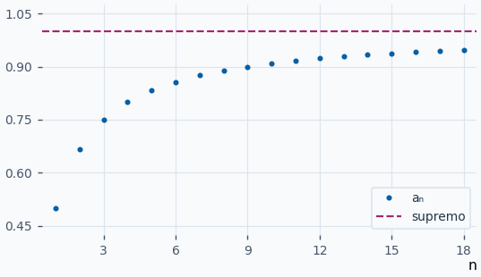
:::

::: original Ejemplo del PDF · Decrecimiento desde el índice 2
Sea \(aₙ=2n/(n³−1)\) para \(n≥2\). El primer término es \(a₂=4/7\). El denominador de la resta es positivo y el numerador también.

\(aₙ−a_{n+1}=\frac{4n³+6n²+2n+2}{(n³−1)(n³+3n²+3n)}>0\)

El máximo es \(4/7\). Los términos son positivos y tienden a cero al dividir por \(n³\), así que el ínfimo es \(0\). El PDF escribe \(a₁\) para el primer valor en la solución. Con los índices de su propia fórmula corresponde a \(a₂\).

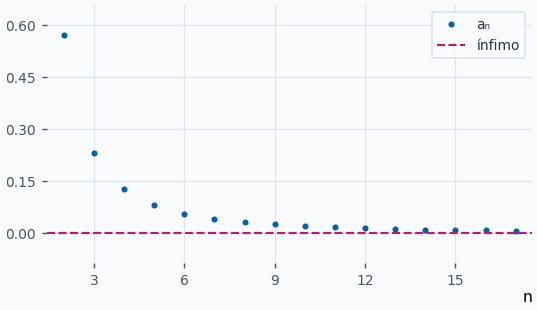
:::

::: ejemplo Ejemplo 1 · Operaciones en el mismo índice
Sea \(aₙ=n\) y \(bₙ=1/(n+1)\). El producto tiene término \(n/(n+1)\) y el cociente tiene término \(n(n+1)\) porque \(bₙ>0\). En \(n=2\) dan \(2/3\) y \(6\). La gráfica compara las dos operaciones sobre los mismos índices.

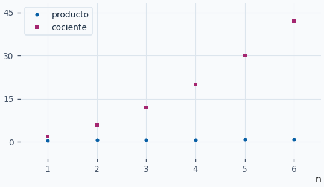
:::

::: ejemplo Ejemplo 2 · Crecer sin cota superior
Para \(aₙ=2n−3\), la diferencia \(a_{n+1}−aₙ=2\) es positiva. Su menor término es \(−1\). Dada una cota candidata \(M\), basta elegir un natural \(n>(M+3)/2\) para superarla.

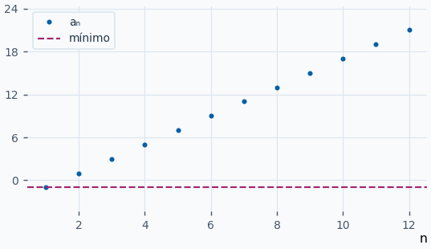
:::

::: ejemplo Ejemplo 3 · Cotas de una sucesión alternante
Sea \(aₙ=(−1)ⁿ/(n+1)\). Entre los índices impares el primer valor \(−1/2\) es el menor y entre los pares \(1/3\) es el mayor. El signo cambia con la paridad y la sucesión completa carece de monotonía.

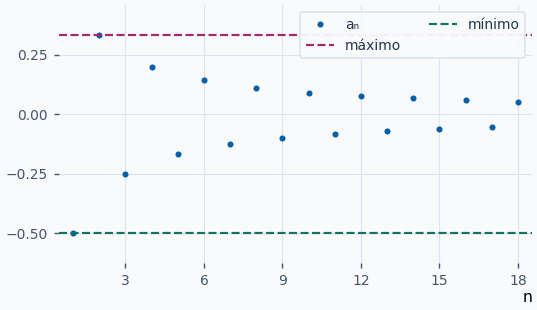
:::

**Ejercicios para resolver**

**1.** Estudia la monotonía y acotación de \(aₙ=1/(n+1)+⋯+1/(2n)\).

::: solucion
Al pasar de \(n\) a \(n+1\) se quita \(1/(n+1)\) y se añaden \(1/(2n+1)\) y \(1/(2n+2)\). La diferencia queda \(1/((2n+1)(2n+2))>0\). Además \(1/2≤aₙ≤n/(n+1)<1\) porque hay \(n\) sumandos entre \(1/(2n)\) y \(1/(n+1)\).
:::

**2.** Halla el término general de la suma y del cociente de \(aₙ=1/n\) y \(bₙ=1/(n+1)\).

::: solucion
La suma es \((2n+1)/(n(n+1))\). Como \(bₙ≠0\), el cociente vale \((n+1)/n\).
:::

**3.** Estudia monotonía, mínimo y supremo de \(aₙ=1−2/(n+2)\).

::: solucion
La diferencia vale \(2/((n+2)(n+3))>0\). El mínimo es \(a₁=1/3\). Como \(aₙ<1\) y la distancia \(2/(n+2)\) tiende a cero, el supremo es \(1\).
:::

**4.** Halla las cotas extremas de \(aₙ=3+(−1)ⁿ\).

::: solucion
Los índices impares dan \(2\) y los pares \(4\). Por ello \(inf aₙ=min aₙ=2\) y \(sup aₙ=max aₙ=4\). La sucesión sube y baja indefinidamente.
:::

## Límite finito, límites infinitos y clasificación {#limite-y-clasificacion}

Un número real \(l\) es el **límite** de \(\{aₙ\}\) si, para toda distancia positiva \(ε\) al límite, hay un índice a partir del cual todos los términos quedan dentro de esa distancia.

\(lim_{n→∞} aₙ=l ⇔ ∀ε>0 ∃n₀∈ℕ : ∀n≥n₀, ∣aₙ−l∣<ε\)

La banda de alturas es \((l−ε,l+ε)\). El índice \(n₀\) puede depender de \(ε\). Los primeros términos no determinan el límite. Para \(+∞\) y \(−∞\) se trabaja con umbrales en vez de bandas.

| Resultado | Definición a partir de un índice |
| --- | --- |
| \(aₙ→+∞\) | \(∀M∈ℝ ∃n₀∈ℕ : ∀n≥n₀, aₙ>M\) |
| \(aₙ→−∞\) | \(∀m∈ℝ ∃n₀∈ℕ : ∀n≥n₀, aₙ<m\) |

En el PDF, **convergente** significa que existe un límite real. **Divergente** significa que \(∣aₙ∣→+∞\). Incluye los límites con signo, como \(n²/3→+∞\) y \(−n²/3→−∞\), y las sucesiones que se alejan en ambos sentidos, como \((−1)ⁿn\). **Oscilante** designa las restantes, como \(1,0,1,0,…\). Esta terminología se mantendrá en 3.1. En el estudio de series se indicará si las sumas parciales divergen a infinito o carecen de límite.

**Unicidad.** Si \(l≠m\) fueran dos límites reales, toma \(ε=∣l−m∣/3\). Sus bandas serían disjuntas. A partir del mayor de los dos índices exigidos, un mismo término tendría que estar en las dos. Para un límite infinito y uno finito, elige un umbral fuera de una banda finita. Para dos infinitos de signo contrario, el umbral \(0\) ya exige condiciones incompatibles.

**Ejemplos resueltos**

::: original Ejemplo del PDF · Límite de los recíprocos
Para \(aₙ=1/n\), elige \(n₀\) natural con \(n₀>1/ε\). Entonces \(n≥n₀\) implica \(0<aₙ≤1/n₀<ε\). La figura usa una banda superior de altura \(0,2\). A partir de \(n=6\) los puntos quedan estrictamente por debajo.

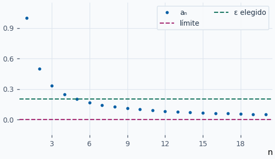
:::

::: ejemplo Ejemplo 1 · Probar un límite distinto de cero
Para \(aₙ=2+3/n\), la distancia a \(2\) es \(3/n\). Dado \(ε>0\), cualquier \(n₀>3/ε\) sirve. Con \(ε=1/2\) se puede tomar \(n₀=7\). La aproximación se produce por arriba.

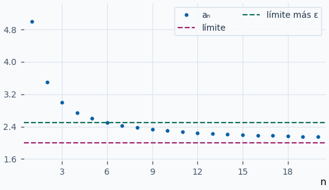
:::

::: ejemplo Ejemplo 2 · Superar un umbral de cualquier altura
Sea \(aₙ=√n−1\). Para \(M≥0\), elige \(n₀>(M+1)²\). Entonces \(√n−1>M\) para todo \(n≥n₀\). Si \(M<0\), ya sirve \(n₀=1\). Por tanto \(aₙ→+∞\).

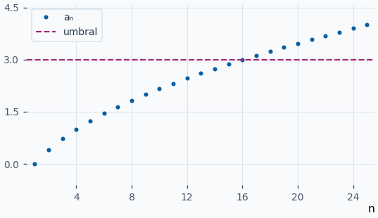
:::

::: ejemplo Ejemplo 3 · Alejarse sin escoger un signo
Sea \(aₙ=(−1)ⁿ(2n+1)\). Para cualquier \(M\), \(∣aₙ∣=2n+1>M\) al crecer \(n\). Los pares son positivos y los impares negativos. Es divergente según el PDF, aunque carece de límite con signo.

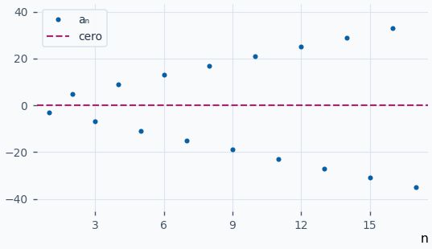
:::

**Ejercicios para resolver**

**1.** Prueba con la definición que \(4−5/n→4\).

::: solucion
\(∣4−5/n−4∣=5/n\). Dado \(ε>0\), elige un natural \(n₀>5/ε\).
:::

**2.** Prueba que \(−n²/3→−∞\).

::: solucion
Para \(m<0\) elige \(n₀>√(−3m)\) y así \(−n²/3<m\) para \(n≥n₀\). Para \(m≥0\) basta \(n₀=1\).
:::

**3.** Clasifica \(aₙ=2+(−1)ⁿ\).

::: solucion
Los pares valen \(3\) y los impares \(1\). Ninguna banda suficientemente estrecha puede contener los dos valores. Al estar acotada, su módulo tampoco tiende a infinito. Es oscilante según el PDF.
:::

**4.** Encuentra un índice a partir del cual \(∣1/(n+2)∣<1/20\).

::: solucion
\(n+2>20\) equivale a \(n>18\). El primer índice válido es \(19\).
:::

## Criterio de convergencia monótona {#convergencia-monotona}

Toda sucesión convergente está acotada. Basta tomar \(ε=1\): desde cierto índice los términos quedan entre \(l−1\) y \(l+1\), y los términos anteriores forman un conjunto finito que también tiene cotas. La sucesión \(1,0,1,0,…\) muestra que la acotación por sí sola no asegura convergencia. Una sucesión divergente en el sentido del PDF carece de una cota para su módulo.

| Monotonía | Cota en la dirección de avance | Conclusión |
| --- | --- | --- |
| Creciente | Existe cota superior | Converge al supremo de sus términos. |
| Decreciente | Existe cota inferior | Converge al ínfimo de sus términos. |
| Creciente | Sin cota superior | Tiende a \(+∞\). |
| Decreciente | Sin cota inferior | Tiende a \(−∞\). |

**Demostración para el caso creciente acotado.** Sea \(l\) el supremo. Para todo \(ε>0\), \(l−ε\) deja de ser cota superior. Algún \(a_{n₀}\) lo supera y, por monotonía, \(l−ε<a_{n₀}≤aₙ≤l\) para \(n≥n₀\). Esto prueba el límite. Para el caso decreciente se aplica el resultado a \(−aₙ\). Si la sucesión creciente no tiene cota superior, para cualquier \(M\) existe un \(a_{n₀}>M\) y los siguientes también lo superan.

**Ejemplos resueltos**

::: original Ejemplo del PDF · La sucesión que se acerca a e
Sea \(aₙ=(1+1/n)ⁿ\). Con \(t>0\), \(t/(1+t)<log(1+t)<t\), como se ve integrando \(1/(1+s)\) entre \(0\) y \(t\). Por tanto \(n·log(1+1/n)<1\) y \(aₙ<e\). Además \(g(x)=x·log(1+1/x)\) tiene derivada \(log(1+1/x)−1/(x+1)>0\). Luego \(aₙ\) crece y converge. La misma desigualdad da \(n/(n+1)<log(aₙ)<1\), de modo que \(aₙ→e≈2,71828\).

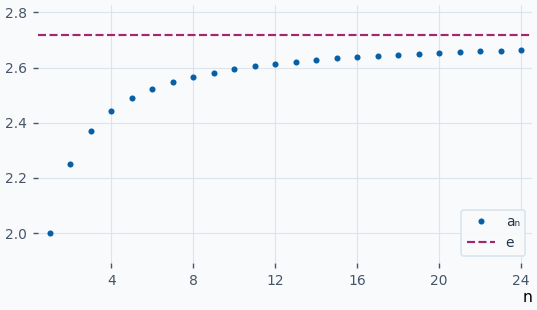
:::

::: ejemplo Ejemplo 1 · Una cota obtenida de la fórmula
Para \(aₙ=3−1/n²\), la distancia \(1/n²\) disminuye. Así, \(aₙ\) crece, está acotada superiormente por \(3\) y se aproxima a esa cota. Su supremo y su límite son \(3\).

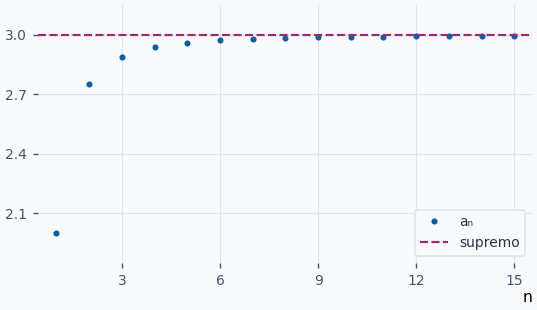
:::

::: ejemplo Ejemplo 2 · Decrecer hacia un ínfimo
Sea \(aₙ=1+2^{-n}\). Al duplicarse el denominador, \(a_{n+1}−aₙ=−2^{−(n+1)}<0\). Todos los términos superan \(1\) y se acercan a esa altura. El ínfimo y el límite son \(1\).

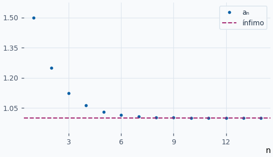
:::

::: ejemplo Ejemplo 3 · Monótona sin cota inferior
La sucesión \(aₙ=−√n\) es decreciente. Para cualquier \(m<0\), un índice \(n>m²\) da \(aₙ<m\). Al no haber cota inferior, el criterio de monotonía da \(aₙ→−∞\).

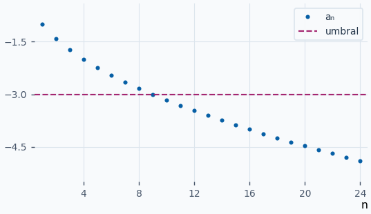
:::

**Ejercicios para resolver**

**1.** Justifica la convergencia y calcula el límite de \(aₙ=5−1/(n+4)\).

::: solucion
Crece porque el recíproco decrece. Tiene cota superior \(5\) y se acerca a ella. Por tanto el supremo y el límite son \(5\).
:::

**2.** Estudia \(aₙ=2/(n+3)\).

::: solucion
Decrece y es positiva. Dado \(ε>0\), para \(n>2/ε\) se cumple \(aₙ<ε\). Su ínfimo y su límite son \(0\).
:::

**3.** Una sucesión creciente satisface \(aₙ≤4\) y para cada \(ε>0\) algún término supera \(4−ε\). Halla su límite.

::: solucion
Las dos condiciones identifican \(4\) como supremo. El criterio de monotonía da \(aₙ→4\).
:::

**4.** ¿Qué valor tiene el límite de una sucesión decreciente cuyos términos bajan de cualquier umbral real?

::: solucion
Carece de cota inferior. Una vez que supera un umbral hacia abajo, todos los términos posteriores quedan por debajo. El límite es \(−∞\).
:::

## Subsucesiones y separación por paridad {#subsucesiones}

Una **subsucesión** es \(\{a_{nⱼ}\}\), donde \(\{nⱼ\}\) es estrictamente creciente y toma valores naturales. Se conservan los índices en su orden original. Como \(nⱼ≥j\), cualquier subsucesión de una sucesión con límite finito o infinito tiene ese mismo límite.

Los índices pares \(2j\) y los impares \(2j−1\) cubren todos los naturales. Si las dos colas cumplen la misma condición de límite, toma el mayor de los índices requeridos en la sucesión original. Todos los índices posteriores pertenecen a una de esas colas.

| Límite de los pares | Límite de los impares | Resultado según el PDF |
| --- | --- | --- |
| \(l∈ℝ\) | El mismo \(l\) | La sucesión converge a \(l\). |
| \(+∞\) o \(−∞\) | El mismo infinito con signo | La sucesión tiene ese límite. |
| \(+∞\) | \(−∞\) | El módulo tiende a \(+∞\). Es divergente sin límite con signo. |
| \(l∈ℝ\) | \(m∈ℝ\), \(l≠m\) | Es oscilante. |
| \(l∈ℝ\) | \(+∞\) o \(−∞\) | Es oscilante. La parte con límite finito impide que el módulo escape a infinito. |

Los casos de la tabla también valen intercambiando pares e impares. Encontrar dos subsucesiones con límites distintos basta para descartar un límite común.

**Ejemplos resueltos**

::: original Ejemplo del PDF · Dos límites finitos distintos
Para \(aₙ=(−1)ⁿ(n²−1)/(2n²+1)\), el cociente sin signo tiende a \(1/2\) al dividir por \(n²\). Los pares tienden a \(1/2\) y los impares a \(−1/2\). Como el módulo tiende a \(1/2\), la clasificación del PDF es oscilante.

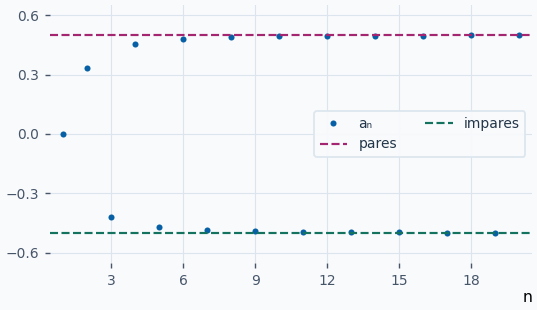
:::

::: ejemplo Ejemplo 1 · Dos caminos hacia el mismo límite
Sea \(aₙ=1+(−1)ⁿ/n\). En los pares queda \(1+1/(2j)\) y en los impares \(1−1/(2j−1)\). Ambos límites son \(1\), así que \(aₙ→1\) aunque se alternen los lados de aproximación.

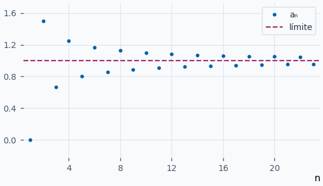
:::

::: ejemplo Ejemplo 2 · Una cola finita y otra que crece
Toma \(a_{2j}=2j\) y \(a_{2j−1}=2\). Los pares tienden a \(+∞\) y los impares permanecen en \(2\). Es oscilante según el PDF y está sin acotar por arriba.

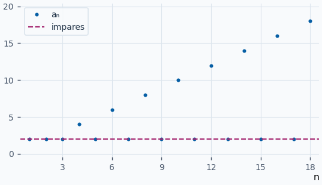
:::

::: ejemplo Ejemplo 3 · Dos colas con el mismo infinito
Para \(aₙ=n+(−1)ⁿ\), los pares son \(2j+1\) y los impares \(2j−2\). Ambos tienden a \(+∞\), de modo que toda la sucesión supera cualquier umbral a partir de un índice común.

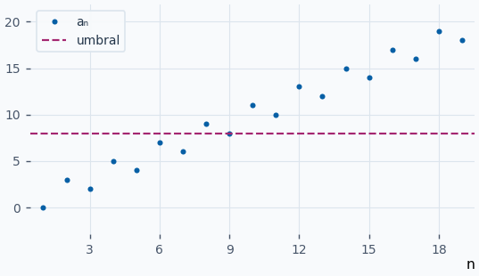
:::

**Ejercicios para resolver**

**1.** Clasifica \(aₙ=(−1)ⁿ+1/n\).

::: solucion
Las subsucesiones par e impar tienden a \(1\) y \(−1\), respectivamente. No hay límite común y el módulo está acotado. Es oscilante.
:::

**2.** Clasifica \(aₙ=(−1)ⁿn²\).

::: solucion
Los pares tienden a \(+∞\) y los impares a \(−∞\). El módulo tiende a \(+∞\). Es divergente sin límite con signo.
:::

**3.** Si \(aₙ→−2\), halla \(lim_{j→∞} a_{3j+1}\).

::: solucion
Los índices \(3j+1\) son estrictamente crecientes. La subsucesión conserva el límite \(−2\).
:::

**4.** Si \(a_{2j}=4+1/j\) y \(a_{2j−1}=4−2/j\), halla el límite de \(aₙ\).

::: solucion
Los dos términos correctores tienden a \(0\). Como pares e impares agotan los índices, \(aₙ→4\).
:::

## Operaciones y cálculo algebraico de límites {#operaciones-de-limites}

Sean \(aₙ→l\) y \(bₙ→m\), con \(l,m∈ℝ\).

| Operación | Límite | Condición |
| --- | --- | --- |
| Suma o resta | \(l±m\) | Ambos límites finitos. |
| Producto por constante | \(αl\) | \(α∈ℝ\). |
| Producto | \(lm\) | Ambos límites finitos. |
| Recíproca y cociente | \(1/m\) y \(l/m\) | \(m≠0\) y \(bₙ≠0\) en la cola utilizada. |

Para la suma se controla la distancia con \(∣(aₙ+bₙ)−(l+m)∣≤∣aₙ−l∣+∣bₙ−m∣\). En el producto se escribe \(aₙbₙ−lm=(aₙ−l)bₙ+l(bₙ−m)\) y se usa que \(bₙ\) está acotada. Si \(m≠0\), desde cierto índice \(∣bₙ∣≥∣m∣/2\). Entonces \(∣1/bₙ−1/m∣=∣bₙ−m∣/∣mbₙ∣\) tiende a cero.

Si \(l≠0\), \(m=0\) y \(bₙ≠0\), entonces \(∣aₙ/bₙ∣→+∞\). Un signo eventual de \(bₙ\), junto al de \(l\), determina si el cociente tiende a \(+∞\) o \(−∞\). Si el signo alterna, estudia las subsucesiones. Los límites con infinitos siguen las reglas de [límites de funciones](?u=calculo%2Flimites#algebra-limites). Formas como \(0/0\), \(∞/∞\) y \(0·∞\) se simplifican antes de decidir.

Para cocientes de polinomios divide por la mayor potencia conveniente. Por ejemplo, en los otros dos cocientes del PDF la división por \(n⁷\) da \((1−4n⁷)/(n⁷+12n)→−4\). Al dividir \((n⁴−3n²+n+2)/(n³+7n)\) por \(n⁴\), el numerador reducido tiende a \(1\) y el denominador a \(0⁺\), así que el límite es \(+∞\).

**Ejemplos resueltos**

::: original Ejemplo del PDF · Mayor grado en el denominador
En \(aₙ=(3n⁴−2n²+1)/(n⁵−3n³)\), divide por \(n⁵\).

\(aₙ=\frac{3/n−2/n³+1/n⁵}{1−3/n²}→0\)

El denominador reducido tiende a \(1\). La figura muestra la cola desde el índice 2.

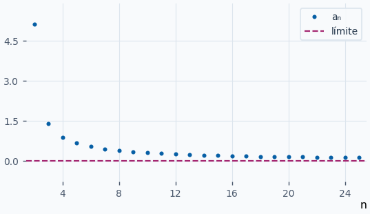
:::

::: ejemplo Ejemplo 1 · Igual grado con signos opuestos
Para \(aₙ=(2n²+1)/(3−4n²)\), divide numerador y denominador por \(n²\). Queda \((2+1/n²)/(3/n²−4)→−1/2\). El denominador original es negativo para \(n≥1\).

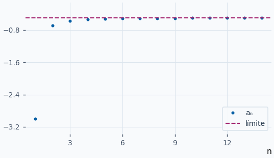
:::

::: ejemplo Ejemplo 2 · Un denominador nulo en el límite y de signo alternante
Para \(aₙ=1+1/n\) y \(bₙ=(−1)ⁿ/n²\), se tiene \(aₙ→1\) y \(bₙ→0\). El cociente es \((−1)ⁿ(n²+n)\). Su módulo crece sin cota y los signos par e impar producen límites opuestos.

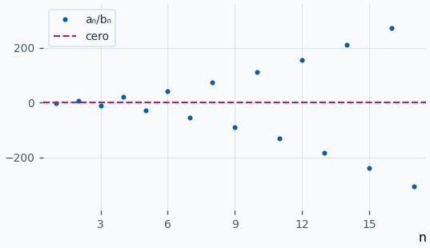
:::

::: ejemplo Ejemplo 3 · Racionalizar una diferencia
Para \(aₙ=√(n²+3n)−n\), la sustitución directa da \(∞−∞\). Multiplica por el conjugado y divide por \(n\).

\(aₙ=\frac{3n}{√(n²+3n)+n}=\frac{3}{√(1+3/n)+1}→3/2\)

La gráfica muestra que el crecimiento de las dos expresiones iniciales deja una diferencia acotada.

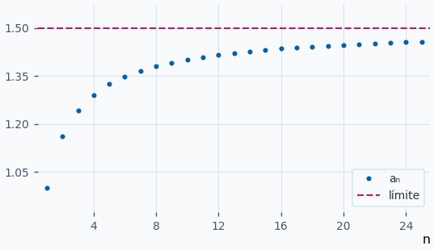
:::

**Ejercicios para resolver**

**1.** Calcula \(lim_{n→∞}(5n³−1)/(2n³+n)\).

::: solucion
Divide por \(n³\). Queda \((5−1/n³)/(2+1/n²)→5/2\).
:::

**2.** Halla \(lim_{n→∞}(n²+1)/(2n+3)\).

::: solucion
Al dividir por \(n²\), el numerador tiende a \(1\) y el denominador \((2/n+3/n²)\) tiende a \(0\) por valores positivos. Resultado \(+∞\).
:::

**3.** Halla \(lim_{n→∞}(√(n²+4)−n)\).

::: solucion
El conjugado deja \(4/(√(n²+4)+n)\). El denominador tiende a \(+∞\) y el límite es \(0\).
:::

**4.** Calcula el límite de \((2−1/n)(3+1/n)−1/(1+1/n)\).

::: solucion
Los dos factores tienden a \(2\) y \(3\). El recíproco tiende a \(1\). La resta tiene límite \(2·3−1=5\).
:::

## Sucesión intermedia y productos acotados {#sucesion-intermedia}

Si \(bₙ≤aₙ≤cₙ\) para todo \(n\) suficientemente grande y \(bₙ,cₙ→l\), entonces \(aₙ→l\). Esto vale para \(l∈ℝ\) y para \(l=±∞\).

Si \(l\) es finito, para un \(ε>0\) basta usar un índice desde el que \(bₙ>l−ε\) y \(cₙ<l+ε\). Así, el término intermedio entra en la misma banda. Si \(l=+∞\) basta que la cota inferior supere cualquier umbral. Para \(l=−∞\) se usa la cota superior.

Además, \(aₙ→l\) si y solo si \(aₙ−l→0\), lo que equivale a \(∣aₙ−l∣→0\). Si \(uₙ→0\) y \(vₙ\) está acotada por \(∣vₙ∣≤K\), entonces

\(0≤∣uₙvₙ∣≤K∣uₙ∣→0\)

Por el teorema, \(uₙvₙ→0\). Esta forma es útil cuando un factor cambia de signo o cuando su límite no existe.

**Ejemplos resueltos**

::: original Ejemplo del PDF · Una suma atrapada entre dos cotas
Sea \(aₙ=∑_{k=1}^{n}1/√(n²+k)\). Cada uno de los \(n\) sumandos está entre \(1/√(n²+n)\) y \(1/√(n²+1)\).

\(\frac{1}{√(1+1/n)}≤aₙ≤\frac{1}{√(1+1/n²)}\)

Ambas cotas tienden a \(1\), de modo que \(aₙ→1\). Los tres conjuntos de puntos corresponden a los mismos índices.

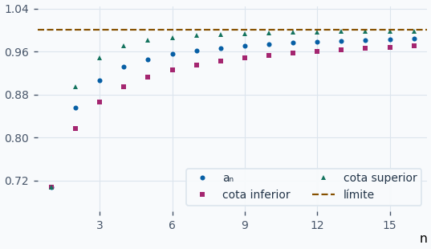
:::

::: original Ejemplo del PDF · Alternar con amplitud decreciente
Para \(aₙ=(−1)ⁿ/n\) se cumple \(∣aₙ∣=1/n→0\). Por tanto \(aₙ→0\). Las envolventes \(−1/n\) y \(1/n\) acotan los valores y se acercan al mismo nivel.

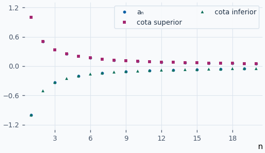
:::

::: ejemplo Ejemplo 1 · Seno acotado y factor pequeño
Sea \(aₙ=sen(n)/n\). Como \(∣sen(n)∣≤1\), se tiene \(∣aₙ∣≤1/n→0\). Por tanto el límite es \(0\), aunque los signos y las alturas del seno cambien.

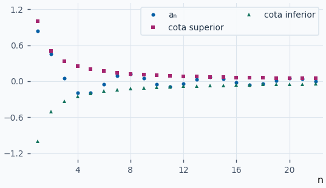
:::

::: ejemplo Ejemplo 2 · Comparar una suma con sus sumandos extremos
En \(aₙ=∑_{k=1}^{n}1/(n²+k)\), cada término está entre \(1/(n²+n)\) y \(1/(n²+1)\). Al sumar las cotas queda \(1/(n+1)≤aₙ≤n/(n²+1)\). Ambas tienden a cero. La presencia de \(n\) sumandos se incorpora antes del límite.

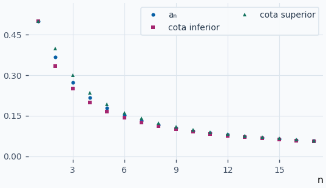
:::

::: ejemplo Ejemplo 3 · Usar una cota inferior para un límite infinito
Sea \(aₙ=n+cos(n)\). Entonces \(aₙ≥n−1\). Para cada umbral \(M\), \(n−1>M\) desde cierto índice. Por tanto \(aₙ→+∞\).

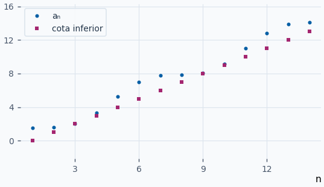
:::

**Ejercicios para resolver**

**1.** Halla \(lim_{n→∞}cos(n)/n²\).

::: solucion
Su módulo está acotado por \(1/n²\), que tiende a cero. Aplica la sucesión intermedia.
:::

**2.** Calcula el límite de \(∑_{k=1}^{n}1/(2n+k)²\).

::: solucion
Cada sumando es positivo y como máximo \(1/(2n+1)²\). La suma queda entre \(0\) y \(n/(2n+1)²→0\).
:::

**3.** Determina \(lim_{n→∞}(−n+sen(n))\).

::: solucion
Como \(sen(n)≤1\), se tiene \(−n+sen(n)≤−n+1→−∞\). Esa cota superior basta para obtener el límite.
:::

**4.** Si \(aₙ→0\) y \(∣bₙ∣≤4\), halla el límite de \(aₙbₙ\).

::: solucion
\(0≤∣aₙbₙ∣≤4∣aₙ∣→0\). Por el teorema, \(aₙbₙ→0\).
:::

## Límites importantes y órdenes de crecimiento {#limites-importantes}

| Expresión | Límite cuando \(n→∞\) | Hipótesis |
| --- | --- | --- |
| \(aₙ^{1/n}\) | \(L\) si \(a_{n+1}/aₙ→L\) | Términos positivos a partir de cierto índice. \(L\) puede ser \(0\) o \(+∞\). |
| \(1/nᵖ\) | \(0\) | \(p>0\). |
| \(log(n)/nᵖ\) | \(0\) | \(p>0\). El logaritmo crece más despacio que cualquier potencia positiva. |
| \(pⁿ\) | \(0\) | \(∣p∣<1\). |
| \((1+p/n)ⁿ\) | \(eᵖ\) | \(p∈ℝ\). La base es positiva para \(n\) suficientemente grande. |

**Del cociente a la raíz.** Para \(0<L<+∞\), fija \(0<u<L<v\). Desde cierto índice \(N\), \(u≤a_{n+1}/aₙ≤v\). Multiplicar cocientes consecutivos da \(a_{N}u^{n−N}≤aₙ≤a_{N}v^{n−N}\). Al tomar raíces \(n\)-ésimas, las cotas tienden a \(u\) y \(v\). Pueden elegirse tan cerca de \(L\) como se quiera. Para \(L=0\) basta cualquier cota superior \(v>0\). Para \(L=+∞\) basta cualquier cota inferior \(u>0\).

**Potencias y logaritmos.** Para \(log(n)/nᵖ\), el cociente de derivadas de \(log(x)/xᵖ\) es \(1/(pxᵖ)→0\) y se evalúa luego en los naturales. Para \(0<∣p∣<1\), se escribe \(∣p∣ⁿ=e^{n·log(∣p∣)}\) con exponente que tiende a \(−∞\). Para \((1+p/n)ⁿ\), toma logaritmos. Si \(p≠0\), \(n·log(1+p/n)=p·log(1+t)/t\) con \(t=p/n→0\). El cociente tiende a \(1\), así que al volver a la exponencial se obtiene \(eᵖ\). Si \(p=0\), la sucesión vale \(1\).

**Ejemplos resueltos**

::: original Ejemplo del PDF · La raíz n-ésima de n
Si \(aₙ=n\), el cociente \(a_{n+1}/aₙ=1+1/n\) tiende a \(1\). Por la relación anterior, \(n^{1/n}→1\). Los primeros puntos pueden subir. La conclusión depende del límite del cociente y no requiere monotonía de la sucesión de raíces.

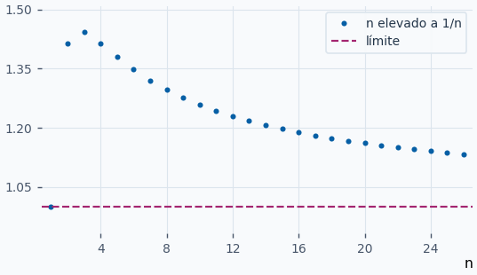
:::

::: ejemplo Ejemplo 1 · Una base negativa de módulo menor que uno
Para \(aₙ=(−2/3)ⁿ\), el módulo es \((2/3)ⁿ\) y tiende a \(0\). Por eso la sucesión converge a cero aunque alterne de signo en todos los índices.

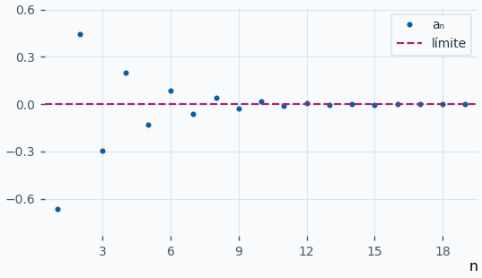
:::

::: ejemplo Ejemplo 2 · Potencia que aproxima e al cuadrado
Para \(aₙ=(1+2/n)ⁿ\), el parámetro es \(p=2\). Así \(log(aₙ)→2\) y \(aₙ→e²\). Para \(n=1\) el valor es \(3\) y para \(n=2\) es \(4\). Los puntos se acercan al nivel \(e²≈7,389\).

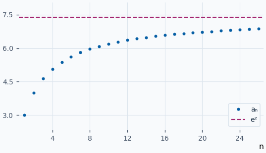
:::

::: ejemplo Ejemplo 3 · Una potencia domina al logaritmo
Para \(aₙ=log(n)/√n\), se aplica el resultado con \(p=1/2\). La sucesión tiende a cero. En índices pequeños puede subir, por eso se representan hasta cien índices para distinguir el descenso posterior.

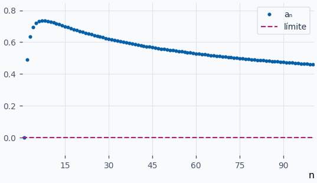
:::

**Ejercicios para resolver**

**1.** Calcula \(lim_{n→∞}(3ⁿn²)^{1/n}\).

::: solucion
Si \(aₙ=3ⁿn²\), entonces \(a_{n+1}/aₙ=3(1+1/n)²→3\). La raíz \(n\)-ésima tiene el mismo límite.
:::

**2.** Calcula \(lim_{n→∞}(1−3/n)ⁿ\) en su cola de base positiva.

::: solucion
Para \(n>3\) la base es positiva. La fórmula con \(p=−3\) da \(e^{−3}\).
:::

**3.** Calcula \(lim_{n→∞}log(n)/n³\).

::: solucion
Es el caso \(p=3>0\). También se puede aplicar L’Hôpital a \(log(x)/x³\) y obtener \(1/(3x³)→0\).
:::

**4.** Calcula \(lim_{n→∞}(1+4/n)^{2n}\).

::: solucion
\((1+4/n)^{2n}=[(1+4/n)ⁿ]²\). El interior tiende a \(e⁴\). El cuadrado tiende a \(e⁸\).
:::
