# 3.2 Series numéricas

El programa de Ingeniería Informática del Software sitúa las series numéricas en 3.2. Esta unidad desarrolla los criterios con material docente abierto. [Programa de Cálculo de la Universidad de Oviedo](https://ocw.uniovi.es/course/section.php?id=1012&lang=en) · [Transparencias de Cálculo para los Grados en Ingeniería · curso 2010–11](https://ocw.uniovi.es/pluginfile.php/5527/mod_resource/content/1/T_S%2CA_GIMECA01-1-001/beamer-tema3.pdf) · [Capítulo de sucesiones y series de OpenStax](https://openstax.org/books/calculus-volume-2/pages/5-key-concepts)

## Término general, sumas parciales y convergencia {#sumas-parciales}

A partir de una sucesión \(\{aₙ\}\) se forma otra sucesión \(\{Sₙ\}\) sumando sus primeros términos. El símbolo \(∑_{n=1}^{∞}aₙ\) representa la **serie**. La suma de la serie existe cuando sus sumas parciales tienen un límite real.

\(S₀=0,    Sₙ=∑_{k=1}^{n} a_{k}=a₁+a₂+⋯+aₙ\)

\(∑_{n=1}^{∞}aₙ=S ⇔ lim_{n→∞}Sₙ=S∈ℝ\)

| Qué ocurre con \(Sₙ\) | Carácter de la serie |
| --- | --- |
| Tiende a \(S∈ℝ\) | Convergente, con suma \(S\). |
| Tiende a \(+∞\) o \(−∞\) | Divergente hacia el infinito indicado. |
| Carece de límite | No converge. Indica cómo se comportan las sumas parciales, por ejemplo si oscilan entre dos alturas. |

**Condición necesaria.** Si \(Sₙ→S\), también \(S_{n−1}→S\). Por ello \(aₙ=Sₙ−S_{n−1}→0\). Si los términos no tienden a cero, la serie no converge. La condición \(aₙ→0\) por sí sola deja el carácter por decidir. La serie armónica será un contraejemplo.

**Colas y linealidad.** Quitar un número finito de términos resta una cantidad fija de cada suma parcial posterior y conserva el carácter. Para una serie convergente, el resto después de \(N\) términos es \(R_{N}=S−S_{N}=∑_{n=N+1}^{∞}aₙ\). Si \(∑aₙ=A\) y \(∑bₙ=B\) convergen, entonces \(∑(αaₙ+βbₙ)=αA+βB\), al aplicar las reglas de límites a las sumas parciales. El producto término a término sigue otro criterio.

**Ejemplos resueltos**

::: ejemplo Ejemplo 1 · Un término general con límite no nulo
Para \(aₙ=n/(n+1)\), \(aₙ→1\). La condición necesaria descarta la convergencia. De hecho \(aₙ≥1/2\), por lo que \(Sₙ≥n/2→+∞\). La gráfica compara los términos con la acumulación.

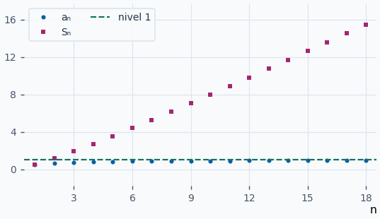
:::

::: ejemplo Ejemplo 2 · Restar los términos que se han quitado
Para \(aₙ=2^{-n}\), \(Sₙ=1−2^{-n}\). Si la serie empieza en \(n=3\), se quitan \(1/2+1/4=3/4\), así que su suma es \(1/4\). A partir de \(n=3\) las dos sumas parciales se separan exactamente en \(3/4\).

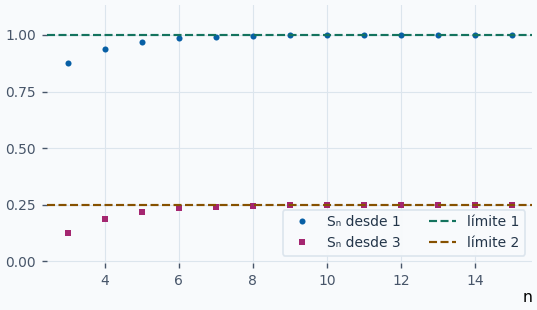
:::

::: ejemplo Ejemplo 3 · Combinar dos series convergentes
Toma \(aₙ=2^{-n}\) y \(bₙ=3^{-n}\), de sumas \(1\) y \(1/2\). Si \(cₙ=2aₙ−bₙ\), su suma es \(2·1−1/2=3/2\). Se aplica la misma combinación a cada suma parcial antes de tomar límites.

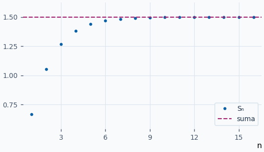
:::

**Ejercicios para resolver**

**1.** Calcula \(S₁,S₂,S₃\) si \(aₙ=n²\). ¿Puede converger la serie?

::: solucion
Las sumas son \(1,5,14\). Como \(aₙ=n²\) no tiende a cero, la serie no converge. Además \(Sₙ≥n²→+∞\).
:::

**2.** Si \(Sₙ=n/(n+2)\) y \(S₀=0\), halla \(aₙ\) y la suma de la serie.

::: solucion
\(aₙ=Sₙ−S_{n−1}=2/((n+1)(n+2))\). Como \(Sₙ→1\), la suma es \(1\).
:::

**3.** Si \(∑aₙ=7\) y \(a₁+a₂+a₃=2\), halla \(∑_{n=4}^{∞}aₙ\).

::: solucion
El resto \(R₃\) vale \(7−2=5\).
:::

**4.** Si \(∑aₙ=4\) y \(∑bₙ=−2\), halla \(∑(aₙ−3bₙ)\).

::: solucion
Ambas series convergen. La suma lineal vale \(4−3·(−2)=10\).
:::

## Series geométricas y telescópicas {#geometricas-y-telescopicas}

Una serie **geométrica** tiene primer término \(a\) y razón constante \(r\). Sus términos son \(a,ar,ar²,…\). Para hallar la suma parcial, escribe \(S_{N}\) y \(rS_{N}\). Al restar se cancelan los términos intermedios.

\((1−r)S_{N}=a−arᴺ\)

\(S_{N}=a\frac{1−rᴺ}{1−r}    (r≠1)\)

Si \(a≠0\) y \(∣r∣<1\), \(rᴺ→0\) y la suma es \(a/(1−r)\). Si \(∣r∣≥1\), los términos no tienden a cero. Cuando \(r=1\), \(S_{N}=Na\). Si \(a=0\), todos los términos y sumas son cero. Para una serie escrita como \(∑_{n=m}^{∞}crⁿ\), el primer término es \(crᵐ\).

Una serie **telescópica** contiene diferencias de términos consecutivos. Si \(aₙ=bₙ−b_{n+1}\), al desarrollar la suma se cancelan los términos intermedios.

\(S_{N}=(b₁−b₂)+(b₂−b₃)+⋯+(b_{N}−b_{N+1})=b₁−b_{N+1}\)

Si \(bₙ→B∈ℝ\), la suma es \(b₁−B\). A veces hay que factorizar o usar fracciones simples para descubrir la diferencia. Conserva el primer índice y escribe el último término que queda.

**Ejemplos resueltos**

::: ejemplo Ejemplo 1 · Una geométrica que alterna y converge
Para \(∑_{n=1}^{∞}3(−1/2)^{n−1}\), el primer término es \(3\) y la razón \(−1/2\). La suma es \(3/(1+1/2)=2\). Como \(S_{N}=2[1−(−1/2)ᴺ]\), los impares quedan por arriba y los pares por abajo.

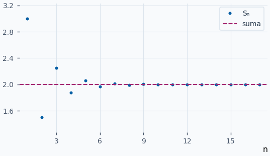
:::

::: ejemplo Ejemplo 2 · Una geométrica de razón menos uno
Para \(aₙ=2(−1)^{n−1}\), las sumas impares valen \(2\) y las pares \(0\). La razón tiene módulo \(1\) y los términos tampoco tienden a cero. Se obtienen dos alturas de sumas parciales sin un límite común.

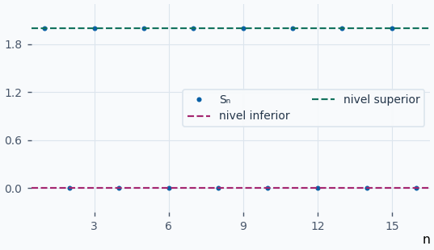
:::

::: ejemplo Ejemplo 3 · Telescópica con fracciones simples
Como \(1/[n(n+2)]=(1/2)[1/n−1/(n+2)]\), se cancelan los términos a dos posiciones de distancia.

\(S_{N}=\frac{1}{2}[1+1/2−1/(N+1)−1/(N+2)]→3/4\)

Quedan los dos primeros términos y dos términos de la cola. La gráfica sigue las sumas crecientes.

![Sumas de 1/\[n(n+2)\] que crecen hacia 3/4.](graficas/geometricas-y-telescopicas-3.png)
:::

**Ejercicios para resolver**

**1.** Suma \(∑_{n=0}^{∞}6/10ⁿ\).

::: solucion
Es geométrica con primer término \(6\) y razón \(1/10\). La suma es \(6/(1−1/10)=20/3\).
:::

**2.** Suma \(∑_{n=2}^{∞}(−1/3)ⁿ\).

::: solucion
El primer término es \(1/9\) y la razón \(−1/3\). La suma es \((1/9)/(1+1/3)=1/12\).
:::

**3.** Suma \(∑_{n=1}^{∞}1/((n+2)(n+3))\).

::: solucion
El término vale \(1/(n+2)−1/(n+3)\). La suma parcial es \(1/3−1/(N+3)\) y su límite es \(1/3\).
:::

**4.** Estudia \(∑_{n=1}^{∞}[√(n+1)−√n]\).

::: solucion
Las sumas se reducen a \(S_{N}=√(N+1)−1→+∞\). Aunque el término general tiende a cero, la serie diverge.
:::

## Serie armónica, armónica generalizada y criterio integral {#armonicas}

Si los términos son no negativos desde un índice, las sumas parciales crecen a partir de ese índice. Por el criterio de monotonía, la serie converge si están acotadas por arriba. Si no hay cota superior, tienden a \(+∞\).

La **armónica** \(∑_{n=1}^{∞}1/n\) diverge. En el bloque de índices \(2^{j−1}+1,…,2ʲ\) hay \(2^{j−1}\) términos y cada uno es al menos \(1/2ʲ\). Cada bloque suma al menos \(1/2\), así que \(S_{2ᵐ}≥1+m/2→+∞\). Esta prueba permite que todos los términos tiendan a cero mientras las sumas siguen creciendo.

**Criterio integral.** Si \(aₙ=f(n)\) para \(n≥m\) y \(f\) es positiva, continua y decreciente en \([m,+∞)\), la serie y \(∫_{m}^{∞}f(x)dx\) tienen el mismo carácter. En \([n,n+1]\) el área bajo \(f\) queda entre los rectángulos de alturas \(f(n+1)\) y \(f(n)\). Al sumar rectángulos se obtienen las dos cotas.

\(∫_{m}^{N+1}f(x)dx ≤ ∑_{n=m}^{N} aₙ ≤ f(m)+∫_{m}^{N}f(x)dx\)

Si converge, para \(N≥m\) también se cumple \(∫_{N+1}^{∞}f(x)dx≤R_{N}≤∫_{N}^{∞}f(x)dx\).

| Serie | Carácter | Justificación |
| --- | --- | --- |
| \(∑_{n=1}^{∞}1/nᵖ\) con \(p>1\) | Converge. | La primitiva \(x^{1−p}/(1−p)\) tiene límite finito. |
| La misma con \(0<p<1\) | Diverge a \(+∞\). | La primitiva crece sin cota. |
| \(p=1\) | Diverge a \(+∞\). | La primitiva es \(log(x)\) o se usan los bloques anteriores. |
| \(p≤0\) | Diverge a \(+∞\). | Los términos son al menos \(1\). |

**Ejemplos resueltos**

::: ejemplo Ejemplo 1 · Las sumas armónicas y una cota inferior
Para \(H_{N}=∑_{n=1}^{N}1/n\), los rectángulos dan \(log(N+1)≤H_{N}\). La cota crece sin límite. En la gráfica ambas trazas suben despacio, lo cual explica por qué observar solo unos pocos índices puede resultar engañoso.

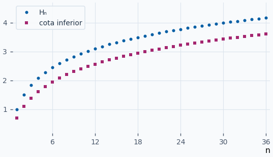
:::

::: ejemplo Ejemplo 2 · Una armónica generalizada convergente
Para \(∑_{n=1}^{∞}1/n²\), \(p=2\). El resto está entre \(1/(N+1)\) y \(1/N\). Con \(N=10\) el error al usar \(S_{10}\) es a lo sumo \(0,1\). La gráfica muestra las sumas y la cota superior \(S_{N}+1/N\).

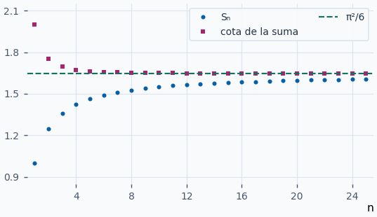
:::

::: ejemplo Ejemplo 3 · Un logaritmo en el denominador
Para \(aₙ=1/[n(log(n))²]\) con \(n≥2\), la función correspondiente es positiva y decreciente. La sustitución \(t=log(x)\) da \(∫_{2}^{∞}dx/[x(log(x))²]=1/log(2)\). Por el criterio integral, la serie converge. La gráfica muestra las sumas bajo la cota \(a₂+1/log(2)\).

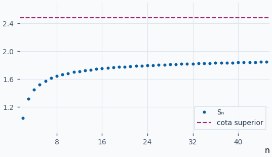
:::

**Ejercicios para resolver**

**1.** Estudia \(∑_{n=1}^{∞}1/√n\).

::: solucion
Es una armónica generalizada con \(p=1/2\). La integral \(∫_{1}^{T} x^{−1/2}dx=2(√T−1)\) crece sin cota, así que diverge.
:::

**2.** Estudia \(∑_{n=2}^{∞}1/[n·log(n)]\).

::: solucion
La función es positiva, continua y decreciente desde \(2\). La primitiva es \(log(log(x))\), que tiende a \(+∞\). La serie diverge.
:::

**3.** Acota el resto de \(∑1/n³\) después de \(N\) términos.

::: solucion
La integral de \(x^{-3}\) desde \(N\) a infinito es \(1/(2N²)\). Desde \(N+1\) vale \(1/(2(N+1)²)\). Por tanto \(1/(2(N+1)²)≤R_{N}≤1/(2N²)\).
:::

**4.** ¿Cuántos términos de \(∑1/n²\) bastan para que la cota del error sea estrictamente menor que \(0,01\)?

::: solucion
Como \(R_{N}≤1/N\), basta exigir \(1/N<0,01\). Un índice que lo garantiza es \(N=101\).
:::

## Comparación directa, por límite y criterio del producto {#comparacion}

Compara series de términos no negativos desde cierto índice. Las desigualdades entre términos pasan a las sumas parciales de la cola.

| Información desde cierto índice | Conclusión |
| --- | --- |
| \(0≤aₙ≤bₙ\) y \(∑bₙ\) converge | \(∑aₙ\) converge por acotación de sus sumas parciales. |
| \(0≤bₙ≤aₙ\) y \(∑bₙ\) diverge | \(∑aₙ\) diverge hacia \(+∞\). |

**Comparación por límite.** Supón \(bₙ>0\) a partir de un índice y calcula \(L=lim_{n→∞}aₙ/bₙ\). Para \(0<L<+∞\), ambos términos quedan comparados mediante constantes positivas. Por ejemplo, desde cierto índice \((L/2)bₙ≤aₙ≤(3L/2)bₙ\). Las dos series tienen el mismo carácter. Si \(L=0\) y \(∑bₙ\) converge, también converge \(∑aₙ\). Si \(L=+∞\) y \(∑bₙ\) diverge, también diverge \(∑aₙ\).

**Criterio del producto o de Pringsheim.** Elige \(bₙ=1/nᵖ\) y estudia \(nᵖaₙ\). Si el límite es positivo y finito, converge para \(p>1\) y diverge para \(p≤1\). Si el límite es \(0\) con \(p>1\), converge. Si es \(+∞\) con \(p≤1\), diverge. La conclusión sale de la comparación anterior. Para los demás casos el límite por sí solo puede quedar sin decidir.

**Ejemplos resueltos**

::: ejemplo Ejemplo 1 · Comparar por arriba con una serie conocida
Para \(aₙ=1/(n²+n+1)\), \(0<aₙ≤1/n²\). La armónica generalizada con \(p=2\) converge. Por tanto, las sumas de \(aₙ\) quedan acotadas y la serie converge.

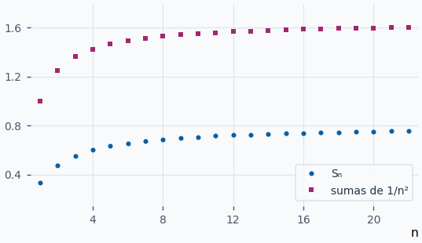
:::

::: ejemplo Ejemplo 2 · Un cociente que tiende a una constante
Compara \(aₙ=(3n+1)/(n²+5)\) con \(bₙ=1/n\). Entonces \(aₙ/bₙ=(3n²+n)/(n²+5)→3\). Ambas series divergen por comparación con la armónica. La gráfica representa el cociente para ver su límite.

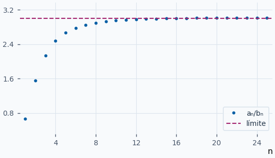
:::

::: ejemplo Ejemplo 3 · Producto que tiende a cero
Para \(aₙ=log(n)/n³\), elige \(p=2\). Se obtiene \(n²aₙ=log(n)/n→0\). Como \(∑1/n²\) converge, también converge \(∑aₙ\). El producto de comparación, mostrado en la gráfica, acaba decreciendo hacia cero.

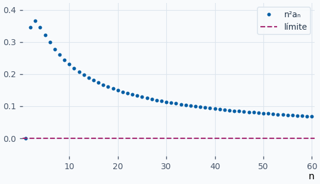
:::

**Ejercicios para resolver**

**1.** Decide si \(∑_{n=1}^{∞}1/(4n+7)\) converge.

::: solucion
Compara con \(1/n\). El cociente \(n/(4n+7)→1/4\) y la armónica diverge.
:::

**2.** Estudia \(∑_{n=1}^{∞}n/(n³+2)\).

::: solucion
\(n²·n/(n³+2)=n³/(n³+2)→1\). Se comporta como \(∑1/n²\), que converge.
:::

**3.** Estudia \(∑_{n=1}^{∞}1/(√n+1)\).

::: solucion
\(√n/(√n+1)→1\). Por comparación por límite con \(1/√n\), la serie diverge.
:::

**4.** ¿Puede deducirse el carácter de \(∑aₙ\) solo de \(0≤aₙ≤1/n\)? Da dos casos.

::: solucion
La cota superior es divergente. Tanto \(aₙ=1/n²\) como \(aₙ=1/n\) la satisfacen. La primera serie converge y la segunda diverge.
:::

## Criterios del cociente, la raíz y Raabe {#cociente-raiz-raabe}

Para una serie de términos positivos en la cola se estudian estos límites. Si los signos varían, el cociente y la raíz se pueden aplicar a los módulos para estudiar convergencia absoluta.

| Criterio | Converge | Diverge |
| --- | --- | --- |
| D’Alembert o cociente | \(L<1\) | \(L>1\) |
| Cauchy o raíz | \(L<1\) | \(L>1\) |
| Raabe | \(R>1\) | \(R<1\) |

**Cociente.**

\(L=lim_{n→∞}\frac{a_{n+1}}{aₙ}\)

Si \(L<1\), elige \(L<r<1\). Desde cierto índice \(N\) se tiene \(a_{n+1}≤raₙ\), y por iteración \(aₙ≤a_{N}r^{n−N}\). Esa cola geométrica converge. Si el cociente es al menos \(1\) desde cierto índice, los términos quedan por encima de un valor positivo y la serie diverge. Esto ocurre cuando \(L>1\), incluido \(L=+∞\).

**Raíz.**

\(L=lim_{n→∞}aₙ^{1/n}\)

Si \(L<1\) se elige \(L<r<1\) y se obtiene \(aₙ≤rⁿ\) para índices grandes. Si \(L>1\), incluidos los límites \(+∞\), los términos superan \(1\) desde cierto índice. Cuando el cociente o la raíz dan \(1\), pueden darse convergencia y divergencia. Para \(1/n²\) y \(1/n\) ambos límites valen \(1\).

**Raabe.**

\(R=lim_{n→∞} n(1−\frac{a_{n+1}}{aₙ})\)

Compara con \(bₙ=1/nᵖ\). Como \(n(1−b_{n+1}/bₙ)→p\), si \(R>1\) se elige \(1<p<R\). Desde cierto índice \(a_{n+1}/aₙ<b_{n+1}/bₙ\), de modo que \(aₙ/bₙ\) decrece y \(aₙ≤Cbₙ\). Si \(R<1\) se elige \(R<p<1\) con \(p>0\). Se invierten las desigualdades y \(aₙ≥cbₙ\) con \(c>0\). El valor \(R=1\) requiere otro criterio.

**Ejemplos resueltos**

::: ejemplo Ejemplo 1 · Un factorial que se cancela en el cociente
Para \(aₙ=2ⁿ/n!\), se obtiene \(a_{n+1}/aₙ=2/(n+1)→0\). La serie converge por D’Alembert. En la gráfica los primeros términos pueden ser iguales, pero los cocientes se hacen pequeños.

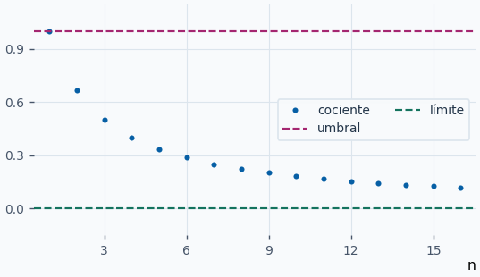
:::

::: ejemplo Ejemplo 2 · Una potencia cuyo exponente es n
Para \(aₙ=[(2n+1)/(5n+3)]ⁿ\), la raíz \(n\)-ésima deja \((2n+1)/(5n+3)→2/5<1\). La serie converge. La raíz evita expandir o comparar potencias consecutivas.

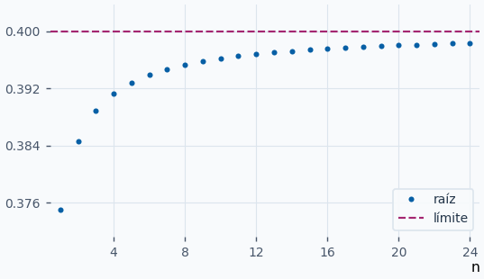
:::

::: ejemplo Ejemplo 3 · Raabe resuelve un cociente de límite uno
Sea \(aₙ=∏_{k=1}^{n}(2k−1)/(2k+2)\). El cociente \(a_{n+1}/aₙ=(2n+1)/(2n+4)\) tiende a \(1\). El producto de Raabe es \(n·3/(2n+4)→3/2>1\). La serie converge. En la gráfica se compara ese producto con el umbral \(1\).

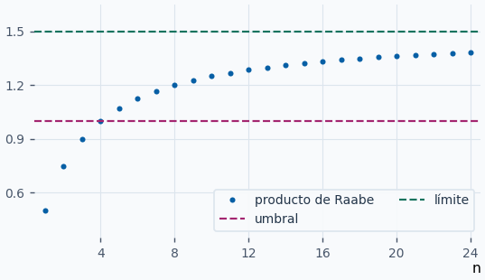
:::

**Ejercicios para resolver**

**1.** Estudia \(∑_{n=1}^{∞}n!/3ⁿ\).

::: solucion
El cociente vale \((n+1)/3→+∞\). Los términos no tienden a cero y las sumas divergen a \(+∞\).
:::

**2.** Estudia \(∑_{n=1}^{∞}[(3n+1)/(2n+4)]ⁿ\).

::: solucion
La raíz \(n\)-ésima tiende a \(3/2>1\). Por Cauchy la serie diverge.
:::

**3.** Aplica Raabe a \(aₙ=1/n²\).

::: solucion
El cociente es \((n/(n+1))²\). El producto de Raabe es \(n(2n+1)/(n+1)²→2\). La serie converge.
:::

**4.** ¿Qué da Raabe para \(aₙ=1/n\)? Decide el carácter.

::: solucion
\(n(1−n/(n+1))=n/(n+1)→1\). Raabe queda sin decidir. La serie armónica diverge.
:::

## Series alternadas, criterio de Leibniz y error {#leibniz}

Una serie **alternada** tiene la forma \(∑_{n=1}^{∞}(−1)^{n+1}bₙ\) o \(∑_{n=1}^{∞}(−1)ⁿbₙ\), con \(bₙ≥0\). El criterio de Leibniz asegura convergencia si \(b_{n+1}≤bₙ\) a partir de cierto índice y \(bₙ→0\).

Si el primer término de la cola es positivo, las sumas pares crecen porque añaden diferencias \(b_{2j+1}−b_{2j+2}≥0\). Las sumas impares decrecen porque añaden \(−b_{2j}+b_{2j+1}≤0\). Las pares quedan por debajo de las impares. La distancia entre sumas consecutivas es \(b_{n+1}\) y tiende a cero. Por tanto las dos subsucesiones se acercan a la misma suma \(S\). Si empieza con signo negativo se aplica el argumento a la serie opuesta.

**Error al truncar.** Cuando \(N\) está en la cola monótona, la suma está entre \(S_{N}\) y \(S_{N+1}\). El resto tiene el signo del primer término omitido, salvo cuando vale cero.

\(∣R_{N}∣=∣S−S_{N}∣≤b_{N+1}\)

**Ejemplos resueltos**

::: original Ejemplo del PDF · La armónica alternada
Para \(∑_{n=1}^{∞}(−1)^{n+1}/n\), los módulos \(1/n\) decrecen y tienden a \(0\). Leibniz da convergencia. Para identificar la suma, integra entre \(0\) y \(1\) la identidad \(1/(1+x)=∑_{k=0}^{N−1}(−x)ᵏ+(−x)ᴺ/(1+x)\). La integral de la parte finita es \(S_{N}\) y el resto queda acotado por \(1/(N+1)\). Por tanto \(S=log(2)\).

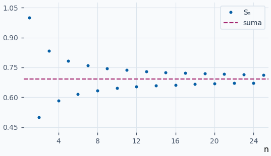
:::

::: ejemplo Ejemplo 1 · Alternar con módulos que decrecen
Sea \(aₙ=(−1)ⁿ/(2n+1)\). Su módulo decrece a cero. La serie converge por Leibniz y, al empezar con signo negativo, las sumas impares quedan por debajo de la suma y las pares por encima. La gráfica permite ver cómo se estrechan esos dos límites.

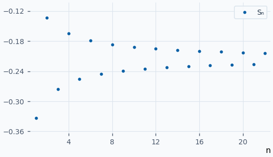
:::

::: ejemplo Ejemplo 2 · Acotar el error con una potencia cúbica
Para \(aₙ=(−1)^{n+1}/n³\), la condición de Leibniz se cumple. Con \(N=5\), \(0≤S₅−S≤1/6³=1/216\), porque el término sexto es negativo. El segmento entre \(S₆\) y \(S₅\) acota la suma.

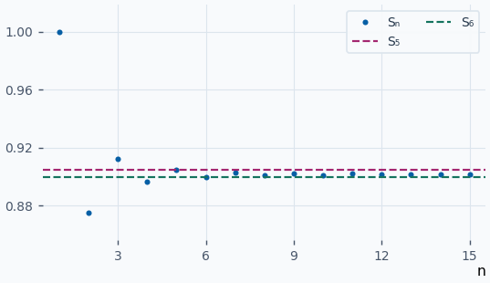
:::

::: ejemplo Ejemplo 3 · El cambio de signo no garantiza convergencia
Para \(aₙ=(−1)^{n+1}(n+2)/(2n+1)\), el módulo tiende a \(1/2\). Falla la condición necesaria del término general. Las sumas pares e impares se mantienen separadas y la alternancia sola no proporciona un límite común.

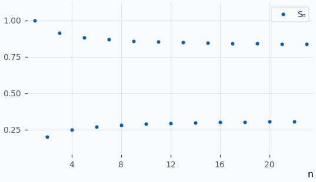
:::

**Ejercicios para resolver**

**1.** Estudia \(∑_{n=1}^{∞}(−1)ⁿ/√n\).

::: solucion
\(bₙ=1/√n\) es decreciente y tiende a cero. Por Leibniz, la serie converge.
:::

**2.** Acota el error de \(S₉\) para \(∑_{n=1}^{∞}(−1)^{n+1}/(n+1)²\).

::: solucion
El primer término omitido tiene índice \(10\) y módulo \(1/121\). Como tiene signo negativo, \(0≤S₉−S≤1/121\).
:::

**3.** Para la armónica alternada, encuentra un \(N\) que garantice por Leibniz un error menor que \(1/100\).

::: solucion
Pide \(1/(N+1)<1/100\). Basta \(N=100\).
:::

**4.** Estudia \(∑_{n=1}^{∞}(−1)ⁿ n/(2n+3)\).

::: solucion
El módulo tiende a \(1/2\) y el término general no tiende a cero. La serie no converge.
:::

## Convergencia absoluta, agrupación y reordenación {#convergencia-absoluta}

Una serie \(∑aₙ\) es **absolutamente convergente** si converge \(∑∣aₙ∣\). Si converge \(∑aₙ\) y diverge la de módulos, es **condicionalmente convergente**. La armónica alternada es condicional, ya que su serie de módulos es la armónica.

Para justificar que la convergencia absoluta implica convergencia, separa \(aₙ=aₙ^+−aₙ^−\), donde \(aₙ^+=max(aₙ,0)\) y \(aₙ^−=max(−aₙ,0)\). Ambas series son no negativas y están dominadas por \(∑∣aₙ∣\). Las dos sumas convergen y su diferencia es la suma de \(∑aₙ\). Si la convergencia es condicional, ambas series de partes positivas y negativas divergen a \(+∞\). Si una fuera finita, la convergencia de su diferencia obligaría a la otra a ser finita.

| Operación | Qué permite conservar |
| --- | --- |
| Agrupar bloques finitos de términos consecutivos de una serie convergente | Conserva la suma, porque las nuevas sumas parciales forman una subsucesión de las anteriores. |
| Descomponer un término en varios sumandos | Requiere controlar las sumas parciales intermedias. En una serie no negativa, si también lo son los nuevos sumandos, quedan entre sumas parciales consecutivas. |
| Reordenar una serie absolutamente convergente | Conserva la suma. Tras incluir un bloque inicial original, el cambio posible queda acotado por la cola de la serie de módulos. |
| Reordenar una serie condicionalmente convergente | Puede alterar la suma. |

Las series de términos no negativos admiten reordenaciones que conservan la suma cuando convergen y el límite \(+∞\) cuando divergen. En el último caso, cualquier suma parcial original suficientemente grande queda incluida en algún prefijo de la reordenación, lo cual basta para superar cualquier umbral.

**Ejemplos resueltos**

::: original Ejemplo del PDF · Agrupar una serie oscilante
En \(−1+1−1+1+⋯\), las sumas parciales alternan entre \(−1\) y \(0\). Si se agrupa de dos en dos desde el principio solo se ven los índices pares y aparece \(0\). Si se deja el primer término aislado y se agrupa el resto, se ven los índices impares y aparece \(−1\). Las dos agrupaciones seleccionan subsucesiones diferentes y la serie original carece de suma.

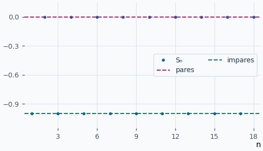
:::

::: original Ejemplo del PDF · Intercalar sumas parciales nuevas al descomponer
La serie \(∑2^{-n}\) suma \(1\). Si cada término se escribe como \(1+(2^{-n}−1)\) y se leen los sumandos por separado, las sumas pares siguen tendiendo a \(1\), pero las impares tienden a \(2\). La serie descompuesta carece de límite.

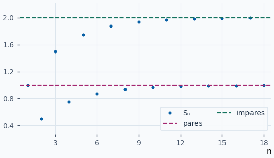
:::

::: original Ejemplo del PDF · Reordenar la armónica alternada
Toma repetidamente un término positivo y dos negativos, conservando el orden dentro de cada signo. Tras \(m\) bloques se han usado los primeros \(m\) positivos y \(2m\) negativos. La suma es \(S_{2m}−(H_{2m}−H_{m})/2\), donde \(H_{j}\) es la suma armónica. Por comparación integral, \(H_{2m}−H_{m}→log(2)\), y \(S_{2m}→log(2)\). El límite reordenado es \(log(2)/2\). Los términos dentro de cada bloque tienden a cero, así que las sumas intermedias dan el mismo límite.

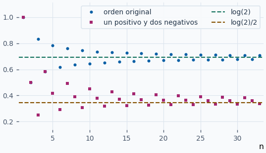
:::

::: ejemplo Ejemplo 1 · Signos irregulares con una cota sumable
Para \(aₙ=cos(n)/n²\), se cumple \(∣aₙ∣≤1/n²\). La serie de módulos converge por comparación. Las sumas con signo pueden subir o bajar, mientras que las sumas de módulos crecen y están acotadas.

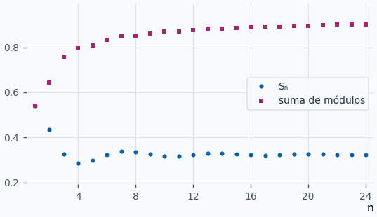
:::

::: ejemplo Ejemplo 2 · Convergencia condicional más lenta
Para \(aₙ=(−1)^{n+1}/√n\), Leibniz da convergencia porque \(1/√n\) decrece a cero. La serie de módulos es una armónica generalizada con \(p=1/2\) y diverge. La gráfica muestra ambas acumulaciones.

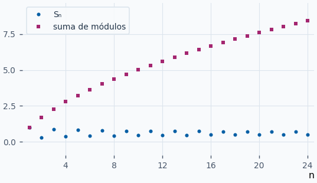
:::

::: ejemplo Ejemplo 3 · Agrupar sin perder la suma
Para \(aₙ=(1/3)ⁿ\), la serie suma \(1/2\). Si se agrupa de tres en tres, las nuevas sumas parciales son \(T_{m}=S_{3m}\). Como \(S_{N}=(1−3^{-N})/2\), ambas colas tienden a \(1/2\). En la gráfica se destacan los índices que quedan al agrupar.

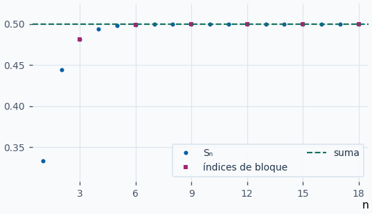
:::

**Ejercicios para resolver**

**1.** Clasifica \(∑_{n=1}^{∞}(−1)ⁿ/n³\) como absoluta, condicional o divergente.

::: solucion
La serie de módulos es \(∑1/n³\), convergente. Por tanto, es absolutamente convergente.
:::

**2.** Clasifica \(∑_{n=1}^{∞}(−1)^{n+1}/(n+3)\).

::: solucion
Los módulos decrecen a cero, de modo que converge por Leibniz. La serie de módulos es una cola de la armónica, que diverge. Es condicional.
:::

**3.** ¿Converge absolutamente \(∑_{n=1}^{∞}sen(n)/2ⁿ\)?

::: solucion
Sí. El módulo está acotado por \(2^{-n}\), que forma una serie geométrica convergente.
:::

**4.** Sea \(∑aₙ\) convergente a \(S\). ¿A qué tienden las sumas obtenidas tomando el primer término solo y agrupando el resto por parejas?

::: solucion
Son \(S₁,S₃,S₅,…\). Como subsucesión de sumas parciales, conservan el límite \(S\).
:::
