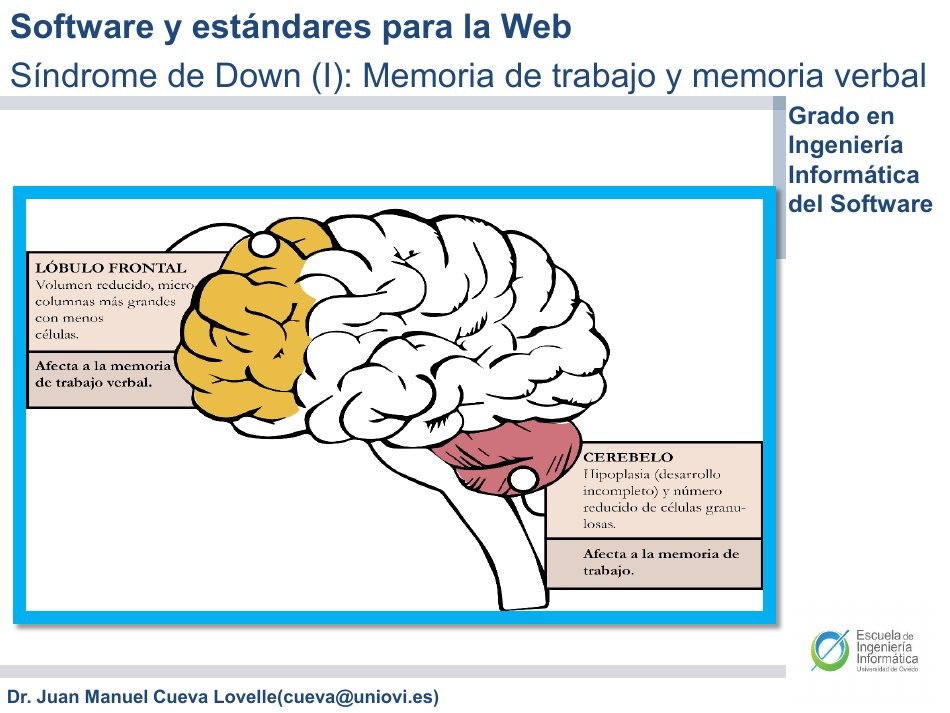
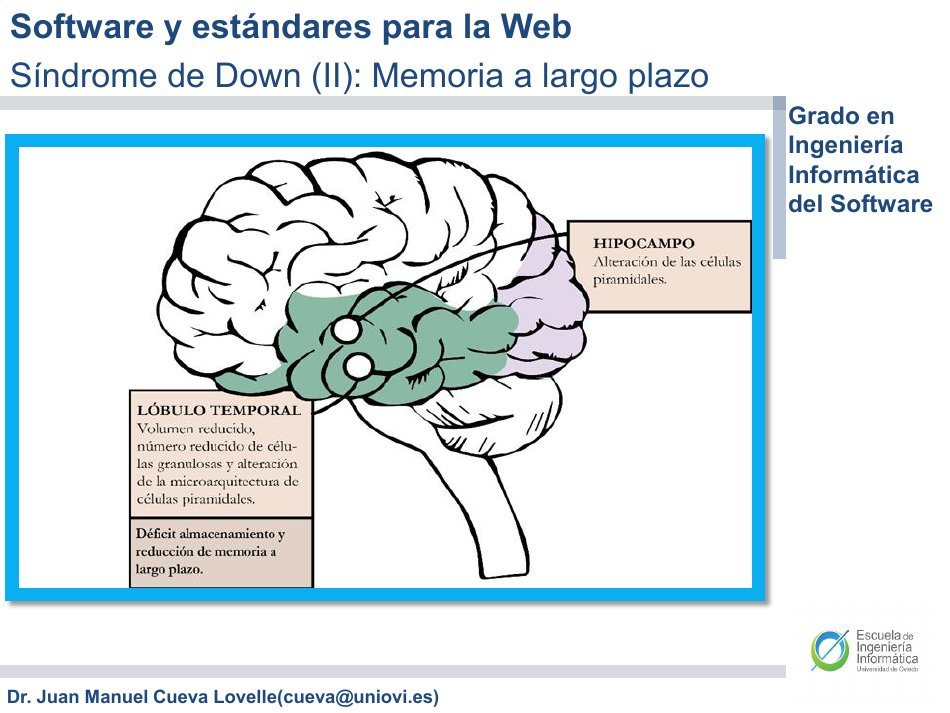
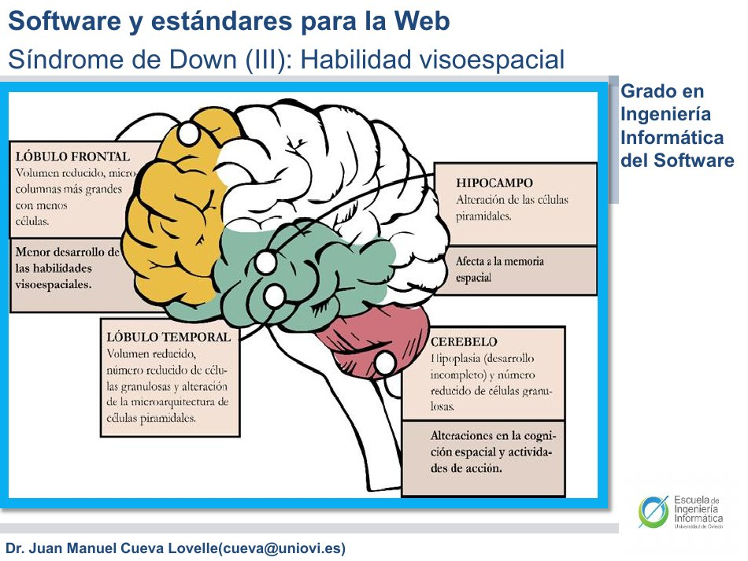
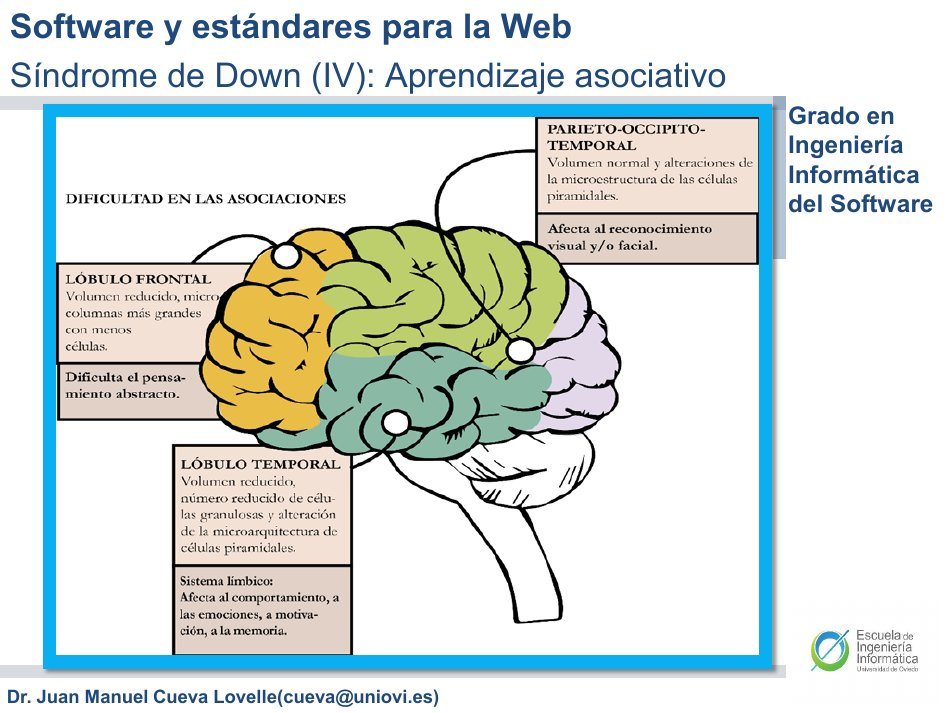
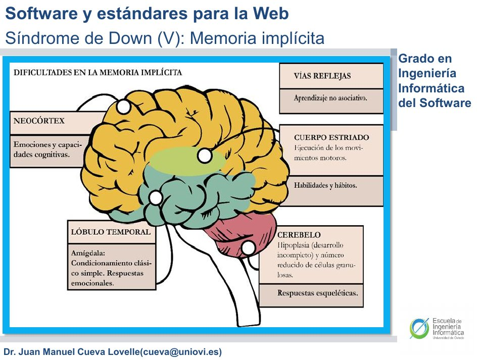
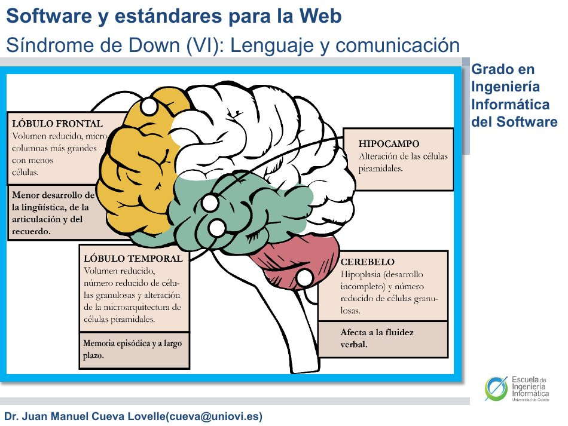

# Accesibilidad Web

## Contenido

1. [Introducción y objetivos](#introduccion-y-objetivos)
2. [Diseño universal](#diseno-universal)
3. [Tipos de discapacidades](#tipos-de-discapacidades)
4. [Discapacidades visuales: ceguera al color](#discapacidades-visuales-ceguera-al-color)
5. [Discapacidades visuales: visión reducida](#discapacidades-visuales-vision-reducida)
6. [Discapacidades visuales: ceguera](#discapacidades-visuales-ceguera)
7. [Discapacidades auditivas](#discapacidades-auditivas)
8. [Discapacidades de movimiento](#discapacidades-de-movimiento)
9. [Discapacidades cognoscitivas](#discapacidades-cognoscitivas)
10. [Síndrome de Down y barreras de interacción](#sindrome-de-down-y-barreras-de-interaccion)
11. [Comprobación de la accesibilidad](#comprobacion-de-la-accesibilidad)
12. [Normativa AENOR y evolución española](#normativa-aenor-y-evolucion-espanola)
13. [Normativa europea y aplicaciones móviles](#normativa-europea-y-aplicaciones-moviles)
14. [WAI y evolución de WCAG](#wai-y-evolucion-de-wcag)
15. [Normativa ISO y sanciones](#normativa-iso-y-sanciones)
16. [Herramientas de comprobación](#herramientas-de-comprobacion)
17. [Errores frecuentes y límites del material](#errores-frecuentes-y-limites-del-material)
18. [Preguntas de repaso y práctica](#preguntas-de-repaso-y-practica)
19. [Resumen final](#resumen-final)
20. [Evaluación y trabajos del seminario](#evaluacion-y-trabajos-del-seminario)
21. [Referencias y cobertura](#referencias-y-cobertura)

## Introducción y objetivos

Las personas difieren en sus capacidades, experiencia y condiciones de uso. Una interfaz debe acomodarse a esa diversidad para que sus usuarios puedan utilizarla sin barreras innecesarias. El seminario denomina **usabilidad universal** al objetivo de que esas diferencias no limiten el uso de los productos y defiende que **la Web debe ser accesible para todas las personas**.

La presentación explica que la etiqueta de discapacidad se asocia a diferencias individuales que superan determinados límites, y que muchas de esas características también aparecen, en menor grado, en otras personas. Por eso, atender las recomendaciones de accesibilidad beneficia a un conjunto más amplio que el de quienes presentan las limitaciones más acusadas. La ceguera al color sirve como primer ejemplo.

Los objetivos de estudio son comprender el diseño universal, distinguir los tipos de barreras y sus alternativas, conocer las referencias normativas que recoge el profesor e interpretar las pruebas y herramientas de evaluación. La accesibilidad afecta tanto a la **salida de información** como a la **entrada de datos y navegación**.

[Ver introducción, páginas 4 y 5](4-Accesibilidad-Web.pdf#page=4).

::: aviso Alcance de estos apuntes
El PDF es la única fuente teórica de la unidad. Las fechas, cifras, nombres de productos, estados de especificaciones y referencias jurídicas se presentan como información del material docente. Se indican sus contradicciones y límites; no se convierten en una comprobación de vigencia legal ni de prestaciones actuales de herramientas.
:::

## Diseño universal

### Definición e importancia

El **diseño universal** es el proceso de diseñar productos usables por el rango más amplio de personas, en el rango más amplio de situaciones, de una manera comercialmente practicable. La definición reúne diversidad de usuarios, diversidad de situaciones y viabilidad del producto; no se limita a una adaptación aislada.

Para mostrar la importancia de las diferencias individuales, la página 8 cita a Egan (1988): en grupos de unas **30 personas** las diferencias pueden alcanzar a menudo un **factor de 20**. El PDF no especifica aquí una tarea o métrica con la que recalcular ese factor. También reproduce una estimación de Microsoft del **año 2000** según la cual uno de cada cinco estadounidenses tenía alguna necesidad especial. Son referencias históricas del documento, no estadísticas actualizadas.

El profesor relaciona esta diversidad con el objetivo de llegar a más usuarios, las políticas de contratación de grandes empresas e instituciones y la existencia de requisitos públicos de accesibilidad. La Web puede paliar barreras de movilidad si el software permite realizar las tareas de forma sencilla; disponer de un servicio en Internet no elimina por sí solo las dificultades de acceso.

[Ver definición e importancia, páginas 7 a 9](4-Accesibilidad-Web.pdf#page=7).

### Los siete principios

| Principio | Significado en la presentación |
|---|---|
| **1. Uso equitativo** | Diseño usable y con precio razonable para personas con diferentes habilidades. |
| **2. Uso flexible** | Acomodación a un rango amplio de gustos y habilidades. |
| **3. Uso simple e intuitivo** | Facilidad de comprensión, independientemente de experiencia, conocimientos o concentración. |
| **4. Información perceptible** | Comunicación efectiva de la información necesaria pese a condiciones ambientales o diferencias sensoriales. |
| **5. Tolerancia para el error** | Minimización de incidentes por azar y de consecuencias adversas de acciones no previstas. |
| **6. Esfuerzo físico mínimo** | Uso eficiente y confortable con la menor fatiga posible. |
| **7. Tamaño y espacio para aproximarse y usar** | Dimensiones y espacio adecuados para aproximación, alcance y utilización. |

Estos principios abordan problemas distintos. **Percibir información** no equivale a **comprender la interfaz**; **reducir fatiga** no equivale a **reducir las consecuencias de un error**. Las dos últimas ideas corresponden, respectivamente, a esfuerzo físico mínimo y tolerancia para el error.

**Explicación didáctica:** una advertencia que solo suena plantea un problema de percepción para quien no puede oírla; una interfaz con demasiadas decisiones difíciles plantea además un problema de comprensión. Identificar la barrera ayuda a elegir el principio relevante.

[Ver principios, páginas 10 y 11](4-Accesibilidad-Web.pdf#page=10).

## Tipos de discapacidades

El documento clasifica las discapacidades atendiendo a los **sentidos corporales** y a la **capacidad para aprender y asimilar conocimientos**:

| Grupo | Desglose o dificultades estudiadas |
|---|---|
| **Visuales** | Ceguera al color, visión reducida y ceguera. |
| **Auditivas** | Acceso a avisos sonoros, audio y contenido cuyo vocabulario necesita especial atención. |
| **De movimiento o motoras** | Manejo del puntero, combinaciones de teclas, pulsaciones sostenidas y necesidad de entradas alternativas. |
| **Cognoscitivas** | Comprensión, aprendizaje, memoria, orientación e interpretación de conceptos de la interfaz. |

La clasificación organiza el estudio; las soluciones se relacionan entre sí. El teclado, por ejemplo, aparece como alternativa tanto en ceguera como en dificultades de movimiento. Una solución útil para una barrera puede resultar insuficiente para otra.

[Ver clasificación, página 13](4-Accesibilidad-Web.pdf#page=13).

## Discapacidades visuales: ceguera al color

### Percepción del color y figuras explicativas

La presentación describe **bastones y conos** sensibles a la luz y atribuye a los conos la percepción del color. Emplea un modelo de tres tipos de conos asociados al rojo, verde y azul, cuya combinación permite percibir otros colores. Explica los defectos de visión del color mediante carencias de alguno de esos tipos y cita **8 % de hombres y 0,5 % de mujeres**. Son las cifras de la diapositiva 15, sin precisar población o estudio de procedencia.

Las figuras desarrollan esta explicación:

- **Página 16:** comparación de la estructura de un bastón y un cono; aparecen segmentos, núcleo y terminal sináptica. Ilustra que son receptores diferenciados.
- **Páginas 17 y 18:** situación del espectro visible dentro del espectro electromagnético y representación de sensibilidad a distintas longitudes de onda. La idea docente es que la sensibilidad no es uniforme para todos los colores.
- **Página 19:** ruedas cromáticas y bandas de color con todos los conos y sin azul, rojo o verde. La misma combinación visual puede distinguirse de otra forma según la percepción.
- **Página 20:** bandas comparadas bajo visión normal, anomalías de percepción, protanopia, deuteranopia, tritanopia y visión acromática. La figura permite observar la pérdida de distinción entre colores; no proporciona un procedimiento clínico de diagnóstico.

[Ver figuras de percepción, páginas 16 a 20](4-Accesibilidad-Web.pdf#page=16).

### No transmitir información importante solo mediante color

La regla central es **no codificar ninguna conducta importante únicamente mediante colores**. Debe reforzarse con etiquetas u otros elementos gráficos que comuniquen la misma información.

En la **metáfora del semáforo** de la página 21 aparecen controles verde, amarillo y rojo con las etiquetas **Adelante, Ayuda y Salir**. Las simulaciones de ausencia de sensibilidad a distintos colores muestran que no basta con identificar una función por su tono. El texto mantiene la distinción entre acciones aunque los colores se confundan.

La figura de la página 22 enumera combinaciones a evitar: **verde/rojo, verde/marrón, azul/púrpura, verde/azul, verde claro/amarillo, azul/gris, verde/gris y verde/negro**. Las muestras comparan diferencias visibles y diferencias que pueden perderse. La lista no sustituye la evaluación de una combinación concreta.

| Ejemplo visual original | Problema | Alternativa explicada |
|---|---|---|
| Mensajes de éxito y error, p. 23 | Distinguir el resultado únicamente por verde o rojo. | Añadir texto comprensible e iconos diferenciados; la figura contrasta diseños malos, válidos y mejores. |
| Campos obligatorios, p. 24 | Marcar los campos necesarios solo con una etiqueta roja. | Usar un asterisco o icono que identifique la obligatoriedad. |
| Gráficos de barras, p. 25 | Asociar categorías exclusivamente a colores. | Complementar con tramas, texturas y texto; se contrasta visión normal y protanopia. |

La frase de la página 24 «No deben usarse colores» se interpreta en el contexto del ejemplo y de la conclusión de la página 27: lo que se evita es **la dependencia exclusiva del color**, no toda utilización de color en formularios.

[Ver ejemplos, páginas 21 a 25](4-Accesibilidad-Web.pdf#page=21).

### Contraste y personalización

Otras barreras son el **contraste insuficiente entre texto y fondo**, el uso de color para resaltar texto y la imposibilidad de sustituir los colores elegidos por el autor. La página 26 menciona, en particular, navegadores antiguos que no admitían hojas de estilo de sustitución.

El PDF propone **hojas de estilo correctoras** para cambiar texto y fondo y señala que las herramientas de evaluación pueden detectar problemas relacionados. Esto no convierte cualquier análisis automático en una garantía sobre todos los usos del color.

[Ver barreras y conclusión, páginas 26 y 27](4-Accesibilidad-Web.pdf#page=26).

## Discapacidades visuales: visión reducida

La visión reducida abarca dificultades de agudeza visual que pueden llegar hasta la falta completa de visión. El seminario identifica tres barreras importantes: páginas e imágenes con **poco contraste** difícil de modificar, dificultades de navegación al ampliar porque se pierde el **contexto circundante**, y tamaños de letra absolutos que no pueden cambiarse fácilmente.

Las ayudas propuestas son **monitores grandes** que permitan aumentar letras e imágenes, **teclados de baja visión** y software de aumento de pantalla y tipografía. La página 30 ilustra estas alternativas con un teclado de teclas muy visibles y una aplicación de ampliación.

Los **ampliadores de pantalla** aumentan una parte de la pantalla y suelen presentar dos vistas coordinadas de la información. El documento cita su presencia en Windows, Linux y Mac, y recuerda que las aplicaciones pueden integrar ayudas de forma natural. La captura de la página 31 muestra ajustes de ampliación, seguimiento del puntero, foco del teclado, edición del texto y opciones de color.

**Explicación didáctica:** ampliar el contenido permite verlo mejor, pero obliga a comprobar también cómo se navega. Si solo se ve una zona y se pierde la relación con el resto, mejorar el tamaño no resuelve por completo la tarea.

[Ver visión reducida, páginas 29 a 31](4-Accesibilidad-Web.pdf#page=29).

## Discapacidades visuales: ceguera

### Cambio de canal y barreras

Cuando la información de la pantalla deja de poder utilizarse visualmente, hay que ofrecer **otro canal de comunicación**. El PDF destaca voz sintetizada y dispositivos Braille actualizables. Las figuras muestran el alfabeto Braille y un dispositivo de acceso. Buena parte de la información gráfica debe convertirse en **descripciones textuales** para poder comunicarse por esos medios.

Las barreras de la página 34 son:

- Vídeos sin descripción mediante texto o audio alternativo.
- Imágenes sin alternativa textual o con una alternativa que no corresponde a la imagen.
- Formularios mal etiquetados o que no pueden recorrerse en una secuencia lógica.
- Marcos, incluidos `iframe` en la terminología del PDF, sin nombres significativos o con acceso dependiente del ratón; el documento menciona también alternativas sin marcos.
- Tablas utilizadas para maquetar en lugar de representar datos tabulares.
- Aplicaciones con JavaScript y Ajax que plantean dificultades de acceso en el contexto descrito.
- CAPTCHA sin alternativa accesible.

El CAPTCHA es una prueba automática para diferenciar ordenadores de personas, desarrollada en la diapositiva como *Completely Automated Public Turing test to tell Computers and Humans Apart*. La captura muestra una **alternativa por sonido**. Ese ejemplo aporta otra vía de acceso a la prueba visual; no permite concluir que cubra cualquier combinación de necesidades sensoriales.

::: aviso Interpretar el contexto de las barreras
La lista del PDF no demuestra que todo JavaScript, Ajax o iframe sea siempre inaccesible. El problema que debe examinarse es si la información y las operaciones pueden utilizarse con las alternativas descritas. Tampoco basta con que exista un texto alternativo: el documento exige que se corresponda con la imagen.
:::

[Ver cambio de canal y barreras, páginas 33 y 34](4-Accesibilidad-Web.pdf#page=33).

### Lectores de pantalla y acceso por teclado

Un **lector de pantalla** obtiene el texto de la pantalla y ofrece esa información mediante sintetizador de voz y/o un dispositivo Braille con refresco. La presentación cita **JAWS for Windows**. Distingue estas ayudas de los **navegadores basados en texto** y de los **navegadores de voz**, que permiten usar voz como entrada y salida.

El **teclado** es fundamental para introducir datos y navegar; el ratón puede resultar poco útil o inútil. Por tanto, todos los elementos de la interfaz deben poder alcanzarse mediante teclado, utilizando las convenciones del sistema operativo correspondiente.

**Explicación didáctica:** que el lector comunique un botón no demuestra que el usuario pueda llegar a él y activarlo. La presentación exige atender tanto a la información como a la interacción.

[Ver ayudas y teclado, páginas 35 y 36](4-Accesibilidad-Web.pdf#page=35).

## Discapacidades auditivas

### Avisos, vocabulario y alternativas al audio

Las interfaces basadas en claves visuales pueden reducir determinadas dificultades auditivas, pero una **alerta codificada únicamente mediante sonido** puede pasar inadvertida. Esto importa especialmente cuando el aviso comunica un riesgo. La abundancia de información visual no compensa la ausencia de alternativa para un mensaje sonoro concreto.

El documento pide prestar atención al **vocabulario** y a quienes utilizan una lengua de signos como primera lengua. La página 40 identifica como barreras la falta de imágenes relacionadas con el contenido en páginas muy textuales y la ausencia de **transcripciones de audio**. Propone subtitular los contenidos de audio y menciona **SWML, SignWriting Markup Language**, basado en XML, con una referencia a SignWriting.

La ilustración de la página 39 representa un alfabeto dactilológico y la de la página 40 una secuencia de signos. Se usan como ejemplos visuales del apartado; no bastan para describir todo un sistema lingüístico.

### Advertencias sobre las afirmaciones de la diapositiva 39

La página 39 incluye la afirmación de que las lenguas de señas «no son auténticamente lenguas», y a la vez indica que son independientes de las lenguas orales y siguen su propia línea de desarrollo. También contiene generalizaciones sobre vocabulario y normalización que no justifica mediante estudios o un alcance definido.

**Limitación del material:** estas afirmaciones se conservan aquí como contenido problemático de la fuente, no como definiciones que deban aceptarse o memorizarse. Los apuntes y cuestionarios se centran en sus recomendaciones de diseño: vocabulario comprensible, apoyo visual pertinente y alternativas al audio. El PDF tampoco aporta evidencia para generalizar su afirmación sobre el uso de SWML a la mayor parte de las aplicaciones web.

[Ver apartado auditivo, páginas 38 a 40](4-Accesibilidad-Web.pdf#page=38).

## Discapacidades de movimiento

### Barreras de entrada y de tiempo

Las dificultades motoras pueden afectar a mover el puntero, pulsar dos teclas simultáneamente o mantener una tecla presionada. En los casos más acusados puede no ser posible utilizar teclado o ratón, y se recurre a voz o movimientos de otras partes del cuerpo.

Las principales barreras citadas son la **ausencia de alternativa de teclado** para órdenes de ratón y las **páginas con tiempo de respuesta limitado**. Una tarea puede ser imposible si exige responder antes de que la persona complete la acción, aunque el control sea visible.

### Ayudas y recomendaciones

El PDF muestra ratones y teclados especializados, reconocimiento de voz y dispositivos de seguimiento de ojos. Propone proporcionar **acceso alternativo por teclado a todas las opciones disponibles con ratón**. Las fotografías ilustran diversidad de dispositivos de entrada; no identifican un único dispositivo apropiado para todas las personas.

También recomienda programas que filtren pulsaciones para eliminar repeticiones y otros errores. Cuando se usa entrada vocal, las **etiquetas de los elementos** pueden servir a los programas para identificar las acciones. La página 45 incorpora una referencia sobre periféricos accesibles de Microsoft.

**Explicación didáctica:** la recomendación de teclado no contradice la necesidad de otros dispositivos. El propio PDF contempla usuarios que no pueden usarlo; por eso conviene distinguir una alternativa habitual de una solución universal para todos los casos.

[Ver movimiento, páginas 42 a 45](4-Accesibilidad-Web.pdf#page=42).

## Discapacidades cognoscitivas

El uso de ordenadores y de la Web se ha extendido a personas con capacidades y necesidades diversas. El seminario relaciona esta situación con el envejecimiento y con dificultades que pueden afectar a tareas cotidianas: leer prensa, enviar correo, comprar, gestionar facturas, elegir hoteles, comunicarse por voz o vídeo y usar domótica.

La recomendación general consiste en **planificar para esa diversidad**, buscar **sencillez** y **evaluar con las personas apropiadas**. No basta con suponer que una interfaz es fácil porque lo parezca a su diseñador. El documento también recuerda que pueden coexistir necesidades: ampliación para visión e iconos o enlaces grandes para facilitar la interacción cuando hay temblor de manos.

[Ver introducción y recomendaciones, páginas 47 y 48](4-Accesibilidad-Web.pdf#page=47).

## Síndrome de Down y barreras de interacción

### Figuras originales sobre memoria y aprendizaje

Las páginas 50 a 55 presentan diagramas del cerebro que relacionan memoria y aprendizaje con zonas coloreadas y recuadros explicativos. Se reproducen para conservar información que no aparece en la extracción de texto. Las relaciones se describen **como esquema del material**, sin convertirlas en un diagnóstico aplicable a cada persona.

| Página | Tema | Relación representada por el esquema |
|---|---|---|
| 50 | Memoria de trabajo y memoria verbal | Destaca lóbulo frontal y cerebelo y los vincula con memoria de trabajo y verbal. |
| 51 | Memoria a largo plazo | Destaca lóbulo temporal e hipocampo y relaciona el conjunto con dificultades de memoria a largo plazo. |
| 52 | Habilidad visoespacial | Relaciona lóbulo frontal, temporal, hipocampo y cerebelo con habilidades y memoria espacial y actividades de acción. |
| 53 | Aprendizaje asociativo | Relaciona regiones frontal, temporal y parieto-occípito-temporal con asociaciones, abstracción y reconocimiento visual o facial. |
| 54 | Memoria implícita | Distingue vías reflejas, neocórtex, cuerpo estriado, lóbulo temporal y cerebelo; asocia emociones, aprendizaje, habilidades, hábitos y respuestas esqueléticas. |
| 55 | Lenguaje y comunicación | Relaciona regiones frontal y temporal, hipocampo y cerebelo con lingüística, articulación, recuerdo y fluidez verbal. |

El desarrollo posterior traduce estos temas a dificultades de interacción. Las páginas 56 y 57 emplean «memoria de trabajo» como rótulo e incluyen corto y largo plazo; se conservan los temas sin asumir que esos términos sean equivalentes.

[Ver diagramas, páginas 50 a 55](4-Accesibilidad-Web.pdf#page=50).

### Memoria a corto y largo plazo

La **memoria a corto plazo** se relaciona en la página 56 con olvidar enviar o terminar formularios, dejar ventanas abiertas, dificultad para decidir entre opciones, olvidar páginas recién visitadas, fatiga al navegar y problemas para comprender páginas.

La **memoria a largo plazo** se vincula en las páginas 57 y 58 con recordar el significado de iconos y metáforas, manejar abstracciones, reconocer distintos dispositivos, adaptarse a actualizaciones y recordar muchos términos de la Web. La figura de la página 58 muestra tres interfaces de mensajería semejantes, pero visualmente diferentes: aprender una no garantiza trasladar sin esfuerzo lo aprendido a otra.

**Explicación didáctica:** distinguir ambas listas permite separar el recuerdo inmediato de lo que se estaba haciendo de la recuperación de significados y aprendizajes anteriores. No son dos nombres intercambiables para un mismo problema.

[Ver ejemplos de memoria, páginas 56 a 58](4-Accesibilidad-Web.pdf#page=56).

### Memoria verbal y habilidad visoespacial

La página 59 describe dificultades de comprensión del lenguaje hablado, de los **sintetizadores que leen páginas** y de los asistentes de voz. Cita Siri, Cortana, OK Google y Alexa como ejemplos del material, sin documentar su estado actual. Una salida por voz no resuelve automáticamente todas las necesidades cognitivas.

La **habilidad visoespacial** se define como las funciones mentales implicadas en distinguir visualmente la posición relativa de los objetos respecto a uno mismo. La página 60 relaciona sus dificultades con localizar elementos de una página, seleccionar caminos y realizar cierre gestáltico. Los ejemplos visuales son un laberinto y una secuencia de formas: ilustran orientación, reconocimiento y selección, no un ejercicio de programación.

[Ver memoria verbal y habilidad visoespacial, páginas 59 y 60](4-Accesibilidad-Web.pdf#page=59).

### Aprendizaje asociativo, memoria implícita y comunicación

El **aprendizaje asociativo** puede verse dificultado por la abstracción de iconos, emoticonos y metáforas. La página 61 muestra símbolos de red, compra, mensajería, fotografía, correo, vídeo y escritura y recomienda **completarlos con etiquetas de texto**. La figura de la página 62 refuerza la dificultad de interpretar símbolos abstractos.

La **memoria implícita** se relaciona en la página 63 con alteraciones emocionales del aprendizaje asociativo, hábitos, respuesta motora y ritmo de aprendizaje de la Web. El documento advierte del aislamiento que puede derivarse de no seguir ese ritmo.

Por último, la página 64 relaciona **lenguaje y comunicación** con problemas de comandos de voz. La captura de un asistente que no entiende una orden ejemplifica que una interfaz conversacional también puede imponer barreras.

[Ver asociaciones y comunicación, páginas 61 a 64](4-Accesibilidad-Web.pdf#page=61).

## Comprobación de la accesibilidad

La primera recomendación del profesor es **evaluar las interfaces con personas que experimenten las barreras estudiadas**. En su defecto, propone listas de recomendaciones de sistemas operativos, AENOR y WAI, además de comprobaciones prácticas:

1. Manejar la interfaz **solo con teclado**.
2. Comprobar el funcionamiento de las herramientas de **ampliación de pantalla** con la aplicación.
3. Cambiar los tipos de letra estándares y verificar que la aplicación sigue viéndose correctamente.

El documento cita Microsoft Accesibilidad como ejemplo de recomendaciones. Estas pruebas se complementan con las normas y herramientas descritas después.

**Explicación didáctica:** son pruebas de aspectos diferentes. Completar un recorrido con teclado aporta evidencia sobre ese recorrido; no permite deducir que el audio tenga transcripción o que los gráficos comuniquen sus categorías sin color.

[Ver procedimiento de comprobación, página 66](4-Accesibilidad-Web.pdf#page=66).

## Normativa AENOR y evolución española

### Hardware y software

El PDF presenta AENOR como **Asociación Española de Normalización y Certificación** y diferencia dos referencias: **139.801 para hardware** y **139.802 para software**. Cita la participación de FUNDESCO, el Hospital Nacional de Parapléjicos y CEAPAT, entre otros organismos.

| Ámbito | Recomendaciones recogidas |
|---|---|
| Periféricos | Independencia respecto a la unidad central para facilitar sustitución; manejo sin necesidad de fuerza física. |
| Sonidos del hardware | Representar en pantalla información auditiva, como el estado del equipo; altavoces cercanos al usuario y regulables en volumen y frecuencia. |
| Controles físicos | Ubicaciones accesibles y consistentes; el botón frontal de encendido es un ejemplo del PDF. |
| Mensajes de software | Permanecer hasta que el usuario lo indique y aparecer en una zona consistente para facilitar su lectura. |
| Texto, gráficos y entrada de datos | Datos reconocibles por lector de pantalla para su validación. |
| Redundancia de salida | Combinar color con texto o forma. |
| Alternativas de entrada | Ratón, voz, teclado o combinación de medios. |
| Manejo del teclado | Activar y desactivar menús y disponer de atajos para dificultades de visión o precisión. |

La referencia de software distingue sistema operativo, aplicaciones e Internet. El apartado de hardware incluye CPU, periféricos, teclado, ratón y pantalla.

[Ver AENOR, páginas 68 a 70](4-Accesibilidad-Web.pdf#page=68).

### De UNE 139803 a UNE-EN 301549

La página 71 denomina **UNE 139803:2004** a «Aplicaciones informáticas para personas con discapacidad. Requisitos de accesibilidad para contenidos en la Web» y la relaciona con WCAG 1.0. Su evolución se presenta así:

| Referencia en el PDF | Relación indicada |
|---|---|
| UNE 139803:2004 | Basada en WCAG 1.0. |
| UNE 139803:2012 | Basada en WCAG 2.0. |
| UNE-EN 301549:2019 | Basada en WCAG 2.1. |
| UNE-EN 301549:2020 | Hito posterior que el PDF enumera sin ampliar su contenido. |
| UNE-EN 301549:2022 | Referencia que la diapositiva presenta como alineada con WCAG 2.1. |

El material relaciona estos requisitos con administraciones y webs financiadas con fondos públicos, entidades que gestionan servicios públicos y determinados servicios de especial trascendencia económica. Menciona empresas con **más de 100 trabajadores o volumen de negocio superior a 6 millones de euros**, junto con la condición sectorial indicada; no deben separarse los umbrales de ese contexto. Cita servicios financieros, seguros, pensiones, suministros de agua, gas y electricidad, agencias de viajes y transporte de viajeros.

La diapositiva remite al **Real Decreto 1112/2018** y a la página de accesibilidad de la Universidad de Oviedo. La enumeración reproduce el alcance explicado por el docente, sin determinar qué obligación jurídica corresponde hoy a una entidad concreta.

[Ver evolución y destinatarios, página 71](4-Accesibilidad-Web.pdf#page=71).

### Ley 56/2007 y Real Decreto 1112/2018

Las páginas 72 a 74 exponen la **Ley 56/2007, de 28 de diciembre, de Medidas de Impulso de la Sociedad de la Información**, como hito histórico. El PDF atribuye a sus apartados:

- **Artículo 18:** objetivo de nivel medio, AA, para páginas de administraciones públicas a **31 de diciembre de 2008**.
- **Artículo 19:** exigencia de accesibilidad en páginas financiadas total o parcialmente por administraciones y en servicios públicos; inclusión de centros educativos, formativos y universitarios públicos y privados con financiación pública. También recoge información sobre el nivel de accesibilidad y un medio de contacto para dificultades, quejas, consultas y mejoras.
- **Artículo 20:** sensibilización, educación y formación; remisión al régimen de infracciones y sanciones por incumplimiento.
- **Disposición adicional quinta:** nivel medio para empresas de especial trascendencia económica en el contexto expuesto, con una excepción cuando una funcionalidad o servicio no disponga de solución tecnológica accesible.

La página 75 diferencia ese antecedente de la referencia principal que la propia presentación utiliza para el sector público: el **Real Decreto 1112/2018, de 7 de septiembre, sobre accesibilidad de sitios web y aplicaciones para dispositivos móviles**, junto con UNE-EN 301549. La página 96 vuelve a citar el Real Decreto 1494/2007 y el plazo de 2008; se conserva como antecedente del recorrido histórico.

[Ver legislación española, páginas 72 a 75](4-Accesibilidad-Web.pdf#page=72).

## Normativa europea y aplicaciones móviles

El material cita la **Directiva (UE) 2016/2102**, de **26 de octubre de 2016**, publicada el **2 de diciembre de 2016**, sobre accesibilidad de sitios web y aplicaciones móviles de organismos del sector público. Incluye niveles estatal, regional, local y universitario y organismos como centros sanitarios y educativos, bibliotecas y tribunales.

Las páginas 78 y 79 destacan la ampliación a **aplicaciones móviles del sector público**, nuevas y antiguas, y señalan el **23 de junio de 2021** como fecha de cumplimiento. Una diapositiva dice «a partir» y la siguiente «antes» de esa fecha; el dato común de estudio es el hito temporal señalado. La presentación vincula la incorporación española con el Real Decreto 1112/2018.

La **Guía de accesibilidad de aplicaciones móviles**, fechada en **diciembre de 2017**, se presenta como recurso para sector público y empresas que trabajan para las administraciones. Incluye ejemplos prácticos con corrección de errores. El PDF cita a Universidad de Alcalá, ILUNION, IMSERSO-CEAPAT y Observatorio de Accesibilidad, con apoyo de la Red ESVI-AL y la Comunidad de Madrid.

También remite a la sección de accesibilidad del **Portal de Administración Electrónica**, con guías web y móviles, metodologías de evaluación y materiales del observatorio.

[Ver normativa europea y guía, páginas 77 a 80](4-Accesibilidad-Web.pdf#page=77).

## WAI y evolución de WCAG

### WAI y áreas de trabajo

**WAI, Web Accessibility Initiative**, es la iniciativa de accesibilidad web promovida por **W3C**. La página 82 identifica cinco áreas: asegurar que las tecnologías web permiten accesibilidad, desarrollar guías, desarrollar herramientas de evaluación y apoyo, difusión y educación, y coordinación entre investigación y desarrollo.

**WCAG** designa las *Web Content Accessibility Guidelines*, pautas de accesibilidad al contenido web. Debe distinguirse la iniciativa que impulsa el trabajo de las pautas que produce.

[Ver WAI, página 82](4-Accesibilidad-Web.pdf#page=82).

### WCAG 1.0: prioridades y catorce pautas históricas

El PDF sitúa la recomendación WCAG 1.0 el **5 de mayo de 1999** y la marca como **obsoleta**, con suspensión el **18 de mayo de 2021**. Su estructura histórica utiliza puntos de verificación y prioridades acumulativas:

| Conformidad WCAG 1.0 | Puntos que deben satisfacerse |
|---|---|
| **A** | Todos los de prioridad 1. |
| **AA** | Todos los de prioridad 1 y 2. |
| **AAA** | Todos los de prioridad 1, 2 y 3. |

La figura de la página 84 representa la progresión acumulativa con una escalera. Alcanzar AAA no consiste solo en satisfacer prioridad 3. La página 83 indica que **W3C no verifica las declaraciones** y que los proveedores de contenido son responsables del uso de los logotipos.

Las catorce pautas históricas recogidas en las páginas 85 y 86 son:

1. Proporcionar alternativas equivalentes para contenido sonoro y visual.
2. No basarse solo en color.
3. Utilizar apropiadamente marcadores y hojas de estilo.
4. Identificar el idioma utilizado.
5. Crear tablas que se transformen correctamente.
6. Asegurar la transformación correcta de páginas con nuevas tecnologías.
7. Dar al usuario control sobre cambios de contenido temporosensibles.
8. Asegurar accesibilidad directa de interfaces incrustadas.
9. Diseñar con independencia del dispositivo.
10. Utilizar soluciones provisionales.
11. Utilizar tecnologías y pautas W3C.
12. Proporcionar información de contexto y orientación.
13. Proporcionar mecanismos claros de navegación.
14. Asegurar documentos claros y sencillos.

Se estudian como parte de la evolución, sin confundir las **prioridades de WCAG 1.0** con la organización por criterios de éxito de las versiones posteriores.

[Ver WCAG 1.0 y pautas, páginas 83 a 86](4-Accesibilidad-Web.pdf#page=83).

### WCAG 2.0 y 2.1: niveles de organización

La presentación fecha **WCAG 2.0 el 11 de diciembre de 2008** y **WCAG 2.1 el 5 de junio de 2018**. Las describe como aplicables a diversas tecnologías y verificables mediante una combinación de **pruebas automatizadas y evaluación humana**.

| Nivel de organización | Función que explica el PDF |
|---|---|
| **Principios** | Fundamentos: perceptibilidad, operabilidad, comprensibilidad y robustez. |
| **Pautas o directrices** | Objetivos generales y marco para comprender los requisitos; no son por sí mismas verificables. |
| **Criterios de éxito** | Requisitos verificables que permiten comprobar conformidad en diseño, compra, regulación o contratos. |
| **Técnicas suficientes y aconsejables** | Material informativo sobre formas de cumplir criterios o mejorar la accesibilidad más allá de sus requisitos. |

El documento enumera **12 pautas en WCAG 2.0** y **13 en WCAG 2.1**. En ambas versiones recoge niveles **A, AA y AAA**, del menor al mayor. No debe confundirse el número de principios, el número de pautas y los niveles de conformidad.

Las **técnicas suficientes** permiten satisfacer los criterios correspondientes; las **aconsejables** van más allá y pueden tratar barreras no cubiertas por criterios verificables. El material también menciona documentación de errores comunes. Una técnica informativa no es lo mismo que un criterio de éxito exigible.

[Ver estructura WCAG 2.0 y 2.1, páginas 87 y 88](4-Accesibilidad-Web.pdf#page=87).

### WCAG 2.2 y WCAG 3

La página 89 presenta **WCAG 2.2** como recomendación W3C fechada en la diapositiva el **12 de diciembre de 2024** y como versión más reciente dentro del material. Destaca nuevos criterios prácticos, como **áreas de clic mayores** y **mejoras en autenticación**. La fecha se conserva como la que muestra la fuente, sin inferir que sea necesariamente la primera publicación de esa versión.

La página 90 presenta **WCAG 3 en desarrollo** y muestra **W3C Working Draft, 10 de septiembre de 2026**. La diferencia que debe conservarse es **recomendación frente a borrador de trabajo**. El PDF no desarrolla nuevos niveles, algoritmos o criterios concretos de WCAG 3; no se añaden aquí.

[Ver WCAG 2.2 y 3, páginas 89 y 90](4-Accesibilidad-Web.pdf#page=89).

## Normativa ISO y sanciones

La página 92 relaciona **ISO/IEC 40500** con la estandarización de WCAG 2.2 por ISO, *International Organization for Standardization*. La imagen muestra **ISO/IEC 40500:2025**, edición 2, publicada en 2025. Es importante conservar la **edición** que aparece en la captura: el número de una norma aislado no identifica por sí solo qué versión temporal se está estudiando.

La página 94 ilustra consecuencias del incumplimiento con una noticia fechada **31 de julio de 2015** sobre una sanción a Iberia. La captura menciona **30.000 euros** y una prohibición de concurrir durante un mes a determinados procedimientos de ayudas en su sector. Es un **caso histórico**, no una tabla general de sanciones ni una predicción de la consecuencia de cualquier incumplimiento.

[Ver ISO](4-Accesibilidad-Web.pdf#page=92) y [ejemplo de sanción](4-Accesibilidad-Web.pdf#page=94).

## Herramientas de comprobación

### Familias de herramientas y alcance

El PDF reúne recomendaciones WAI para navegación con discapacidades permanentes o temporales, un directorio de herramientas y referencias a políticas de accesibilidad. Su resumen distingue **analizadores de HTML y CSS**, **navegadores de texto** y **herramientas de contraste**. Cada familia permite observar aspectos diferentes y complementa la evaluación con personas.

| Familia | Ejemplos del documento | Qué se observa |
|---|---|---|
| Analizadores | TAW, AChecker, WAVE, Analizador Web | Informes de problemas y comprobaciones pendientes sobre el contenido analizado. |
| Navegación textual | Lynx y ELinks | Lectura y navegación sin depender de gráficos. |
| Color y contraste | Colour Contrast Analyser, Color Tester, WebAIM Contrast Checker y Color Oracle | Contraste y/o simulaciones de percepción según la herramienta ilustrada. |

[Ver introducción a herramientas, página 96](4-Accesibilidad-Web.pdf#page=96).

### TAW: procedimiento e interpretación de informes

El procedimiento mostrado consiste en **introducir la URL, elegir el tipo de verificación y pulsar Analizar**. La presentación relaciona la herramienta con reglas WAI, puntos de verificación identificados por código y descripciones de problemas y posibles soluciones. En su explicación histórica distingue prioridad 1, que debe satisfacerse; prioridad 2, que debe observarse; y prioridad 3, que puede satisfacerse.

La captura de la página 99 muestra la interfaz con URL y opciones. La página 100 explica el informe **WCAG 1.0**: análisis HTML y CSS, sin analizar el interior del código JavaScript en esa descripción. El informe identifica código del punto, descripción, línea y etiqueta HTML. Diferencia:

- **Automático:** resultado obtenido del análisis del código.
- **Manual:** comprobación que debe realizar un experto; puede no tratarse realmente de un problema.

La tabla de esa captura muestra **0 automáticos en las tres prioridades**, junto con **19, 46 y 26 comprobaciones manuales**, respectivamente. Su utilidad didáctica es mostrar que **cero problemas automáticos no significa cero comprobaciones pendientes**.

La página 101 clasifica resultados en **problemas, advertencias y no verificados**, con ejemplos para AA y AAA. El título dice WCAG 2.0 mientras el texto y la captura mencionan WCAG 2.2: se conserva esa discrepancia y no se utiliza para asegurar qué versiones soporta actualmente la herramienta.

[Ver TAW, páginas 98 a 101](4-Accesibilidad-Web.pdf#page=98).

### AChecker, WAVE y Analizador Web

**AChecker** se presenta como analizador de HTML con informes de **problemas, posibles problemas y problemas potenciales**, además de validación HTML y CSS. La página 103 combina un encabezado WCAG 2.0 con una captura que anuncia WCAG 2.2; el nombre o la imagen no bastan para verificar compatibilidad actual ni resolver esa mezcla de versiones.

**WAVE** analiza HTML y organiza su informe en **errores, alertas, características, elementos estructurales, HTML5 y ARIA, y errores de contraste**. La captura de la página 105 muestra contadores por categorías y el contenido analizado. La presencia de categorías ARIA no implica que el PDF enseñe sus roles o sintaxis; por ello no se añaden preguntas técnicas de ARIA ajenas al material.

Las páginas 107 a 109 muestran un **Analizador Web del Observatorio de Accesibilidad Web** con interfaz de análisis, resumen de resultados, gráfico y tabla de verificaciones. En la captura se lee **OAW Ecuador** y aparece la Universidad Politécnica Salesiana. No debe confundirse automáticamente con el observatorio español mencionado al hablar del Portal de Administración Electrónica. La tabla incluye códigos de verificación, observación, técnica e incidencias; las imágenes ilustran cómo examinar un informe, no garantizan el estado del sitio mostrado.

[Ver AChecker](4-Accesibilidad-Web.pdf#page=103), [WAVE](4-Accesibilidad-Web.pdf#page=105) y [Analizador Web](4-Accesibilidad-Web.pdf#page=107).

### Lynx y ELinks

**Lynx** se utiliza para comprobar navegación **solo con texto, sin gráficos**. El documento indica descargarlo e instalarlo y aporta referencias para Windows y Mac. La captura de la página 112 representa una página de la Universidad de Oviedo como una secuencia de enlaces y texto.

**ELinks** tiene el mismo propósito de comprobación textual. La página 114 menciona adaptación a varios idiomas y versiones para Windows, Linux y Mac. Las capturas siguientes muestran un diálogo de configuración, selección de idioma y una página en modo texto.

**Explicación didáctica:** observar qué información y enlaces sobreviven en modo texto ayuda a detectar dependencia de gráficos. No sustituye una prueba con lector de pantalla, una comprobación de contraste o una evaluación de comprensión.

[Ver Lynx, páginas 111 y 112](4-Accesibilidad-Web.pdf#page=111), y [ELinks, páginas 114 a 117](4-Accesibilidad-Web.pdf#page=114).

### Colour Contrast Analyser y otras herramientas de color

**Colour Contrast Analyser** se presenta como herramienta de comprobación de contraste. La captura de la página 119 permite elegir **color de primer plano y fondo**, obtener un resultado y distinguir comprobaciones de texto normal y grande y niveles AA/AAA. No se introducen umbrales numéricos que el texto del PDF no desarrolla.

La página 120 describe simulaciones mediante estos términos:

| Término | Descripción del PDF |
|---|---|
| **Protanopia** | Carencia de sensibilidad al rojo. |
| **Deuteranopia** | Deficiencia para discriminar entre verde y rojo. |
| **Tritanopia** | Carencia de sensibilidad al azul. |

La página 121 muestra una simulación sobre una imagen de una página. Permite observar cambios de percepción; no certifica por sí sola todos los criterios de accesibilidad de esa página.

**Color Tester**, en la página 123, aparece como comprobador de contraste. Su captura menciona paletas, simulación de visión daltónica, conversión de colores y exportación. La página 125 añade referencias a **WebAIM Contrast Checker** y **Color Oracle**, sin desarrollar instrucciones detalladas de uso.

[Ver contraste y simulación, páginas 119 a 125](4-Accesibilidad-Web.pdf#page=119).

## Errores frecuentes y límites del material

| Confusión | Distinción que debe conservarse |
|---|---|
| Accesibilidad equivale a una prueba automática sin errores. | Hay verificaciones manuales, pruebas funcionales y evaluación con personas. |
| Usar color está prohibido. | Se evita comunicar información importante exclusivamente mediante color. |
| Una alternativa sonora resuelve toda barrera sensorial. | El apartado auditivo demuestra la necesidad de alternativas al sonido. |
| Un icono se entiende siempre. | El apartado cognoscitivo pide etiquetas textuales para iconos abstractos. |
| Toda versión de WCAG usa las prioridades de 1.0. | WCAG 2.0/2.1 distinguen principios, pautas, criterios verificables y técnicas informativas. |
| Un logotipo implica verificación por W3C. | El apartado histórico dice expresamente que W3C no verifica las declaraciones. |
| Un borrador y una recomendación tienen el mismo estado. | WCAG 3 se presenta en desarrollo; WCAG 2.2, como recomendación. |
| Una captura determina el estado actual de una herramienta. | Debe respetarse su versión y contexto documental. |

::: aviso Discrepancia normativa de la página 127
El resumen del PDF afirma de forma general que administraciones y grandes empresas españolas deben cumplir AA de WCAG 2.2. Sin embargo, la página 71 vincula UNE-EN 301549:2022 a WCAG 2.1 y la página 75 remite a RD 1112/2018 y UNE-EN 301549. Se conservan ambas referencias como discrepancia de la fuente. No se presenta la frase del resumen como una conclusión jurídica general demostrada ni se usa como respuesta normativa inequívoca en los test.
:::

También se han señalado las afirmaciones problemáticas sobre lenguas de signos de la página 39, la mezcla de rótulos de versiones en TAW y AChecker, los rótulos de memoria de las páginas 56 y 57 y los límites de las cifras históricas. La unidad no incorpora datos externos para resolverlos.

## Preguntas de repaso y práctica

::: pregunta ¿Cuáles son los componentes de la definición de diseño universal?
Usabilidad para el rango más amplio de personas, funcionamiento en el rango más amplio de situaciones y viabilidad comercial. Deben conservarse los tres componentes de la página 7.
:::

::: pregunta ¿Por qué ampliar una pantalla puede dejar un problema de navegación?
Porque al ampliar se puede perder el contexto circundante. La página 29 distingue mejorar la visión del contenido y poder navegar de forma comprensible; las dos vistas coordinadas de la página 31 ayudan a entender esa relación.
:::

::: pregunta ¿Por qué un CAPTCHA con audio no demuestra accesibilidad para todas las personas?
El ejemplo aporta una alternativa a la prueba visual, pero la unidad también describe barreras auditivas. Añadir un canal no demuestra que todos los usuarios puedan utilizarlo.
:::

::: pregunta ¿Qué diferencia una pauta, un criterio de éxito y una técnica en WCAG 2.0 y 2.1?
La pauta expresa un objetivo general no verificable por sí solo; el criterio de éxito es verificable; la técnica es material informativo suficiente o aconsejable. Se explican en las páginas 87 y 88.
:::

::: pregunta ¿Qué significa un resultado Manual en el ejemplo de TAW?
Que hace falta revisión experta y que el hallazgo podría no ser un problema. La captura con cero problemas automáticos sigue teniendo verificaciones manuales pendientes.
:::

::: practica Revisar un formulario y sus mensajes
**Ejercicio didáctico basado en los ejemplos del PDF.** Un formulario marca campos obligatorios solo en rojo, avisa del error únicamente con un sonido y exige pulsar un control accesible solo con ratón antes de un tiempo limitado. ¿Qué barreras deben revisarse?

**Resolución:** la obligatoriedad necesita una señal adicional, como el asterisco o icono del ejemplo de la página 24; el aviso sonoro necesita una vía perceptible para quien no lo oye, según la página 38; la operación debe disponer de alternativa por teclado, según las páginas 36 y 44; el límite temporal puede impedir responder a usuarios con dificultades motoras, según la página 43. La revisión debe comprobar cada aspecto, no dar por resuelto el formulario por corregir uno solo.
:::

::: practica Interpretar un informe automático
**Ejercicio didáctico.** Un informe muestra cero incidencias automáticas y 19 comprobaciones manuales de prioridad 1. ¿Se puede declarar que no quedan barreras?

**Resolución:** no. Es el patrón de la captura histórica de TAW en la página 100: los resultados manuales deben examinarse por una persona experta. Además, la página 66 propone pruebas de teclado, ampliación y tipografía y recomienda evaluar con usuarios. La ausencia de un hallazgo automático solo describe el análisis realizado.
:::

## Resumen final

La accesibilidad parte de reconocer la diversidad de personas y situaciones. El **diseño universal** la incorpora mediante siete principios que atienden comprensión, percepción, interacción, errores, esfuerzo y espacio. Las barreras visuales, auditivas, motoras y cognoscitivas requieren alternativas apropiadas: etiquetas y texturas además de color, información textual y Braille o voz, transcripciones, teclado y otras entradas, sencillez y apoyo a memoria y aprendizaje.

La comprobación combina **personas, recomendaciones, normas y herramientas**. Los analizadores, navegadores de texto y comprobadores de contraste aportan evidencias complementarias. El estudio de AENOR, legislación, WAI, WCAG e ISO exige distinguir versión, fecha, estado y alcance, conservando expresamente las discrepancias del documento.

[Ver resumen del profesor, con los matices anteriores](4-Accesibilidad-Web.pdf#page=127).

## Evaluación y trabajos del seminario

Las páginas 139 y 140 anuncian un **test de accesibilidad en el Campus Virtual**, con plazo hasta el siguiente seminario según el documento, y preguntas en parciales y exámenes finales sobre seminarios y el libro de Steve Krug **No me hagas pensar**. No se ha facilitado un calendario con fechas concretas para ese test.

La página 141 cita **3.ª edición, Anaya, 2014** e indica que existen ediciones posteriores que, según la presentación, corrigen erratas sin cambiar el contenido. Esta unidad no sustituye la lectura: el PDF no contiene el texto del libro y no se inventan sus capítulos ni preguntas sobre contenidos no proporcionados.

Como complemento de estudio se incluyen [resumen](?u=software-estandares-web%2Fseminarios-accesibilidad-web&vista=resumen), [claves de examen](?u=software-estandares-web%2Fseminarios-accesibilidad-web&vista=examen) y tres cuestionarios propios de 50 preguntas: [fácil](?cuestionario=software-estandares-web--seminarios-accesibilidad-web--facil), [medio](?cuestionario=software-estandares-web--seminarios-accesibilidad-web--medio) y [difícil](?cuestionario=software-estandares-web--seminarios-accesibilidad-web--dificil). Son autoevaluaciones de estos apuntes y no el test oficial anunciado.

[Ver trabajos, páginas 139 a 141](4-Accesibilidad-Web.pdf#page=139).

## Referencias y cobertura

### Documento original y bibliografía

- [Documento teórico original: Seminario 4, Accesibilidad en la Web](4-Accesibilidad-Web.pdf), Dr. Juan Manuel Cueva Lovelle, Universidad de Oviedo, **142 páginas**.
- J. Thatcher y otros. **Constructing Accessible Web Sites**. Glasshaus, 2003. La grafía del texto de la diapositiva difiere de la portada mostrada.
- Joshue O Connor. **Pro HTML5 Accessibility**. Apress, 2012, 386 páginas, según el PDF.
- John M. Slatin y Sharron Rush. **Maximum Accessibility: Making Your Web Site More Usable for Everyone**. Addison Wesley, 2002, 640 páginas.
- Katie Cunningham. **Accessibility Handbook. Making 508 Compliant Websites**. O'Reilly Media, 2012, 100 páginas.
- Antonio Martínez Ron. **El ojo desnudo**. Crítica, 2016.
- D. E. Egan. **Individual Differences in Human Computer Interaction**, en *Handbook of Human Computer Interaction*. M. G. Helander, T. K. Landauer y P. V. Prabhu. Elsevier, 1988, tal como figura en el material.
- M. Paciello. **Web Accessibility for People with Disabilities**. R & D, 2000, según la referencia del PDF.
- Lucía Alonso Virgos. **Capacita tu Web para usuarios con síndrome de Down**. Conferencia, Escuela de Ingeniería Informática de la Universidad de Oviedo, 11 de octubre de 2018.
- Steve Krug. **No me hagas pensar**. 3.ª edición, Anaya, 2014; lectura indicada en la página 141.

[Ver bibliografía, páginas 129 a 134](4-Accesibilidad-Web.pdf#page=129).

### Recursos citados por el documento

Los enlaces se conservan como referencias del PDF; no se han consultado para ampliar la teoría ni se ha comprobado su disponibilidad actual.

- [Introducción a la accesibilidad web](http://w3c.es/Divulgacion/accesibilidad), [WAI](http://www.w3.org/WAI), [lista de herramientas](http://www.w3.org/WAI/ER/tools/index.html) y [políticas de accesibilidad](http://www.w3.org/WAI/Policy/).
- [WCAG 1.0](https://www.w3.org/TR/WCAG10/), [WCAG 2.0](https://www.w3.org/TR/WCAG20/), [WCAG 2.1](https://www.w3.org/TR/WCAG21/), [WCAG 2.2](https://www.w3.org/TR/WCAG22/) y [WCAG 3](https://www.w3.org/TR/wcag-3.0/).
- [Real Decreto 1112/2018](https://www.boe.es/diario_boe/txt.php?id=BOE-A-2018-12699), [Ley 56/2007, enlace del PDF](http://www.boe.es/boe/dias/2007/12/29/pdfs/A53701-53719.pdf), [accesibilidad de la Universidad de Oviedo](https://www.uniovi.es/accesibilidad) e [ISO/IEC 40500, referencia de la diapositiva](https://www.iso.org/standard/91029.html).
- [Guía de accesibilidad de aplicaciones móviles](https://administracionelectronica.gob.es/pae_Home/pae_Estrategias/pae_Accesibilidad/pae_documentacion/pae_eInclusion_Accesibilidad_de_apps.html#.WjX6eUtrw_U).
- [Microsoft Accesibilidad, referencia del material](http://www.microsoft.com/enable/) y [artículo sobre periféricos accesibles](https://www.xataka.com/perifericos/no-hay-muchos-fabricantes-que-presten-atencion-a-accesibilidad-microsoft-uno-ellos-sube-apuesta).
- [SignWriting](http://www.signwriting.org/), [TAW](http://www.tawdis.net/), [AChecker, enlace del PDF](http://achecker.ca/checker/index.php), [WAVE](http://wave.webaim.org/) y [documentación del Analizador Web](http://dspace.ups.edu.ec/bitstream/123456789/6290/1/UPS-CT002849.pdf).
- [Lynx](https://lynx.invisible-island.net/), [Windows, enlace de la diapositiva](http://www.vordweb.co.uk/standards/download_lynx.htm), [Lynxlet para Mac](http://habilis.net/lynxlet/), [ELinks](http://elinks.or.cz/) y [referencia sobre ELinks citada](https://en.wikipedia.org/wiki/ELinks).
- [Colour Contrast Analyser, enlace original](http://www.visionaustralia.org/digital-access-cca), [versión Mac citada](http://www.paciellogroup.com/resources/contrastanalyser/#macdownload), [Color Tester](https://color.mediaandme.be/es), [WebAIM Contrast Checker](https://webaim.org/resources/contrastchecker/) y [Color Oracle](http://colororacle.org/).
- [Noticia sobre sanción, primera referencia](http://www.iprofesional.com/notas/216839-Sancionan-a-una-aerolnea-porque-su-web-no-es-accesible-para-discapacitados) y [segunda referencia](http://www.eldiario.es/sociedad/Sanidad-sanciona-Iberia-euros-inaccesibilidad_0_415058884.html).
- Entrevista a una persona sordociega por Santi Trigueros: [parte I](https://www.youtube.com/watch?v=nSntEUeAYZ8), [parte II](https://www.youtube.com/watch?v=LAeVmY2-vjA), [parte III](https://www.youtube.com/watch?v=UMcM_hZJkd8).
- [Seeing the web clearer](https://medium.com/empathybroker/seeing-the-web-clearer-26bda83d10be), [ColorBlind](http://wearecolorblind.com/), [Colour Blind Awareness](http://www.colourblindawareness.org/), [Facts About Color Blindness](https://nei.nih.gov/health/color_blindness/facts_about) y [guía gráfica de accesibilidad](https://www.accessguide.io).

### Comprobación de cobertura

Se han analizado **las 142 páginas**, incluyendo portada, esquemas repetidos y cierre. Las páginas de contenido quedan cubiertas así:

| Páginas | Contenido incorporado |
|---|---|
| 4-5 | Diversidad y usabilidad universal. |
| 7-11 | Definición, importancia y siete principios. |
| 13 | Clasificación de discapacidades. |
| 15-27 | Percepción del color, figuras, semáforo, combinaciones, formularios, mensajes y gráficos. |
| 29-31 | Visión reducida y ampliadores. |
| 33-36 | Ceguera, alternativas, CAPTCHA, lectores y teclado. |
| 38-40 | Audición, vocabulario, transcripciones, SWML y limitaciones de las afirmaciones. |
| 42-45 | Movimiento, dispositivos y alternativas de entrada. |
| 47-48 | Necesidades cognoscitivas y evaluación. |
| 50-64 | Seis diagramas originales y dificultades de memoria, orientación, aprendizaje y comunicación. |
| 66 | Evaluación con personas, teclado, ampliación y tipografía. |
| 68-75 | AENOR, evolución UNE, Ley 56/2007 y RD 1112/2018. |
| 77-80 | Directiva europea, aplicaciones móviles y guía. |
| 82-90 | WAI, WCAG 1.0, 2.0, 2.1, 2.2 y 3. |
| 92 y 94 | ISO/IEC 40500:2025 y ejemplo histórico de sanción. |
| 96-125 | Analizadores, informes, navegadores de texto y contraste. |
| 127 | Resumen y discrepancia de versiones normativas. |
| 129-137 | Bibliografía y recursos citados. |
| 139-141 | Test, exámenes y lectura indicados por el profesor. |

**Ejemplos originales:** se explican las figuras, interfaces e informes y se conservan como imágenes los seis diagramas de las páginas 50-55. **Ejemplos didácticos:** se añaden aclaraciones identificadas y dos ejercicios resueltos de revisión de interfaz e interpretación de informe. El PDF no aporta ejemplos de código fuente que deban transcribirse.

**Información no resuelta:** se señalan contradicciones de la fuente y no se infiere disponibilidad actual de enlaces, productos o servicios. Las capturas de aplicaciones y los esquemas no permiten deducir funciones no explicadas por el profesor. Las referencias bibliográficas se recogen sin sustituir su lectura ni completar con contenido externo.
